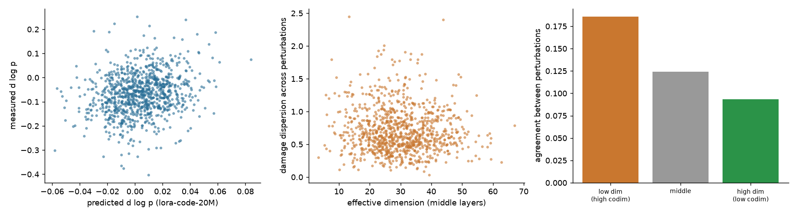

# Codimension study: 1.4b_s0_step143000

968 concepts x 224 contexts. Damage = change in log p of the concept in its own contexts. Predicted = first-order direct-path change through the MLP-output update alone (scripts/codim_pass.py).

## Test 1: is damage explained by the update's direction?

| perturbation | measured vs predicted d log p | measured vs overlap at q | measured vs overlap at p | within-concept (median over concepts) |
|---|---|---|---|---|
| lora-code-20M | +0.220 | -0.190 | -0.215 | +0.059 |
| lora-wiki_de-20M | +0.367 | -0.031 | -0.074 | +0.060 |
| prune0.25 | +0.239 | -0.099 | -0.103 | +0.075 |
| prune0.5 | -0.106 | -0.136 | +0.076 | +0.023 |

Overlap is entered with a minus sign (more overlap -> more damage expected -> positive correlation).

Agreement between perturbations, measured (disjoint context halves) vs predicted:

| pair | measured | predicted d log p | overlap at q |
|---|---|---|---|
| lora-code-20M / lora-wiki_de-20M | +0.164 | +0.047 | +0.366 |
| lora-code-20M / prune0.25 | +0.172 | -0.060 | -0.201 |
| lora-code-20M / prune0.5 | +0.191 | -0.092 | -0.200 |
| lora-wiki_de-20M / prune0.25 | +0.207 | -0.079 | -0.244 |
| lora-wiki_de-20M / prune0.5 | -0.066 | -0.196 | -0.261 |
| prune0.25 / prune0.5 | +0.151 | +0.343 | +0.987 |

## Test 2: are low-codimension (high effective dimension) concepts damaged consistently?

Effective dimension (middle layers): median 29.1 [5%: 13.5, 95%: 47.4] of 223 possible; mean-shift signature spread median 303 neurons.

| prediction | Spearman with effective dimension | ... with excess effective dimension (after log freq + n tokens) | with signature spread |
|---|---|---|---|
| (a) overlap dispersion across perturbations (expect < 0) | -0.140 | -0.139 | -0.000 |
| (b) damage dispersion across perturbations (expect < 0) | -0.042 | +0.024 | -0.006 |
| mean damage (z, higher = less damaged) | +0.171 | +0.122 | -0.040 |

(c) Agreement between perturbations (disjoint halves, mean over pairs) by tercile of excess effective dimension (expect: rises with dimension):

| tercile | concepts | mean agreement | lora-code-20M / lora-wiki_de-20M | lora-code-20M / prune0.25 | lora-code-20M / prune0.5 | lora-wiki_de-20M / prune0.25 | lora-wiki_de-20M / prune0.5 | prune0.25 / prune0.5 |
|---|---|---|---|---|---|---|---|---|
| low dim (high codim) | 323 | +0.186 | +0.225 | +0.270 | +0.273 | +0.162 | -0.012 | +0.193 |
| middle | 322 | +0.124 | +0.172 | +0.126 | +0.145 | +0.268 | -0.057 | +0.091 |
| high dim (low codim) | 323 | +0.093 | +0.097 | +0.118 | +0.147 | +0.176 | -0.145 | +0.167 |

High minus low tercile: -0.092 [95% bootstrap -0.165, -0.028]

