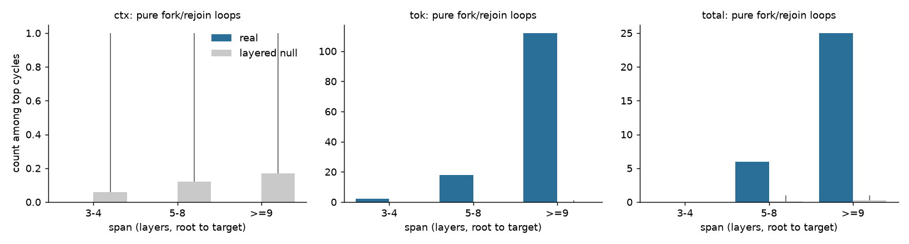

# Cross-layer neuron loops: 1.4b_s0_step143000

One graph over the MLP neurons of all layers; edges within and across layers from one correlation type.
Good = chordless, >= 4 neurons, beats layered rewiring nulls (degree- and triangle-preserving). Random wiring is
far loopier than geometric graphs, so 'good' is near-impossible; the test that matters is the typology table.
Pure diamond = fork at one root neuron, two unrelated arms, rejoin at one target; span = layers from root to target.

| graph | neurons | edges (cross) | H1 | good | good pure diamonds | ... span >= 2 |
|---|---|---|---|---|---|---|
| ctx | 196608 | 2867873 (1819132) | 1000 | 0 | 0 | 0 |
| tok | 196608 | 5418975 (2837893) | 1000 | 0 | 0 | 0 |
| total | 196608 | 3852132 (2340117) | 1000 | 0 | 0 | 0 |

## Typology of the top cycles: real vs layered null (triangle-preserving; p = share of nulls >= real)

### ctx

| type | real | null mean | null 95% | p |
|---|---|---|---|---|
| diamond span 1 | 0 | 2.4 | 5.0 | 1.000 |
| diamond span 2 | 0 | 0.8 | 3.0 | 1.000 |
| diamond span 3-4 | 0 | 1.2 | 3.0 | 1.000 |
| diamond span 5-8 | 0 | 2.2 | 5.0 | 1.000 |
| diamond span >=9 | 0 | 10.9 | 16.0 | 1.000 |
| flat | 988 | 795.4 | 813.0 | 0.010 |
| pure span 3-4 | 0 | 0.1 | 1.0 | 1.000 |
| pure span 5-8 | 0 | 0.1 | 1.0 | 1.000 |
| pure span >=9 | 0 | 0.2 | 1.0 | 1.000 |
| zigzag | 12 | 186.7 | 206.1 | 1.000 |

### tok

| type | real | null mean | null 95% | p |
|---|---|---|---|---|
| diamond span 1 | 10 | 50.6 | 60.1 | 1.000 |
| diamond span 2 | 9 | 16.2 | 22.0 | 0.980 |
| diamond span 3-4 | 21 | 18.9 | 25.1 | 0.356 |
| diamond span 5-8 | 58 | 16.9 | 24.0 | 0.010 |
| diamond span >=9 | 132 | 40.5 | 51.0 | 0.010 |
| flat | 0 | 29.8 | 38.0 | 1.000 |
| pure span 3-4 | 2 | 0.0 | 0.0 | 0.010 |
| pure span 5-8 | 18 | 0.0 | 0.0 | 0.010 |
| pure span >=9 | 112 | 0.1 | 1.0 | 0.010 |
| zigzag | 638 | 827.1 | 846.1 | 1.000 |

### total

| type | real | null mean | null 95% | p |
|---|---|---|---|---|
| diamond span 1 | 5 | 34.2 | 44.0 | 1.000 |
| diamond span 2 | 1 | 9.1 | 14.0 | 1.000 |
| diamond span 3-4 | 8 | 14.7 | 24.0 | 0.980 |
| diamond span 5-8 | 14 | 19.8 | 27.0 | 0.931 |
| diamond span >=9 | 126 | 72.0 | 86.0 | 0.010 |
| flat | 82 | 24.3 | 32.0 | 0.010 |
| pure span 3-4 | 0 | 0.0 | 0.0 | 1.000 |
| pure span 5-8 | 6 | 0.1 | 1.0 | 0.010 |
| pure span >=9 | 25 | 0.2 | 1.0 | 0.010 |
| zigzag | 733 | 825.6 | 857.0 | 1.000 |

## Chordless pure diamonds among the top cycles: residual-path check (medians)

| graph | n | median span | direct_pct | arm_pct | root r2_tok | target r2_tok | tok_share |
|---|---|---|---|---|---|---|---|
| tok | 132 | 14 | 0.62 | 0.75 | 0.26 | 0.19 | 3.24 |
| total | 31 | 13 | 0.70 | 0.96 | 0.25 | 0.19 | 1.45 |

Examples: crosslayer_<graph>_examples.md. 
