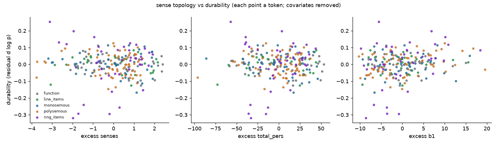

# Sense topology vs durability: 1.4b_s0_step143000 (senses eq224)

229 tokens. Durability = mean change in log p of the token in its own contexts, variant minus base (primary: mean of lora-code-20M, lora-wiki_de-20M). Excess topology = residual after log frequency + class.

## Durability by variant (mean [5%, 95%] over tokens)

| variant | mean d log p | 5% | 95% |
|---|---|---|---|
| lora-code-20M | -0.044 | -0.141 | 0.026 |
| lora-wiki_de-20M | -0.096 | -0.310 | 0.083 |
| nf4 | -0.072 | -0.283 | 0.136 |
| noise0.03s0 | -0.004 | -0.112 | 0.108 |
| prune0.25 | -0.284 | -0.616 | 0.038 |

## Topology by class (means)

| class | tokens | senses (middle) | bars | mean bar length | max bar | total persistence | b1 (strict) |
|---|---|---|---|---|---|---|---|
| function | 40 | 2.99 | 32.3 | 2.13 | 8.6 | 70.3 | 11.95 |
| line_items | 28 | 3.95 | 33.4 | 2.55 | 11.7 | 85.3 | 11.32 |
| monosemous | 52 | 4.08 | 29.4 | 3.26 | 13.0 | 91.8 | 8.92 |
| polysemous | 68 | 4.86 | 32.2 | 3.49 | 15.2 | 106.0 | 11.41 |
| ring_items | 41 | 4.23 | 31.4 | 3.00 | 12.5 | 85.0 | 11.61 |

## Each excess measure alone (partial Spearman with durability, controlling log frequency, base log p, class; and standardised OLS beta with 95% bootstrap CI)

| measure | target | Spearman | p | beta [95% CI] |
|---|---|---|---|---|
| senses | durability | -0.055 | 0.409 | -0.052 [-0.198, +0.092] |
| senses | d_nf4 | +0.029 | 0.658 | +0.062 [-0.060, +0.184] |
| senses | d_noise0.03s0 | +0.018 | 0.785 | +0.008 [-0.148, +0.163] |
| senses | d_prune0.25 | -0.060 | 0.367 | -0.061 [-0.174, +0.060] |
| total_pers | durability | -0.029 | 0.665 | +0.000 [-0.133, +0.128] |
| total_pers | d_nf4 | -0.012 | 0.853 | +0.040 [-0.077, +0.158] |
| total_pers | d_noise0.03s0 | +0.004 | 0.958 | +0.024 [-0.137, +0.181] |
| total_pers | d_prune0.25 | -0.068 | 0.306 | -0.073 [-0.186, +0.046] |
| mean_len | durability | -0.100 | 0.131 | -0.132 [-0.334, +0.022] |
| mean_len | d_nf4 | -0.022 | 0.739 | +0.064 [-0.115, +0.236] |
| mean_len | d_noise0.03s0 | +0.003 | 0.969 | +0.031 [-0.118, +0.178] |
| mean_len | d_prune0.25 | -0.129 | 0.0515 | -0.119 [-0.239, -0.021] |
| max_len | durability | -0.132 | 0.0467 | -0.128 [-0.267, -0.005] |
| max_len | d_nf4 | +0.016 | 0.811 | +0.032 [-0.093, +0.159] |
| max_len | d_noise0.03s0 | +0.009 | 0.893 | +0.022 [-0.126, +0.162] |
| max_len | d_prune0.25 | -0.118 | 0.0751 | -0.132 [-0.250, -0.028] |
| b1 | durability | +0.185 | 0.00492 | +0.197 [+0.078, +0.325] |
| b1 | d_nf4 | -0.036 | 0.585 | -0.038 [-0.159, +0.090] |
| b1 | d_noise0.03s0 | +0.018 | 0.789 | +0.035 [-0.104, +0.176] |
| b1 | d_prune0.25 | +0.125 | 0.0584 | +0.119 [+0.018, +0.232] |

## Joint model: durability ~ excess senses + excess persistence + excess b1 + covariates

| term | beta | 95% CI | p (bootstrap) |
|---|---|---|---|
| excess senses | -0.146 | [-0.379, +0.092] | 0.252 |
| excess total_pers | +0.138 | [-0.081, +0.367] | 0.222 |
| excess b1 | +0.188 | [+0.062, +0.328] | 0.003 |
| log_freq | -0.131 | [-0.416, +0.157] | 0.346 |
| base_logp | -0.057 | [-0.254, +0.132] | 0.557 |
| class line_items | -0.129 | [-0.303, +0.024] | 0.093 |
| class monosemous | -0.348 | [-0.616, -0.090] | 0.006 |
| class polysemous | -0.224 | [-0.480, +0.022] | 0.069 |
| class ring_items | -0.420 | [-0.694, -0.182] | 0.001 |

## Representational retention (middle layers; mean over tokens)

| variant | sense separation kept (eta^2 ratio) | CKA base vs variant | Spearman(excess persistence, separation kept) |
|---|---|---|---|
| lora-code-20M | 0.991 | 0.995 | -0.027 (p 0.69, 221 tokens) |
| lora-wiki_de-20M | 1.001 | 0.991 | -0.089 (p 0.19, 221 tokens) |
| nf4 | 0.999 | 0.996 | +0.125 (p 0.063, 221 tokens) |
| noise0.03s0 | 0.999 | 0.999 | +0.027 (p 0.69, 221 tokens) |
| prune0.25 | 1.028 | 0.977 | -0.146 (p 0.03, 221 tokens) |

