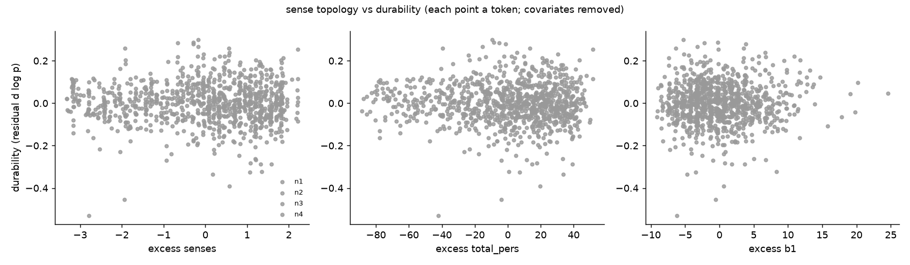

# Sense topology vs durability: 1.4b_s0_step143000 (senses cfoot_eq224)

## Confirmatory test (specified 2026-11-17, before these data; exploratory panel: beta +0.19 [0.06, 0.33])

Primary: standardised coefficient of excess b1 (strict links 0.7) in the joint model; durability = mean d log p over the two 20M LoRA fine-tunes. Confirmed if the 95% bootstrap CI lies above 0.

**Result: beta = +0.037 [-0.026, +0.099], p = 0.253: NOT confirmed**

968 tokens. Durability = mean change in log p of the token in its own contexts, variant minus base (primary: mean of lora-code-20M, lora-wiki_de-20M). Excess topology = residual after log frequency + class.

## Durability by variant (mean [5%, 95%] over tokens)

| variant | mean d log p | 5% | 95% |
|---|---|---|---|
| lora-code-20M | -0.068 | -0.204 | 0.074 |
| lora-wiki_de-20M | -0.071 | -0.314 | 0.189 |
| prune0.25 | -0.464 | -1.007 | 0.093 |
| prune0.5 | -6.725 | -11.137 | -3.714 |

## Topology by class (means)

| class | tokens | senses (middle) | bars | mean bar length | max bar | total persistence | b1 (strict) |
|---|---|---|---|---|---|---|---|
| n1 | 350 | 4.21 | 28.4 | 3.44 | 14.0 | 91.4 | 9.30 |
| n2 | 349 | 4.18 | 26.0 | 3.65 | 14.6 | 89.6 | 8.36 |
| n3 | 242 | 3.80 | 23.2 | 3.73 | 13.7 | 79.6 | 7.24 |
| n4 | 27 | 3.58 | 23.3 | 3.43 | 13.4 | 76.6 | 6.81 |

## Each excess measure alone (partial Spearman with durability, controlling log frequency, base log p, class; and standardised OLS beta with 95% bootstrap CI)

| measure | target | Spearman | p | beta [95% CI] |
|---|---|---|---|---|
| senses | durability | -0.044 | 0.172 | -0.019 [-0.079, +0.037] |
| senses | d_prune0.25 | +0.029 | 0.369 | +0.021 [-0.042, +0.085] |
| senses | d_prune0.5 | -0.023 | 0.48 | -0.005 [-0.046, +0.038] |
| total_pers | durability | -0.043 | 0.185 | -0.034 [-0.090, +0.020] |
| total_pers | d_prune0.25 | +0.010 | 0.762 | -0.000 [-0.063, +0.065] |
| total_pers | d_prune0.5 | -0.058 | 0.0701 | -0.025 [-0.068, +0.020] |
| mean_len | durability | -0.098 | 0.00237 | -0.080 [-0.143, -0.024] |
| mean_len | d_prune0.25 | -0.074 | 0.0214 | -0.076 [-0.140, -0.008] |
| mean_len | d_prune0.5 | -0.083 | 0.00958 | -0.054 [-0.094, -0.012] |
| max_len | durability | -0.095 | 0.00299 | -0.075 [-0.134, -0.021] |
| max_len | d_prune0.25 | -0.028 | 0.381 | -0.020 [-0.082, +0.045] |
| max_len | d_prune0.5 | -0.068 | 0.0347 | -0.039 [-0.076, +0.005] |
| b1 | durability | +0.023 | 0.469 | +0.041 [-0.021, +0.102] |
| b1 | d_prune0.25 | +0.074 | 0.0213 | +0.072 [+0.011, +0.129] |
| b1 | d_prune0.5 | +0.057 | 0.0746 | +0.046 [+0.008, +0.082] |

## Joint model: durability ~ excess senses + excess persistence + excess b1 + covariates

| term | beta | 95% CI | p (bootstrap) |
|---|---|---|---|
| excess senses | +0.046 | [-0.090, +0.186] | 0.534 |
| excess total_pers | -0.070 | [-0.202, +0.061] | 0.3 |
| excess b1 | +0.037 | [-0.026, +0.099] | 0.253 |
| log_freq | +0.104 | [+0.022, +0.181] | 0.011 |
| base_logp | -0.036 | [-0.104, +0.036] | 0.334 |
| log_synsets | -0.014 | [-0.086, +0.063] | 0.696 |
| class n2 | +0.191 | [+0.106, +0.276] | 0.001 |
| class n3 | +0.170 | [+0.085, +0.256] | 0 |
| class n4 | -0.003 | [-0.082, +0.076] | 0.946 |

