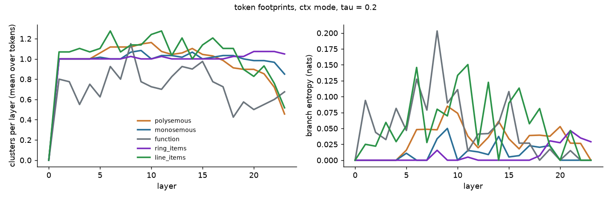

# Token fork/rejoin across layers (ctx mode): 1.4b_s0_step143000

Active neurons: z > 3.0 (at most 128); cluster = correlation > tau, size >= 2; link threshold 0.2. Mean [95% bootstrap CI over tokens].

## tau = 0.1

| class | tokens | clusters (middle layers) | forks | rejoins | loops (b1) | max loop span |
|---|---|---|---|---|---|---|
| polysemous | 68 | 1.03 [1.02, 1.05] | 0.07 [0.01, 0.15] | 0.12 [0.04, 0.21] | 0.04 [0.00, 0.10] | 0.09 [0.00, 0.21] |
| monosemous | 60 | 1.00 [0.99, 1.01] | 0.00 [0.00, 0.00] | 0.02 [0.00, 0.05] | 0.00 [0.00, 0.00] | 0.00 [0.00, 0.00] |
| function | 40 | 0.79 [0.70, 0.88] | 0.00 [0.00, 0.00] | 0.07 [0.00, 0.17] | 0.00 [0.00, 0.00] | 0.00 [0.00, 0.00] |
| ring_items | 41 | 1.00 [1.00, 1.00] | 0.02 [0.00, 0.07] | 0.00 [0.00, 0.00] | 0.00 [0.00, 0.00] | 0.00 [0.00, 0.00] |
| line_items | 29 | 1.03 [1.01, 1.06] | 0.07 [0.00, 0.17] | 0.00 [0.00, 0.00] | 0.00 [0.00, 0.00] | 0.00 [0.00, 0.00] |

Known answer, polysemous > monosemous (Mann-Whitney, one-sided): middle-layer clusters p = 0.000723, forks p = 0.0167, loops p = 0.0515

## tau = 0.2

| class | tokens | clusters (middle layers) | forks | rejoins | loops (b1) | max loop span |
|---|---|---|---|---|---|---|
| polysemous | 68 | 1.09 [1.07, 1.12] | 0.16 [0.06, 0.29] | 0.24 [0.12, 0.37] | 0.07 [0.01, 0.16] | 0.12 [0.03, 0.24] |
| monosemous | 60 | 1.04 [1.02, 1.06] | 0.07 [0.02, 0.13] | 0.10 [0.03, 0.18] | 0.05 [0.00, 0.12] | 0.10 [0.00, 0.23] |
| function | 40 | 0.87 [0.76, 0.99] | 0.23 [0.10, 0.38] | 0.38 [0.17, 0.62] | 0.10 [0.03, 0.20] | 0.23 [0.05, 0.47] |
| ring_items | 41 | 1.01 [1.00, 1.02] | 0.05 [0.00, 0.12] | 0.05 [0.00, 0.12] | 0.05 [0.00, 0.12] | 0.10 [0.00, 0.24] |
| line_items | 29 | 1.15 [1.09, 1.21] | 0.45 [0.24, 0.69] | 0.31 [0.10, 0.59] | 0.17 [0.03, 0.34] | 0.34 [0.07, 0.69] |

Known answer, polysemous > monosemous (Mann-Whitney, one-sided): middle-layer clusters p = 0.00081, forks p = 0.155, loops p = 0.409

## tau = 0.3

| class | tokens | clusters (middle layers) | forks | rejoins | loops (b1) | max loop span |
|---|---|---|---|---|---|---|
| polysemous | 68 | 1.24 [1.19, 1.28] | 0.49 [0.29, 0.69] | 0.47 [0.31, 0.66] | 0.21 [0.09, 0.35] | 0.31 [0.15, 0.50] |
| monosemous | 60 | 1.26 [1.21, 1.32] | 0.67 [0.50, 0.85] | 0.52 [0.35, 0.70] | 0.22 [0.12, 0.33] | 0.40 [0.20, 0.60] |
| function | 40 | 0.92 [0.78, 1.07] | 0.78 [0.42, 1.15] | 0.85 [0.45, 1.30] | 0.38 [0.17, 0.62] | 0.53 [0.25, 0.85] |
| ring_items | 41 | 1.11 [1.08, 1.15] | 1.22 [0.88, 1.61] | 1.02 [0.68, 1.41] | 0.78 [0.46, 1.15] | 0.98 [0.63, 1.32] |
| line_items | 29 | 1.56 [1.41, 1.72] | 2.97 [2.24, 3.72] | 2.69 [1.97, 3.41] | 1.76 [1.17, 2.38] | 1.72 [1.31, 2.10] |

Known answer, polysemous > monosemous (Mann-Whitney, one-sided): middle-layer clusters p = 0.574, forks p = 0.982, loops p = 0.756

