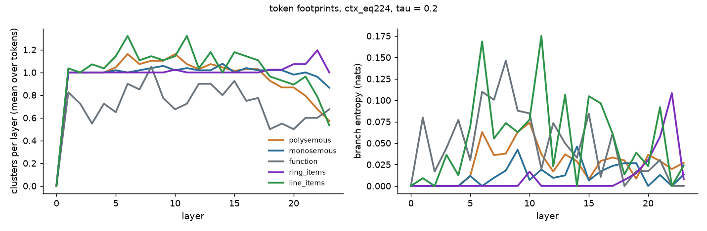

# Token fork/rejoin across layers (ctx_eq224): 1.4b_s0_step143000

Active neurons: z > 3.0 (at most 128); cluster = correlation > tau, size >= 2; link threshold 0.2. Mean [95% bootstrap CI over tokens].

## tau = 0.1

| class | tokens | clusters (middle layers) | forks | rejoins | loops (b1) | max loop span |
|---|---|---|---|---|---|---|
| polysemous | 68 | 1.03 [1.01, 1.05] | 0.09 [0.03, 0.16] | 0.07 [0.01, 0.15] | 0.06 [0.01, 0.12] | 0.12 [0.03, 0.24] |
| monosemous | 52 | 1.00 [0.99, 1.01] | 0.02 [0.00, 0.06] | 0.04 [0.00, 0.10] | 0.02 [0.00, 0.06] | 0.04 [0.00, 0.12] |
| function | 40 | 0.78 [0.69, 0.88] | 0.07 [0.00, 0.17] | 0.03 [0.00, 0.07] | 0.00 [0.00, 0.00] | 0.00 [0.00, 0.00] |
| ring_items | 41 | 1.00 [1.00, 1.00] | 0.00 [0.00, 0.00] | 0.00 [0.00, 0.00] | 0.00 [0.00, 0.00] | 0.00 [0.00, 0.00] |
| line_items | 28 | 1.03 [1.01, 1.04] | 0.07 [0.00, 0.18] | 0.07 [0.00, 0.21] | 0.04 [0.00, 0.11] | 0.07 [0.00, 0.21] |

Known answer, polysemous > monosemous (Mann-Whitney, one-sided): middle-layer clusters p = 0.00293, forks p = 0.0565, loops p = 0.144

## tau = 0.2

| class | tokens | clusters (middle layers) | forks | rejoins | loops (b1) | max loop span |
|---|---|---|---|---|---|---|
| polysemous | 68 | 1.08 [1.05, 1.10] | 0.15 [0.04, 0.26] | 0.21 [0.10, 0.35] | 0.06 [0.00, 0.15] | 0.09 [0.00, 0.21] |
| monosemous | 52 | 1.03 [1.02, 1.05] | 0.04 [0.00, 0.10] | 0.06 [0.00, 0.13] | 0.02 [0.00, 0.06] | 0.04 [0.00, 0.12] |
| function | 40 | 0.84 [0.72, 0.96] | 0.30 [0.10, 0.55] | 0.42 [0.17, 0.72] | 0.10 [0.00, 0.23] | 0.15 [0.00, 0.35] |
| ring_items | 41 | 1.00 [1.00, 1.01] | 0.07 [0.00, 0.17] | 0.07 [0.00, 0.20] | 0.00 [0.00, 0.00] | 0.00 [0.00, 0.00] |
| line_items | 28 | 1.14 [1.08, 1.20] | 0.50 [0.29, 0.75] | 0.25 [0.07, 0.50] | 0.11 [0.00, 0.25] | 0.29 [0.00, 0.64] |

Known answer, polysemous > monosemous (Mann-Whitney, one-sided): middle-layer clusters p = 0.00525, forks p = 0.0883, loops p = 0.227

## tau = 0.3

| class | tokens | clusters (middle layers) | forks | rejoins | loops (b1) | max loop span |
|---|---|---|---|---|---|---|
| polysemous | 68 | 1.22 [1.18, 1.27] | 0.65 [0.41, 0.90] | 0.56 [0.38, 0.75] | 0.34 [0.18, 0.51] | 0.49 [0.28, 0.69] |
| monosemous | 52 | 1.27 [1.21, 1.33] | 0.69 [0.44, 0.96] | 0.54 [0.31, 0.79] | 0.29 [0.12, 0.48] | 0.38 [0.19, 0.62] |
| function | 40 | 0.88 [0.73, 1.02] | 0.82 [0.42, 1.30] | 1.02 [0.62, 1.50] | 0.45 [0.17, 0.78] | 0.47 [0.23, 0.78] |
| ring_items | 41 | 1.08 [1.05, 1.12] | 1.07 [0.68, 1.54] | 1.02 [0.66, 1.44] | 0.54 [0.27, 0.85] | 0.68 [0.39, 0.98] |
| line_items | 28 | 1.58 [1.42, 1.75] | 2.93 [2.18, 3.68] | 2.36 [1.57, 3.14] | 1.57 [1.00, 2.21] | 1.43 [1.00, 1.86] |

Known answer, polysemous > monosemous (Mann-Whitney, one-sided): middle-layer clusters p = 0.851, forks p = 0.713, loops p = 0.364

