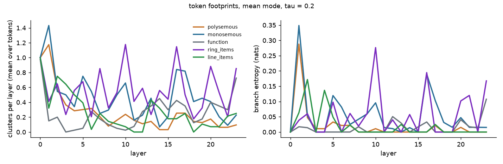

# Token fork/rejoin across layers (mean mode): 1.4b_s0_step143000

Active neurons: z > 3.0 (at most 128); cluster = correlation > tau, size >= 2; link threshold 0.1. Mean [95% bootstrap CI over tokens].

## tau = 0.1

| class | tokens | clusters (middle layers) | forks | rejoins | loops (b1) | max loop span |
|---|---|---|---|---|---|---|
| polysemous | 63 | 0.89 [0.74, 1.05] | 1.21 [0.83, 1.59] | 1.13 [0.75, 1.54] | 0.43 [0.24, 0.63] | 0.57 [0.35, 0.83] |
| monosemous | 44 | 1.78 [1.51, 2.07] | 4.48 [3.39, 5.80] | 4.27 [3.14, 5.66] | 2.75 [1.75, 3.95] | 1.52 [1.16, 1.93] |
| function | 40 | 0.57 [0.46, 0.71] | 0.47 [0.20, 0.82] | 0.42 [0.12, 0.78] | 0.20 [0.05, 0.40] | 0.25 [0.05, 0.50] |
| ring_items | 34 | 2.44 [2.11, 2.78] | 6.32 [5.00, 7.59] | 6.62 [5.21, 8.06] | 5.06 [3.85, 6.27] | 1.71 [1.35, 2.03] |
| line_items | 28 | 1.40 [1.12, 1.68] | 0.64 [0.39, 0.89] | 0.46 [0.25, 0.68] | 0.11 [0.00, 0.21] | 0.21 [0.00, 0.43] |

Known answer, polysemous > monosemous (Mann-Whitney, one-sided): middle-layer clusters p = 1, forks p = 1, loops p = 1

## tau = 0.2

| class | tokens | clusters (middle layers) | forks | rejoins | loops (b1) | max loop span |
|---|---|---|---|---|---|---|
| polysemous | 63 | 0.12 [0.09, 0.15] | 0.02 [0.00, 0.05] | 0.02 [0.00, 0.05] | 0.00 [0.00, 0.00] | 0.00 [0.00, 0.00] |
| monosemous | 44 | 0.32 [0.24, 0.41] | 0.05 [0.00, 0.11] | 0.07 [0.00, 0.16] | 0.00 [0.00, 0.00] | 0.00 [0.00, 0.00] |
| function | 40 | 0.20 [0.13, 0.28] | 0.03 [0.00, 0.07] | 0.10 [0.03, 0.20] | 0.03 [0.00, 0.07] | 0.05 [0.00, 0.15] |
| ring_items | 34 | 0.53 [0.42, 0.65] | 0.26 [0.09, 0.47] | 0.03 [0.00, 0.09] | 0.03 [0.00, 0.09] | 0.06 [0.00, 0.18] |
| line_items | 28 | 0.16 [0.09, 0.22] | 0.00 [0.00, 0.00] | 0.00 [0.00, 0.00] | 0.00 [0.00, 0.00] | 0.00 [0.00, 0.00] |

Known answer, polysemous > monosemous (Mann-Whitney, one-sided): middle-layer clusters p = 1, forks p = 0.821, loops p = 1

## tau = 0.3

| class | tokens | clusters (middle layers) | forks | rejoins | loops (b1) | max loop span |
|---|---|---|---|---|---|---|
| polysemous | 63 | 0.03 [0.01, 0.04] | 0.00 [0.00, 0.00] | 0.00 [0.00, 0.00] | 0.00 [0.00, 0.00] | 0.00 [0.00, 0.00] |
| monosemous | 44 | 0.06 [0.04, 0.09] | 0.00 [0.00, 0.00] | 0.00 [0.00, 0.00] | 0.00 [0.00, 0.00] | 0.00 [0.00, 0.00] |
| function | 40 | 0.09 [0.04, 0.14] | 0.00 [0.00, 0.00] | 0.00 [0.00, 0.00] | 0.00 [0.00, 0.00] | 0.00 [0.00, 0.00] |
| ring_items | 34 | 0.11 [0.08, 0.15] | 0.00 [0.00, 0.00] | 0.00 [0.00, 0.00] | 0.00 [0.00, 0.00] | 0.00 [0.00, 0.00] |
| line_items | 28 | 0.04 [0.02, 0.07] | 0.00 [0.00, 0.00] | 0.00 [0.00, 0.00] | 0.00 [0.00, 0.00] | 0.00 [0.00, 0.00] |

Known answer, polysemous > monosemous (Mann-Whitney, one-sided): middle-layer clusters p = 0.987, forks p = 1, loops p = 1

