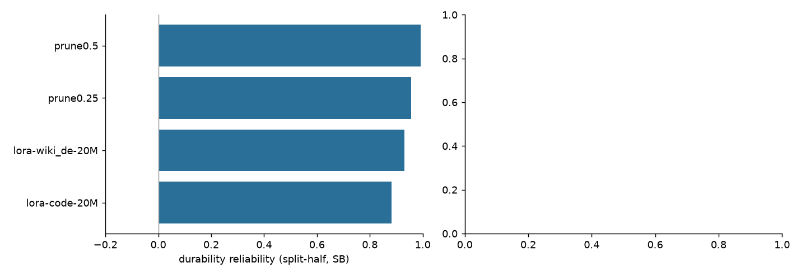

# Measurement reliability (cfoot): 1.4b_s0_step143000

968 concepts, 224 contexts each, split into two fixed random halves of 112. Reliability = Spearman-Brown corrected split-half correlation across concepts (1 = the measure ranks concepts the same way on independent contexts; 0 = pure noise).

## Durability: context-sampling reliability (split-half)

| variant | mean d log p | split-half r | reliability |
|---|---|---|---|
| lora-code-20M | -0.068 | +0.790 | +0.883 |
| lora-wiki_de-20M | -0.071 | +0.871 | +0.931 |
| prune0.25 | -0.464 | +0.916 | +0.956 |
| prune0.5 | -6.725 | +0.985 | +0.992 |
| base log p (sanity) | | +0.954 | +0.977 |

## Durability: is it the same trait across perturbations? (disjoint halves; replicate pairs first)

Correlation of variant 1 on half A with variant 2 on half B (and the swap, averaged). Shared base noise cannot inflate it. Divided by sqrt(rel1 x rel2) it is the correlation of the TRUE per-concept damage.

| variant 1 | variant 2 | r (disjoint) | disattenuated |
|---|---|---|---|
| lora-code-20M | lora-wiki_de-20M | +0.164 | +0.181 |
| lora-code-20M | prune0.25 | +0.172 | +0.187 |
| lora-code-20M | prune0.5 | +0.191 | +0.204 |
| lora-wiki_de-20M | prune0.25 | +0.207 | +0.220 |
| lora-wiki_de-20M | prune0.5 | -0.066 | -0.069 |
| prune0.25 | prune0.5 | +0.151 | +0.155 |

## Composite durability (mean of z-scored changes)

| set | variants | split-half r | reliability |
|---|---|---|---|
| LoRA 20M (all seeds) | 2 | +0.827 | +0.905 |
| all LoRA milestones | 2 | +0.827 | +0.905 |
| all variants | 4 | +0.895 | +0.944 |

