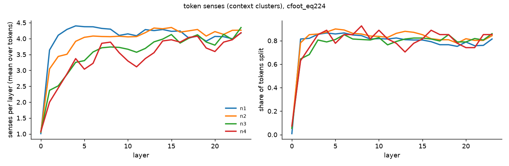

# Token senses: context clusters across layers (cfoot_eq224): 1.4b_s0_step143000

Per layer: k-means on the top 10 PCs of the token's contexts, k by gap statistic vs one Gaussian blob (k <= 6, clusters >= 8 contexts); clusters at adjacent layers linked when overlap >= 0.3.
Mean [95% bootstrap CI over tokens]. Middle layers = the middle third.

| class | tokens | senses (middle layers) | layers split | forks | rejoins | loops (b1) | max loop span | ARI adjacent |
|---|---|---|---|---|---|---|---|---|
| n1 | 350 | 4.21 [4.06, 4.37] | 0.78 [0.75, 0.80] | 18.26 [17.52, 19.01] | 17.27 [16.53, 18.03] | 22.94 [22.13, 23.77] | 12.23 [11.64, 12.82] | 0.51 [0.49, 0.53] |
| n2 | 349 | 4.18 [4.03, 4.33] | 0.81 [0.79, 0.83] | 17.17 [16.45, 17.92] | 15.62 [14.93, 16.35] | 20.46 [19.64, 21.30] | 12.64 [12.07, 13.21] | 0.55 [0.53, 0.56] |
| n3 | 242 | 3.80 [3.64, 3.97] | 0.77 [0.74, 0.80] | 15.49 [14.67, 16.35] | 13.71 [12.93, 14.52] | 17.81 [16.85, 18.75] | 11.30 [10.55, 12.01] | 0.53 [0.51, 0.56] |
| n4 | 27 | 3.58 [3.11, 4.04] | 0.78 [0.69, 0.86] | 15.56 [13.30, 18.00] | 13.96 [11.52, 16.48] | 17.56 [14.78, 20.30] | 10.67 [8.89, 12.56] | 0.51 [0.44, 0.57] |

Most split tokens:

| token | class | senses (middle) | forks | loops |
|---|---|---|---|---|
| brittle | n2 | 6.00 | 33 | 35 |
| relative | n1 | 6.00 | 23 | 34 |
| exploited | n1 | 6.00 | 31 | 33 |
| torture | n1 | 6.00 | 24 | 32 |
| coordinated | n1 | 6.00 | 20 | 32 |
| dye | n1 | 6.00 | 28 | 31 |
| inexact | n2 | 6.00 | 26 | 31 |
| defamatory | n3 | 6.00 | 31 | 31 |
| handed | n1 | 6.00 | 23 | 30 |
| bets | n1 | 6.00 | 16 | 29 |
| slips | n1 | 6.00 | 22 | 29 |
| retreat | n1 | 6.00 | 26 | 29 |
| grabbing | n1 | 6.00 | 15 | 28 |
| crowns | n2 | 6.00 | 23 | 28 |
| prominence | n1 | 6.00 | 27 | 27 |

