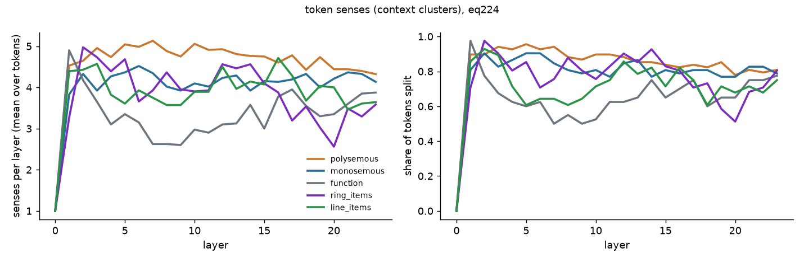

# Token senses: context clusters across layers (eq224): 1.4b_s0_step143000

Per layer: k-means on the top 10 PCs of the token's contexts, k by gap statistic vs one Gaussian blob (k <= 6, clusters >= 8 contexts); clusters at adjacent layers linked when overlap >= 0.3.
Mean [95% bootstrap CI over tokens]. Middle layers = the middle third.

| class | tokens | senses (middle layers) | layers split | forks | rejoins | loops (b1) | max loop span | ARI adjacent |
|---|---|---|---|---|---|---|---|---|
| polysemous | 68 | 4.86 [4.54, 5.14] | 0.83 [0.79, 0.87] | 20.76 [19.06, 22.40] | 19.88 [18.13, 21.57] | 26.79 [25.19, 28.32] | 13.96 [12.71, 15.28] | 0.54 [0.50, 0.58] |
| monosemous | 52 | 4.08 [3.72, 4.46] | 0.79 [0.73, 0.84] | 18.69 [16.94, 20.62] | 17.81 [16.02, 19.64] | 23.60 [21.38, 25.83] | 12.13 [10.61, 13.63] | 0.51 [0.47, 0.55] |
| function | 40 | 2.99 [2.57, 3.40] | 0.64 [0.56, 0.71] | 17.40 [14.85, 20.00] | 16.40 [14.00, 18.82] | 26.10 [23.20, 28.90] | 8.20 [6.97, 9.45] | 0.37 [0.32, 0.41] |
| ring_items | 41 | 4.23 [3.80, 4.61] | 0.75 [0.70, 0.80] | 17.10 [15.39, 18.88] | 16.54 [14.95, 18.10] | 25.37 [22.80, 27.80] | 11.61 [9.98, 13.22] | 0.49 [0.44, 0.53] |
| line_items | 28 | 3.95 [3.36, 4.49] | 0.70 [0.61, 0.78] | 19.71 [17.18, 22.32] | 18.64 [16.14, 21.07] | 27.93 [24.93, 30.75] | 9.68 [8.07, 11.29] | 0.41 [0.35, 0.47] |

Known answer, polysemous > monosemous (Mann-Whitney, one-sided): senses_mid p = 0.000168, split_share p = 0.0984, forks p = 0.0535, b1 p = 0.00488

Most split tokens:

| token | class | senses (middle) | forks | loops |
|---|---|---|---|---|
| sixth | line_items | 6.00 | 28 | 39 |
| saw | polysemous | 6.00 | 28 | 33 |
| fifth | line_items | 6.00 | 22 | 32 |
| fan | polysemous | 6.00 | 22 | 31 |
| red | ring_items | 6.00 | 25 | 29 |
| record | polysemous | 6.00 | 29 | 28 |
| drill | polysemous | 6.00 | 24 | 28 |
| cotton | monosemous | 6.00 | 27 | 28 |
| Cancer | ring_items | 6.00 | 17 | 28 |
| plot | polysemous | 6.00 | 22 | 27 |
| sandwich | monosemous | 6.00 | 27 | 27 |
| third | line_items | 6.00 | 28 | 27 |
| bear | polysemous | 6.00 | 26 | 25 |
| piano | monosemous | 6.00 | 23 | 24 |
| purple | ring_items | 6.00 | 25 | 24 |

