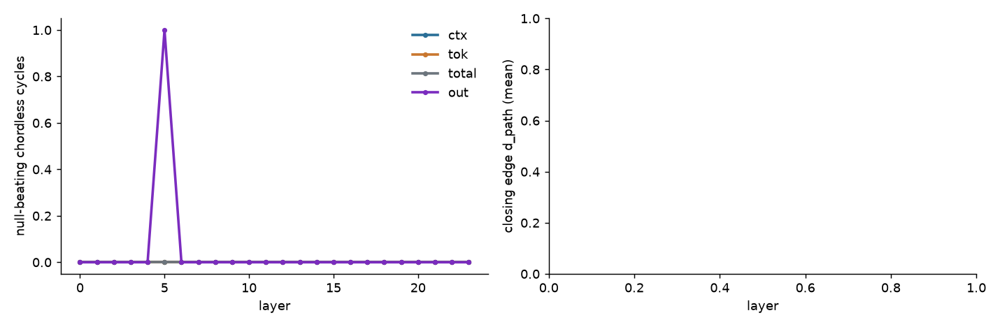

# Neuron-space loops: 1.4b_s0_step143000

Nodes: MLP neurons. Good cycle = chordless, >= 4 neurons, lifetime and score above the 95th percentile of
degree- and triangle-preserving rewiring nulls. ctx = within-token correlation (emergent candidates),
tok = between-token correlation (inherited from token identity), out = output-weight cosine.

## Cycles per layer

 layer  median_r2_tok  ctx_good  tok_good  total_good  out_good
     0       0.999975         0         0           0         0
     1       0.450911         0         0           0         0
     2       0.254990         0         0           0         0
     3       0.269113         0         0           0         0
     4       0.227137         0         0           0         0
     5       0.212325         0         0           0         1
     6       0.199908         0         0           0         0
     7       0.176593         0         0           0         0
     8       0.186309         0         0           0         0
     9       0.162103         0         0           0         0
    10       0.170440         0         0           0         0
    11       0.172632         0         0           0         0
    12       0.174789         0         0           0         0
    13       0.161699         0         0           0         0
    14       0.156965         0         0           0         0
    15       0.145083         0         0           0         0
    16       0.133096         0         0           0         0
    17       0.118699         0         0           0         0
    18       0.112620         0         0           0         0
    19       0.099479         0         0           0         0
    20       0.102047         0         0           0         0
    21       0.099827         0         0           0         0
    22       0.109024         0         0           0         0
    23       0.130968         0         0           0         0

## Closing-edge test (pooled over layers; mean [95% bootstrap CI over cycles])

d_path > 0: the two neurons the closing edge joins write more similar outputs than pairs at the same
hop distance that are not joined (the loop closes functionally). d_edge ~ 0: the closing edge acts like
an ordinary edge of the same input strength.

## Calibration: do neurons join a family's ends? (known answers)

Statistic: where the first-last pair sits between far pairs (0) and neighbouring items (1), 95% bootstrap
interval over neurons. R = above 0.7, L = below 0.7, - = straddles, no ordered structure, or an end missing.

layer          0  1  2  3  4  5  6  7  8  9  10 11 12 13 14 15 16 17 18 19 20 21 22 23
truth family                                                                          
line  numbers   L  L  L  L  L  L  L  L  L  L  L  L  L  L  L  L  L  L  L  L  L  L  L  L
      ordinals  L  L  L  L  L  L  L  L  L  -  L  L  L  L  L  L  L  L  L  L  L  -  L  L
      sizes     L  L  L  L  L  L  L  L  L  L  L  L  L  L  L  L  L  L  L  L  L  L  L  L
ring  compass   -  -  -  -  -  -  -  -  -  -  -  -  -  -  -  -  -  -  -  -  -  -  -  -
      days      -  -  L  L  L  L  L  L  L  -  L  L  L  L  L  L  L  L  L  L  L  L  L  L
      hues      -  -  -  -  -  -  -  -  -  -  -  -  -  -  -  -  -  -  -  -  -  -  -  -
      months    L  L  L  -  -  L  L  L  -  -  -  L  L  L  L  L  L  L  -  L  L  L  L  -

calls made 108/168; correct 70/108; rings called on line families 0

