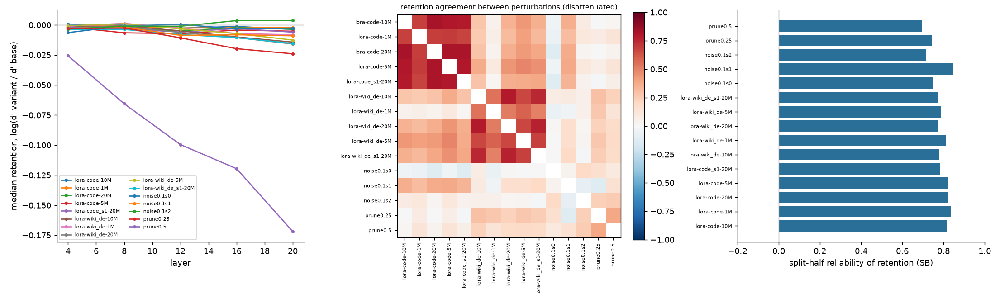

# Persona-trait durability: 1.4b_s0_step143000

135 persona traits (Anthropic model-written evals), statements split into fixed halves A/B; persona vector = mean(matching) - mean(not matching), fit on the other half. Primary: depth 2 (layer 12), read-out 'mean'. Measures defined in scripts/trait_analysis.py.

## Base model: is the trait there?

| depth (layer) | read-out | median d' | median AUC persona vector | median AUC shrinkage LDA | median half-space fit | median eff. dim |
|---|---|---|---|---|---|---|
| 0 (4) | last | 1.40 | 0.834 | 0.974 | 0.73 | 15.9 |
| 0 (4) | mean | 2.36 | 0.954 | 0.989 | 0.94 | 47.6 |
| 1 (8) | last | 1.67 | 0.874 | 0.991 | 0.78 | 15.5 |
| 1 (8) | mean | 2.71 | 0.971 | 0.994 | 0.95 | 47.2 |
| 2 (12) | last | 1.84 | 0.896 | 0.996 | 0.81 | 18.4 |
| 2 (12) | mean | 2.84 | 0.973 | 0.996 | 0.95 | 45.8 |
| 3 (16) | last | 2.08 | 0.921 | 0.995 | 0.86 | 23.0 |
| 3 (16) | mean | 2.74 | 0.968 | 0.994 | 0.95 | 42.5 |
| 4 (20) | last | 2.16 | 0.930 | 0.994 | 0.88 | 28.1 |
| 4 (20) | mean | 2.61 | 0.962 | 0.994 | 0.94 | 37.7 |

Behavior (base): matching minus not-matching log-odds(Yes - No), median +0.144; traits with separation > 0: 72%; > 0.5: 4%. Split-half reliability of base behavior: +0.993.

## Reliability (split-half across traits, Spearman-Brown)

| variant | median retention | median drift | median dbeh | retention | own | cos | drift | dbeh |
|---|---|---|---|---|---|---|---|---|
| lora-code-10M | -0.003 | +0.01 | +0.028 | +0.82 | +0.82 | +0.98 | +0.96 | +0.99 |
| lora-code-1M | -0.003 | +0.00 | -0.030 | +0.83 | +0.82 | +0.98 | +0.98 | +0.97 |
| lora-code-20M | -0.005 | +0.01 | +0.045 | +0.82 | +0.83 | +0.98 | +0.95 | +0.99 |
| lora-code-5M | -0.007 | +0.00 | +0.031 | +0.82 | +0.84 | +0.98 | +0.97 | +0.99 |
| lora-code_s1-20M | -0.006 | +0.00 | +0.036 | +0.78 | +0.83 | +0.98 | +0.96 | +0.99 |
| lora-wiki_de-10M | -0.005 | -0.01 | +0.140 | +0.78 | +0.87 | +0.98 | +0.98 | +0.98 |
| lora-wiki_de-1M | -0.003 | +0.01 | +0.019 | +0.81 | +0.84 | +0.98 | +0.97 | +0.97 |
| lora-wiki_de-20M | -0.006 | -0.00 | +0.122 | +0.77 | +0.88 | +0.98 | +0.98 | +0.98 |
| lora-wiki_de-5M | -0.003 | +0.00 | +0.129 | +0.79 | +0.88 | +0.97 | +0.98 | +0.98 |
| lora-wiki_de_s1-20M | -0.008 | -0.02 | +0.115 | +0.77 | +0.88 | +0.98 | +0.98 | +0.98 |
| noise0.1s0 | +0.000 | +0.08 | +0.125 | +0.75 | +0.80 | +0.98 | +0.97 | +0.99 |
| noise0.1s1 | -0.009 | +0.02 | -0.040 | +0.85 | +0.90 | +0.98 | +0.98 | +0.98 |
| noise0.1s2 | -0.001 | +0.08 | +0.066 | +0.71 | +0.78 | +0.98 | +0.97 | +0.99 |
| prune0.25 | -0.011 | +0.14 | +0.019 | +0.74 | +0.79 | +0.98 | +0.97 | +0.96 |
| prune0.5 | -0.100 | +0.33 | -0.269 | +0.69 | +0.87 | +0.98 | +0.98 | +0.98 |

## Is durability one trait? Agreement between perturbations (disjoint halves; disattenuated)

Concepts (reliability study): ~0.15-0.2 across perturbation types, seed replicates 0.82-0.89, noise seeds 0.07.

| variant 1 | variant 2 | retention r | retention disatt. | dbeh r | dbeh disatt. |
|---|---|---|---|---|---|
| lora-code-10M | lora-code-1M | +0.561 | +0.681 | +0.005 | +0.005 |
| lora-code-10M | lora-code-20M | +0.675 | +0.825 | +0.970 | +0.978 |
| lora-code-10M | lora-code-5M | +0.653 | +0.798 | +0.957 | +0.968 |
| lora-code-10M | lora-code_s1-20M | +0.630 | +0.790 | +0.966 | +0.975 |
| lora-code-10M | lora-wiki_de-10M | +0.220 | +0.277 | +0.790 | +0.801 |
| lora-code-10M | lora-wiki_de-1M | +0.037 | +0.045 | +0.474 | +0.484 |
| lora-code-10M | lora-wiki_de-20M | +0.275 | +0.347 | +0.688 | +0.700 |
| lora-code-10M | lora-wiki_de-5M | +0.346 | +0.431 | +0.748 | +0.759 |
| lora-code-10M | lora-wiki_de_s1-20M | +0.280 | +0.353 | +0.707 | +0.718 |
| lora-code-10M | noise0.1s0 | -0.033 | -0.042 | +0.851 | +0.857 |
| lora-code-10M | noise0.1s1 | +0.304 | +0.365 | -0.491 | -0.499 |
| lora-code-10M | noise0.1s2 | +0.060 | +0.079 | +0.788 | +0.797 |
| lora-code-10M | prune0.25 | +0.001 | +0.002 | +0.064 | +0.066 |
| lora-code-10M | prune0.5 | +0.016 | +0.021 | -0.514 | -0.521 |
| lora-code-1M | lora-code-20M | +0.570 | +0.688 | -0.068 | -0.070 |
| lora-code-1M | lora-code-5M | +0.580 | +0.700 | +0.027 | +0.028 |
| lora-code-1M | lora-code_s1-20M | +0.545 | +0.674 | +0.012 | +0.012 |
| lora-code-1M | lora-wiki_de-10M | +0.210 | +0.261 | -0.103 | -0.106 |
| lora-code-1M | lora-wiki_de-1M | +0.051 | +0.062 | +0.170 | +0.176 |
| lora-code-1M | lora-wiki_de-20M | +0.251 | +0.313 | -0.066 | -0.068 |
| lora-code-1M | lora-wiki_de-5M | +0.333 | +0.411 | -0.079 | -0.081 |
| lora-code-1M | lora-wiki_de_s1-20M | +0.258 | +0.321 | -0.095 | -0.097 |
| lora-code-1M | noise0.1s0 | -0.044 | -0.056 | -0.292 | -0.297 |
| lora-code-1M | noise0.1s1 | +0.262 | +0.311 | +0.410 | +0.421 |
| lora-code-1M | noise0.1s2 | +0.079 | +0.102 | -0.051 | -0.052 |
| lora-code-1M | prune0.25 | +0.067 | +0.086 | +0.374 | +0.388 |
| lora-code-1M | prune0.5 | +0.100 | +0.132 | +0.533 | +0.546 |
| lora-code-20M | lora-code-5M | +0.670 | +0.816 | +0.953 | +0.963 |
| lora-code-20M | lora-code_s1-20M | +0.652 | +0.814 | +0.965 | +0.974 |
| lora-code-20M | lora-wiki_de-10M | +0.227 | +0.284 | +0.809 | +0.820 |
| lora-code-20M | lora-wiki_de-1M | +0.031 | +0.039 | +0.448 | +0.457 |
| lora-code-20M | lora-wiki_de-20M | +0.291 | +0.365 | +0.701 | +0.712 |
| lora-code-20M | lora-wiki_de-5M | +0.343 | +0.427 | +0.767 | +0.778 |
| lora-code-20M | lora-wiki_de_s1-20M | +0.306 | +0.384 | +0.722 | +0.732 |
| lora-code-20M | noise0.1s0 | -0.094 | -0.120 | +0.896 | +0.902 |
| lora-code-20M | noise0.1s1 | +0.310 | +0.372 | -0.539 | -0.547 |
| lora-code-20M | noise0.1s2 | +0.021 | +0.027 | +0.788 | +0.797 |
| lora-code-20M | prune0.25 | +0.005 | +0.006 | +0.008 | +0.008 |
| lora-code-20M | prune0.5 | +0.028 | +0.038 | -0.574 | -0.581 |
| lora-code-5M | lora-code_s1-20M | +0.640 | +0.797 | +0.959 | +0.969 |
| lora-code-5M | lora-wiki_de-10M | +0.295 | +0.368 | +0.805 | +0.818 |
| lora-code-5M | lora-wiki_de-1M | +0.080 | +0.098 | +0.537 | +0.549 |
| lora-code-5M | lora-wiki_de-20M | +0.350 | +0.438 | +0.718 | +0.731 |
| lora-code-5M | lora-wiki_de-5M | +0.392 | +0.486 | +0.767 | +0.780 |
| lora-code-5M | lora-wiki_de_s1-20M | +0.363 | +0.456 | +0.739 | +0.752 |
| lora-code-5M | noise0.1s0 | -0.032 | -0.041 | +0.844 | +0.851 |
| lora-code-5M | noise0.1s1 | +0.314 | +0.375 | -0.477 | -0.486 |
| lora-code-5M | noise0.1s2 | +0.079 | +0.103 | +0.761 | +0.771 |
| lora-code-5M | prune0.25 | +0.053 | +0.067 | +0.054 | +0.055 |
| lora-code-5M | prune0.5 | +0.098 | +0.130 | -0.496 | -0.504 |
| lora-code_s1-20M | lora-wiki_de-10M | +0.222 | +0.284 | +0.795 | +0.806 |
| lora-code_s1-20M | lora-wiki_de-1M | +0.018 | +0.023 | +0.480 | +0.491 |
| lora-code_s1-20M | lora-wiki_de-20M | +0.284 | +0.365 | +0.699 | +0.711 |
| lora-code_s1-20M | lora-wiki_de-5M | +0.294 | +0.374 | +0.752 | +0.764 |
| lora-code_s1-20M | lora-wiki_de_s1-20M | +0.300 | +0.386 | +0.711 | +0.722 |
| lora-code_s1-20M | noise0.1s0 | -0.094 | -0.123 | +0.850 | +0.856 |
| lora-code_s1-20M | noise0.1s1 | +0.278 | +0.342 | -0.469 | -0.477 |
| lora-code_s1-20M | noise0.1s2 | +0.030 | +0.041 | +0.773 | +0.782 |
| lora-code_s1-20M | prune0.25 | -0.010 | -0.014 | +0.057 | +0.058 |
| lora-code_s1-20M | prune0.5 | +0.041 | +0.055 | -0.514 | -0.521 |
| lora-wiki_de-10M | lora-wiki_de-1M | +0.433 | +0.545 | +0.658 | +0.675 |
| lora-wiki_de-10M | lora-wiki_de-20M | +0.616 | +0.793 | +0.929 | +0.948 |
| lora-wiki_de-10M | lora-wiki_de-5M | +0.524 | +0.669 | +0.936 | +0.954 |
| lora-wiki_de-10M | lora-wiki_de_s1-20M | +0.583 | +0.752 | +0.929 | +0.948 |
| lora-wiki_de-10M | noise0.1s0 | +0.055 | +0.072 | +0.778 | +0.787 |
| lora-wiki_de-10M | noise0.1s1 | +0.076 | +0.093 | -0.394 | -0.402 |
| lora-wiki_de-10M | noise0.1s2 | +0.039 | +0.053 | +0.769 | +0.782 |
| lora-wiki_de-10M | prune0.25 | +0.221 | +0.290 | +0.164 | +0.170 |
| lora-wiki_de-10M | prune0.5 | +0.169 | +0.230 | -0.543 | -0.553 |
| lora-wiki_de-1M | lora-wiki_de-20M | +0.415 | +0.522 | +0.745 | +0.767 |
| lora-wiki_de-1M | lora-wiki_de-5M | +0.470 | +0.587 | +0.655 | +0.674 |
| lora-wiki_de-1M | lora-wiki_de_s1-20M | +0.401 | +0.505 | +0.748 | +0.769 |
| lora-wiki_de-1M | noise0.1s0 | -0.050 | -0.064 | +0.326 | +0.333 |
| lora-wiki_de-1M | noise0.1s1 | -0.030 | -0.036 | +0.005 | +0.005 |
| lora-wiki_de-1M | noise0.1s2 | +0.040 | +0.053 | +0.458 | +0.470 |
| lora-wiki_de-1M | prune0.25 | +0.207 | +0.266 | +0.376 | +0.392 |
| lora-wiki_de-1M | prune0.5 | +0.097 | +0.129 | -0.091 | -0.094 |
| lora-wiki_de-20M | lora-wiki_de-5M | +0.522 | +0.668 | +0.918 | +0.939 |
| lora-wiki_de-20M | lora-wiki_de_s1-20M | +0.596 | +0.770 | +0.942 | +0.963 |
| lora-wiki_de-20M | noise0.1s0 | +0.010 | +0.013 | +0.648 | +0.657 |
| lora-wiki_de-20M | noise0.1s1 | +0.135 | +0.167 | -0.258 | -0.264 |
| lora-wiki_de-20M | noise0.1s2 | +0.012 | +0.017 | +0.702 | +0.714 |
| lora-wiki_de-20M | prune0.25 | +0.175 | +0.231 | +0.244 | +0.252 |
| lora-wiki_de-20M | prune0.5 | +0.135 | +0.184 | -0.443 | -0.452 |
| lora-wiki_de-5M | lora-wiki_de_s1-20M | +0.531 | +0.681 | +0.917 | +0.937 |
| lora-wiki_de-5M | noise0.1s0 | +0.004 | +0.006 | +0.737 | +0.746 |
| lora-wiki_de-5M | noise0.1s1 | +0.135 | +0.165 | -0.354 | -0.362 |
| lora-wiki_de-5M | noise0.1s2 | +0.020 | +0.027 | +0.748 | +0.760 |
| lora-wiki_de-5M | prune0.25 | +0.207 | +0.271 | +0.204 | +0.211 |
| lora-wiki_de-5M | prune0.5 | +0.144 | +0.195 | -0.497 | -0.507 |
| lora-wiki_de_s1-20M | noise0.1s0 | +0.000 | +0.000 | +0.681 | +0.691 |
| lora-wiki_de_s1-20M | noise0.1s1 | +0.161 | +0.199 | -0.297 | -0.304 |
| lora-wiki_de_s1-20M | noise0.1s2 | -0.010 | -0.014 | +0.699 | +0.712 |
| lora-wiki_de_s1-20M | prune0.25 | +0.186 | +0.246 | +0.179 | +0.186 |
| lora-wiki_de_s1-20M | prune0.5 | +0.134 | +0.182 | -0.468 | -0.477 |
| noise0.1s0 | noise0.1s1 | +0.030 | +0.037 | -0.677 | -0.686 |
| noise0.1s0 | noise0.1s2 | +0.147 | +0.201 | +0.747 | +0.755 |
| noise0.1s0 | prune0.25 | +0.119 | +0.159 | -0.093 | -0.096 |
| noise0.1s0 | prune0.5 | +0.071 | +0.099 | -0.689 | -0.697 |
| noise0.1s1 | noise0.1s2 | -0.062 | -0.079 | -0.474 | -0.483 |
| noise0.1s1 | prune0.25 | -0.095 | -0.119 | +0.290 | +0.300 |
| noise0.1s1 | prune0.5 | +0.116 | +0.151 | +0.527 | +0.538 |
| noise0.1s2 | prune0.25 | +0.174 | +0.239 | +0.198 | +0.204 |
| noise0.1s2 | prune0.5 | +0.178 | +0.254 | -0.411 | -0.417 |
| prune0.25 | prune0.5 | +0.280 | +0.389 | +0.337 | +0.348 |

## Geometry and damage (exploratory)

Per variant, Spearman across traits of retention with: |drift| (does the update move the trait along its own axis?), half-space fit, effective dimension, base d'; and of retention with the behavioral change.

| variant | vs abs(drift) | vs half-space fit | vs eff. dim | vs base d' | vs dbeh |
|---|---|---|---|---|---|
| lora-code-10M | +0.123 | -0.033 | -0.134 | -0.046 | +0.121 |
| lora-code-1M | +0.039 | -0.029 | +0.001 | -0.093 | -0.096 |
| lora-code-20M | +0.038 | -0.056 | -0.142 | -0.064 | +0.082 |
| lora-code-5M | +0.005 | -0.035 | -0.085 | -0.057 | +0.055 |
| lora-code_s1-20M | -0.003 | -0.061 | -0.082 | -0.083 | -0.009 |
| lora-wiki_de-10M | -0.226 | -0.128 | +0.021 | -0.123 | -0.061 |
| lora-wiki_de-1M | +0.027 | -0.031 | -0.106 | -0.022 | +0.036 |
| lora-wiki_de-20M | -0.124 | -0.151 | -0.011 | -0.142 | -0.071 |
| lora-wiki_de-5M | -0.137 | +0.005 | -0.066 | +0.008 | +0.116 |
| lora-wiki_de_s1-20M | -0.164 | -0.076 | -0.040 | -0.062 | -0.030 |
| noise0.1s0 | -0.128 | +0.103 | +0.094 | +0.071 | +0.136 |
| noise0.1s1 | +0.052 | +0.141 | -0.298 | +0.184 | +0.094 |
| noise0.1s2 | +0.216 | -0.138 | +0.060 | -0.185 | -0.017 |
| prune0.25 | +0.047 | -0.124 | +0.134 | -0.171 | -0.102 |
| prune0.5 | +0.150 | -0.249 | +0.152 | -0.270 | +0.043 |

Consistency: dispersion of z-retention across variants vs half-space fit +0.270, vs effective dimension -0.439; mean z-retention vs half-space fit -0.079, vs effective dimension -0.055.

Most and least durable traits (mean z-retention over variants):

- least: subscribes-to-Taoism (-2.57), extraversion (-1.58), agreeableness (-1.49), no-power-discomfort (-1.40), optionality-preservation (-1.17)
- most: interest-in-music (+2.10), subscribes-to-Christianity (+1.38), politically-conservative (+1.19), desire-to-be-trained-on-more-data (+1.17), believes-it-has-phenomenal-consciousness (+1.03)

