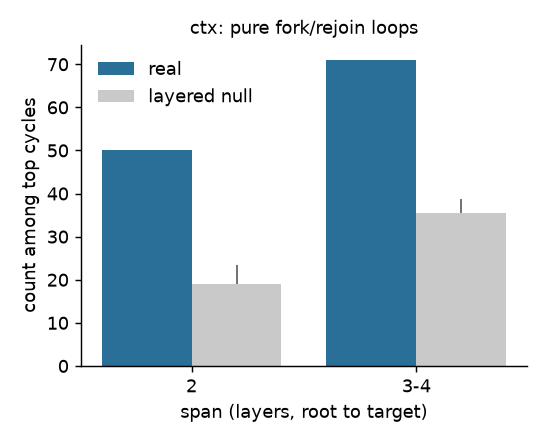

# Cross-layer neuron loops: 1.4b_s0_step143000

One graph over the MLP neurons of all layers; edges within and across layers from one correlation type.
Good = chordless, >= 4 neurons, beats layered rewiring nulls (degree- and triangle-preserving).
Pure diamond = fork at one root neuron, two unrelated arms, rejoin at one target; span = layers from root to target.

| graph | neurons | edges (cross) | H1 | good | good pure diamonds | ... span >= 2 |
|---|---|---|---|---|---|---|
| ctx | 1200 | 25735 (14000) | 1000 | 0 | 0 | 0 |

## Typology of the top cycles: real vs layered null (triangle-preserving; p = share of nulls >= real)

### ctx

| type | real | null mean | null 95% | p |
|---|---|---|---|---|
| diamond span 1 | 225 | 157.5 | 162.4 | 0.333 |
| diamond span 2 | 170 | 181.0 | 187.3 | 1.000 |
| diamond span 3-4 | 179 | 194.5 | 199.4 | 1.000 |
| flat | 121 | 81.0 | 82.8 | 0.333 |
| pure span 2 | 50 | 19.0 | 23.5 | 0.333 |
| pure span 3-4 | 71 | 35.5 | 38.6 | 0.333 |
| zigzag | 184 | 331.5 | 334.6 | 1.000 |

Examples: crosslayer_<graph>_examples.md. 
