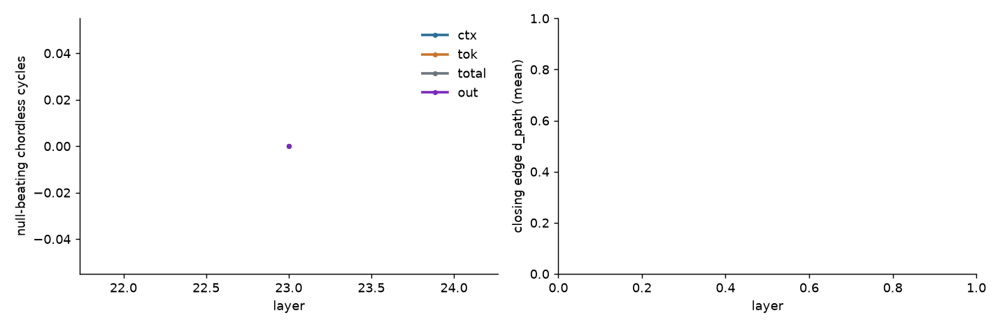

# Neuron-space loops: 1.4b_s0_step143000

Nodes: MLP neurons. Good cycle = chordless, >= 4 neurons, lifetime and score above the 95th percentile of
degree- and triangle-preserving rewiring nulls. ctx = within-token correlation (emergent candidates),
tok = between-token correlation (inherited from token identity), out = output-weight cosine.

## Cycles per layer

 layer  median_r2_tok  ctx_good  tok_good  total_good  out_good
    23       0.169001         0         0           0         0

## Closing-edge test (pooled over layers; mean [95% bootstrap CI over cycles])

d_path > 0: the two neurons the closing edge joins write more similar outputs than pairs at the same
hop distance that are not joined (the loop closes functionally). d_edge ~ 0: the closing edge acts like
an ordinary edge of the same input strength.

## Calibration (token-level families as neuron tuning rings; known answers)

layer    23
family     
months    0
numbers   0

1 = ring (Gaussian-null p < 0.05 and order matches the neurons' preferred items).

