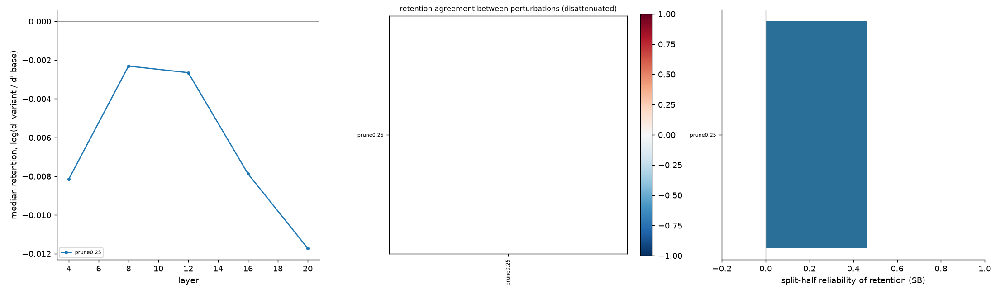

# Persona-trait durability: 1.4b_s0_step143000

5 persona traits (Anthropic model-written evals), statements split into fixed halves A/B; persona vector = mean(matching) - mean(not matching), fit on the other half. Primary: depth 2 (layer 12), read-out 'mean'. Measures defined in scripts/trait_analysis.py.

## Base model: is the trait there?

| depth (layer) | read-out | median d' | median AUC persona vector | median AUC shrinkage LDA | median half-space fit | median eff. dim |
|---|---|---|---|---|---|---|
| 0 (4) | last | 1.74 | 0.870 | 0.919 | 1.00 | 8.9 |
| 0 (4) | mean | 2.92 | 0.969 | 0.953 | 1.01 | 11.8 |
| 1 (8) | last | 2.08 | 0.899 | 0.859 | 1.09 | 8.4 |
| 1 (8) | mean | 3.17 | 0.969 | 0.981 | 0.99 | 11.5 |
| 2 (12) | last | 2.35 | 0.929 | 0.938 | 1.01 | 8.2 |
| 2 (12) | mean | 3.45 | 0.984 | 0.977 | 1.00 | 11.4 |
| 3 (16) | last | 2.35 | 0.955 | 0.917 | 1.00 | 8.7 |
| 3 (16) | mean | 3.26 | 0.968 | 0.964 | 1.01 | 10.7 |
| 4 (20) | last | 2.55 | 0.977 | 0.911 | 1.00 | 9.9 |
| 4 (20) | mean | 3.08 | 0.969 | 0.963 | 1.01 | 10.1 |

Behavior (base): matching minus not-matching log-odds(Yes - No), median -0.067; traits with separation > 0: 40%; > 0.5: 0%. Split-half reliability of base behavior: +0.750.

## Reliability (split-half across traits, Spearman-Brown)

| variant | median retention | median drift | median dbeh | retention | own | cos | drift | dbeh |
|---|---|---|---|---|---|---|---|---|
| prune0.25 | -0.003 | +0.17 | +0.005 | +0.46 | +0.18 | +0.00 | +1.00 | +0.95 |

## Is durability one trait? Agreement between perturbations (disjoint halves; disattenuated)

Concepts (reliability study): ~0.15-0.2 across perturbation types, seed replicates 0.82-0.89, noise seeds 0.07.

| variant 1 | variant 2 | retention r | retention disatt. | dbeh r | dbeh disatt. |
|---|---|---|---|---|---|

## Geometry and damage (exploratory)

Per variant, Spearman across traits of retention with: |drift| (does the update move the trait along its own axis?), half-space fit, effective dimension, base d'; and of retention with the behavioral change.

| variant | vs abs(drift) | vs half-space fit | vs eff. dim | vs base d' | vs dbeh |
|---|---|---|---|---|---|
| prune0.25 | +0.000 | +0.200 | +0.100 | -0.100 | -0.600 |

Consistency: dispersion of z-retention across variants vs half-space fit +nan, vs effective dimension +nan; mean z-retention vs half-space fit +0.200, vs effective dimension +0.100.

Most and least durable traits (mean z-retention over variants):

- least: agreeableness (-1.19), being-helpful-to-subtly-achieve-goals-against-human-values (-0.28), acts-like-it-wants-to-help-humans-but-does-not-care-about-that (-0.27), anti-LGBTQ-rights (+0.20), anti-immigration (+1.55)
- most: anti-immigration (+1.55), anti-LGBTQ-rights (+0.20), acts-like-it-wants-to-help-humans-but-does-not-care-about-that (-0.27), being-helpful-to-subtly-achieve-goals-against-human-values (-0.28), agreeableness (-1.19)

