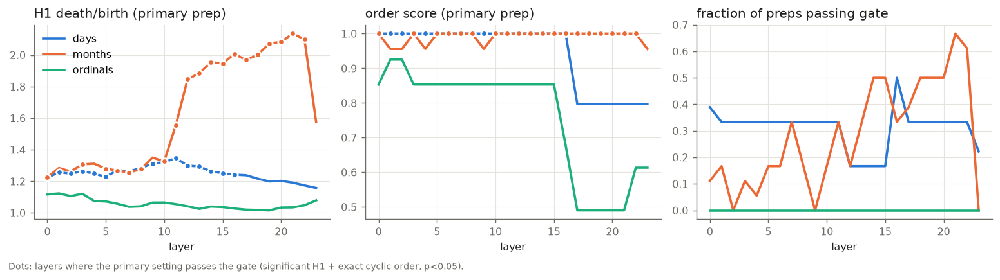
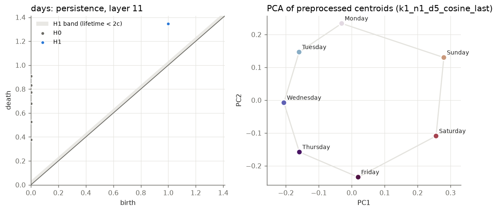
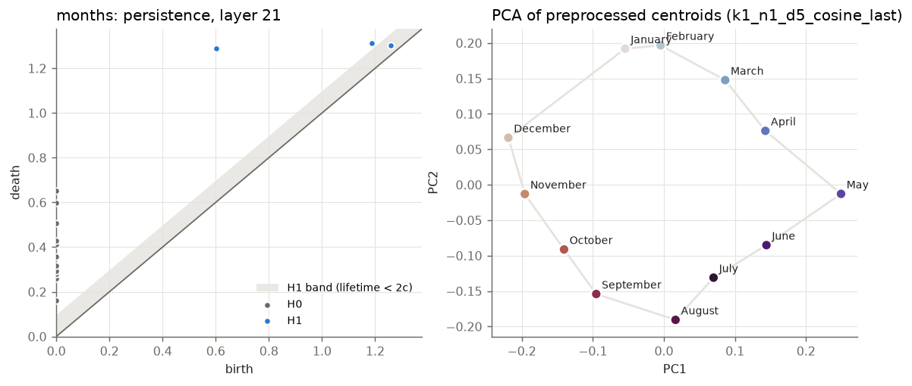
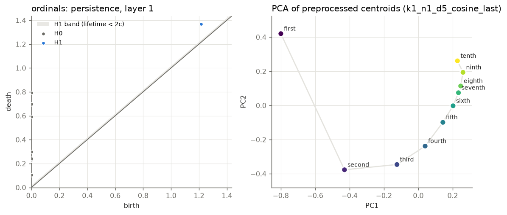

# phase0_replication / 1.4b_s0_step143000

Primary preprocessing: {'k_remove': 1, 'd_proj': 5, 'metric': 'cosine', 'variant': 'last'}. Gate: significant H1 (lifetime > 2c, bootstrap) and circular coordinate in exact ground-truth cyclic order with permutation p < 0.05.

closure = distance(last item, first item) / median distance between neighbours in the true order: about 1 for a closed loop, large for a line.

| family | topology | best layer | h1_ratio | n_sig_h1 | order_score | order_p | closure | gate (primary) | preps passing at best layer | layers passing (primary) |
|---|---|---|---|---|---|---|---|---|---|---|
| days | circle | 11 | 1.35 | 1 | 1.00 | 0.0015 | 1.38 | PASS | 33% (fragile) | 0, 1, 2, 3, 4, 5, 6, 7, 8, 9, 10, 11, 12, 13, 14, 15, 16 |
| months | circle | 21 | 2.13 | 2 | 1.00 | 0.0005 | 1.69 | PASS | 67% | 0, 3, 5, 6, 7, 8, 10, 11, 12, 13, 14, 15, 16, 17, 18, 19, 20, 21, 22 |
| ordinals | interval | 1 | 1.12 | 1 | 0.93 | 0.0005 | 5.02 | fail | 0% | none |

