# phase1_families / 1.4b_s0_step143000

Primary preprocessing {'k_remove': 1, 'd_proj': 5, 'metric': 'cosine', 'variant': 'last'}; template contexts unless stated. Topology score = order_score x 1[closure < 2] for circle families of 30 items or fewer; line_order_score x 1[closure >= 2] for line controls (an ordered arc that stays open); h1_ratio above 30 items (cities). shape_pass = significant H1 + exact cyclic order (p < 0.05) + closure < 2 for circles; linear order p < 0.05 + closure >= 2 for line controls. Robustness = share of the 36 preprocessing settings with shape_pass at the best layer (< 50% = fragile).

| family | topology | origin | items | best layer | score | closure | n_sig_h1 | gauss p | shape_pass layers | robustness | score @12-16 | pile items | pile best layer | pile score |
|---|---|---|---|---|---|---|---|---|---|---|---|---|---|---|
| days | circle | explicit | 7 | 11 | 1.00 | 1.38 | 1 | 0.17 | 0-16 | 17% (fragile) | 1.00 | 7 | 11 | 1.00 |
| months | circle | explicit | 12 | 21 | 1.00 | 1.69 | 2 | 0.01 | 12-15, 17-22 | 33% (fragile) | 0.80 | 12 | 19 | 1.00 |
| clock_hours | circle | explicit | 12 | 8 | 0.00 | 4.06 | 1 | 0.82 | none | 0% (fragile) | 0.00 | 12 | 23 | 0.00 |
| zodiac | circle | explicit | 12 | 23 | 0.54 | 0.15 | 0 | 0.85 | none | 0% (fragile) | 0.00 | 12 | 20 | 0.42 |
| moon_phases | circle | explicit | 8 | 13 | 0.40 | 1.06 | 2 | 0.66 | none | 0% (fragile) | 0.31 | - | - | - |
| compass | circle | explicit | 16 | 2 | 0.64 | 1.21 | 4 | 0.79 | none | 0% (fragile) | 0.16 | 16 | 2 | 0.81 |
| hues | circle | implicit | 24 | 3 | 0.93 | 1.04 | 2 | 0.63 | none | 0% (fragile) | 0.20 | 24 | 11 | 0.16 |
| cities_longitude | circle | implicit | 300 | 23 | 4.39 | 0.66 | 5 | 0.01 | 1, 12-13, 15-16, 19-23 | 36% (fragile) | 3.34 | 263 | 4 | 4.26 |
| krebs | circle | implicit_long | 9 | 17 | 0.39 | 1.17 | 1 | 0.54 | none | 0% (fragile) | 0.19 | 8 | 0 | 0.49 |
| anacyclosis | circle | implicit_long | 6 | 14 | 0.25 | 1.16 | 1 | 0.49 | none | 0% (fragile) | 0.25 | 5 | 22 | 0.20 |
| water_cycle | circle | explicit | 5 | 22 | 1.00 | 1.12 | 1 | 0.31 | none | 0% (fragile) | 0.20 | 5 | 22 | 1.00 |
| emotions | circle | emergent | 28 | 8 | 0.67 | 0.30 | 6 | 0.56 | none | 0% (fragile) | 0.59 | 27 | 5 | 0.65 |
| keys | torus | emergent | 24 | 1 | 0.24 | 0.92 | 4 | 0.98 | none | 0% (fragile) | 0.13 | 15 | 23 | 0.14 |
| triads | torus | emergent | 24 | 4 | 0.16 | 0.80 | 3 | 0.96 | none | 0% (fragile) | 0.12 | 9 | 21 | 0.45 |
| political | unknown | open | 18 | 12 | 0.68 | 0.59 | 5 | 0.07 | none | 0% (fragile) | 0.50 | 18 | 13 | 0.39 |
| ordinals | interval | control | 10 | 12 | 0.79 | 4.68 | 0 | 0.85 | 0-23 | 100% | 0.78 | 10 | 4 | 0.79 |
| sizes | interval | control | 10 | 23 | 0.71 | 3.20 | 0 | 0.87 | 4-23 | 69% | 0.69 | 10 | 16 | 0.67 |
| life_stages | interval | control | 10 | 13 | 0.65 | 2.39 | 1 | 0.89 | 0, 9-17 | 42% (fragile) | 0.63 | 10 | 13 | 0.67 |
| centuries | interval | control | 12 | 13 | 0.89 | 8.77 | 1 | 0.81 | 0-23 | 100% | 0.88 | 12 | 13 | 0.93 |
| temperature | interval | control | 12 | 11 | 0.87 | 3.69 | 1 | 0.75 | 7-23 | 47% (fragile) | 0.83 | 11 | 18 | 0.83 |
| city_latitude | interval | control | 100 | 19 | 0.55 | 3.49 | 4 | 0.84 | 6-23 | 53% | 0.54 | 77 | 19 | 0.70 |
| numbers | interval | control | 12 | 23 | 0.90 | 2.40 | 1 | 0.13 | 0-23 | 100% | 0.83 | 12 | 18 | 0.89 |

## Circles vs line controls (families of 30 items or fewer, template contexts)

| group | n | mean score at best layer | mean score at layers 12-16 |
|---|---|---|---|
| circle/torus | 13 | 0.55 | 0.30 |
| line controls | 7 | 0.77 | 0.74 |
| unknown (political) | 1 | 0.68 | 0.50 |

Cities (h1_ratio): cities_longitude 4.39 (best) / 3.34 (12-16)

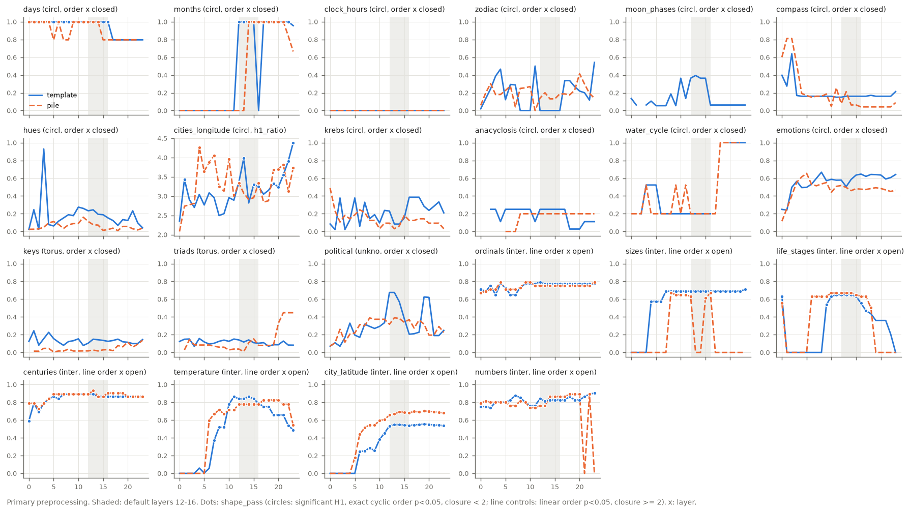

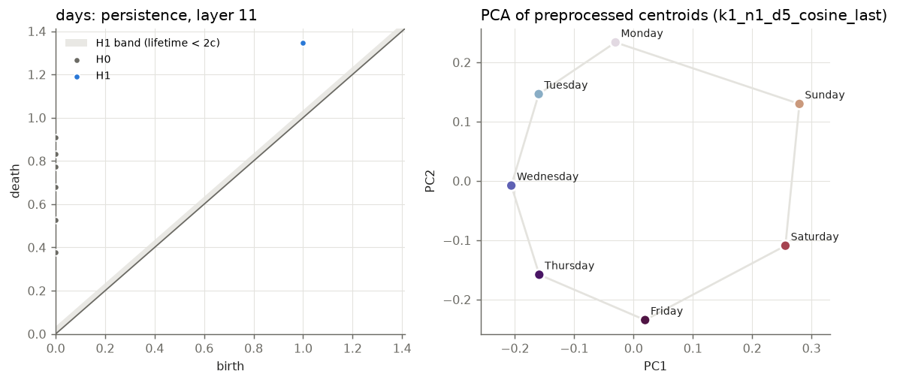
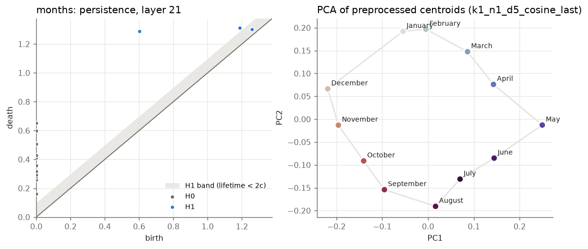
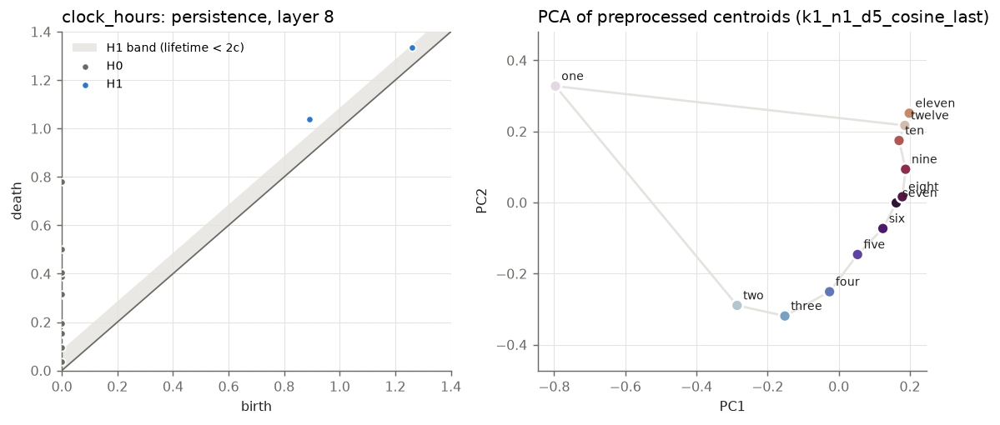
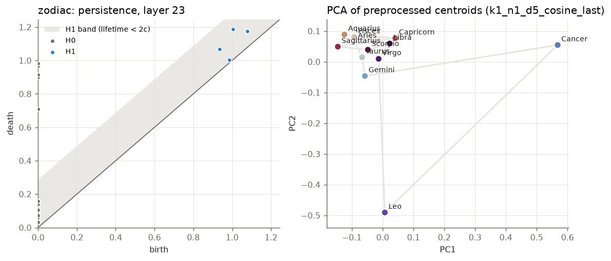
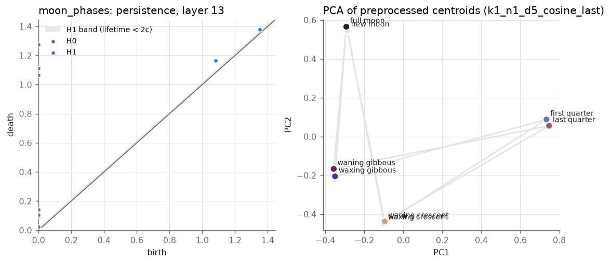
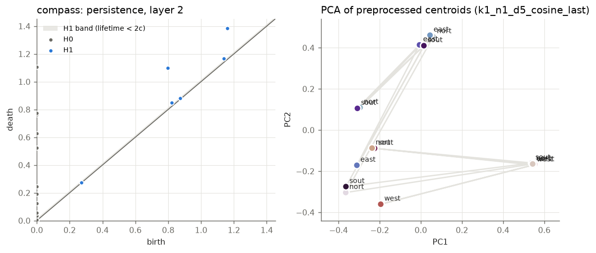
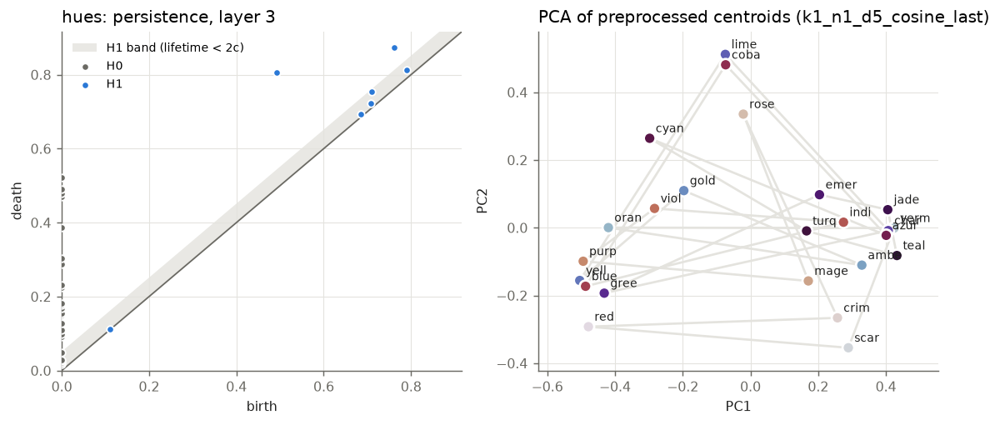
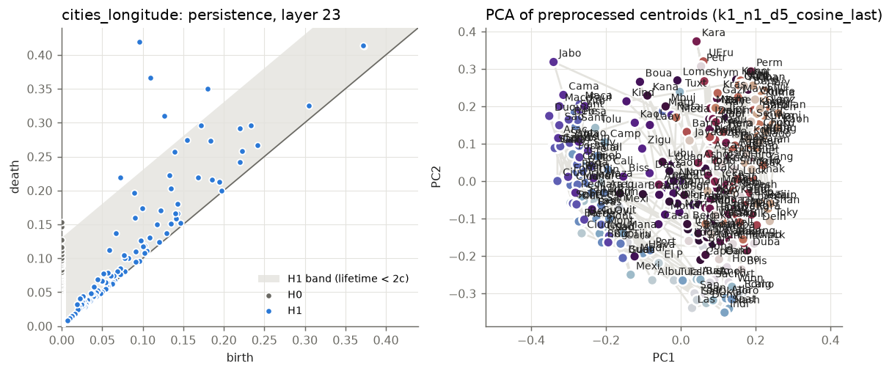
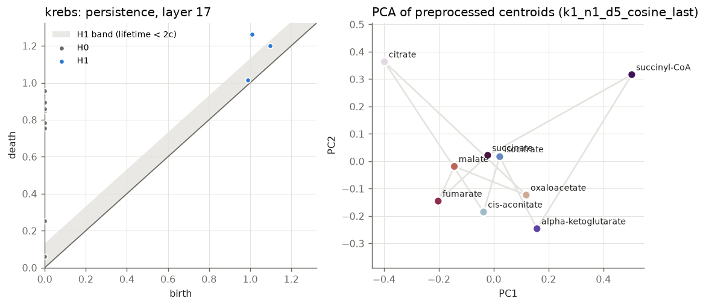
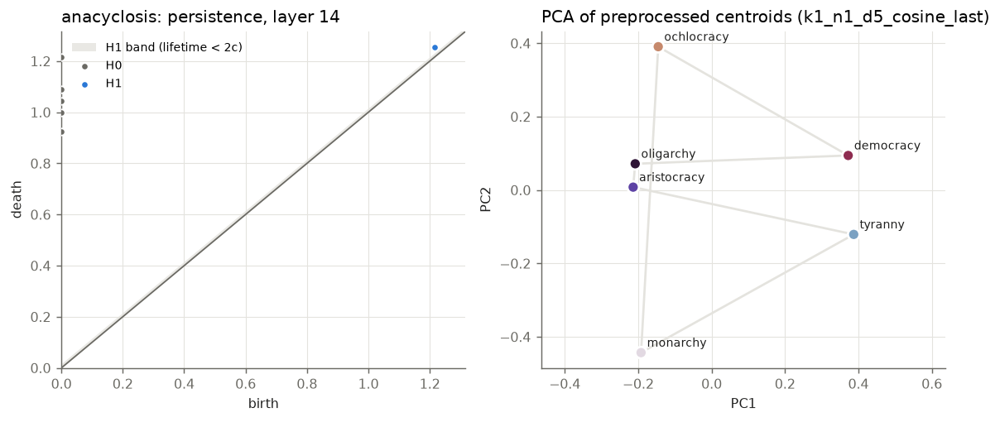
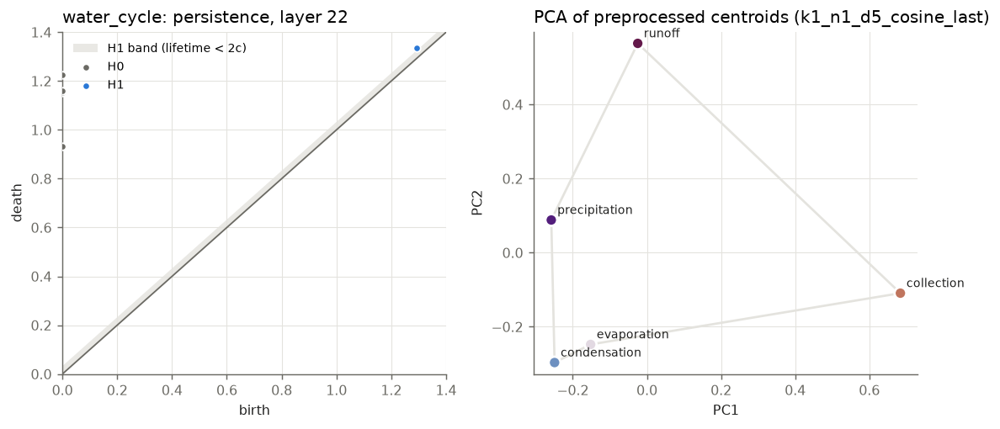
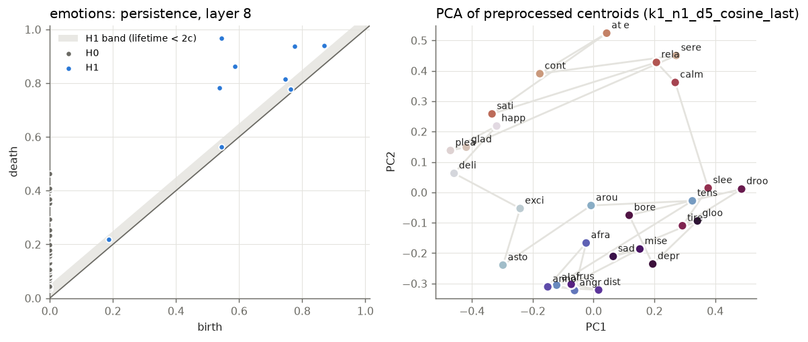
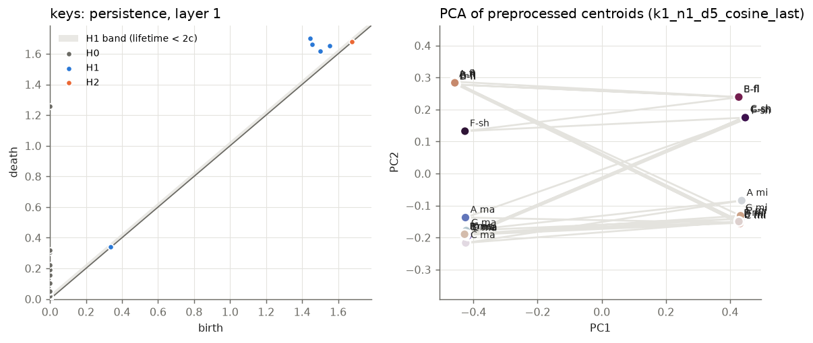
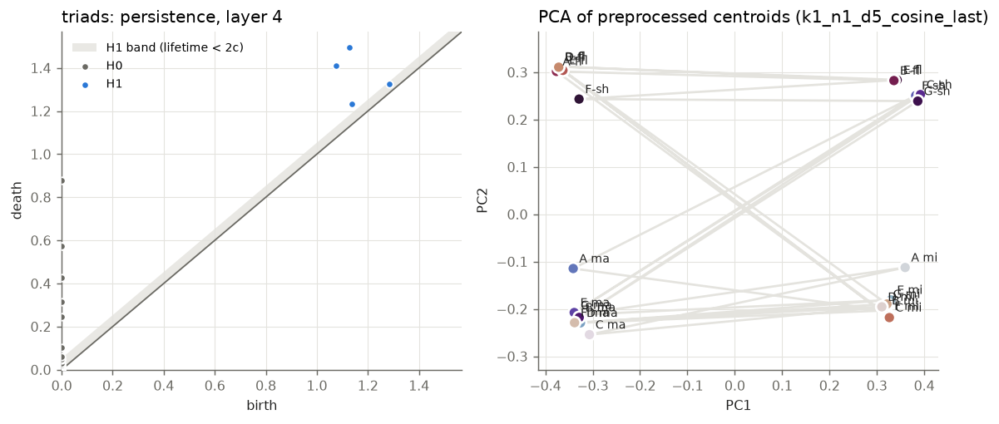
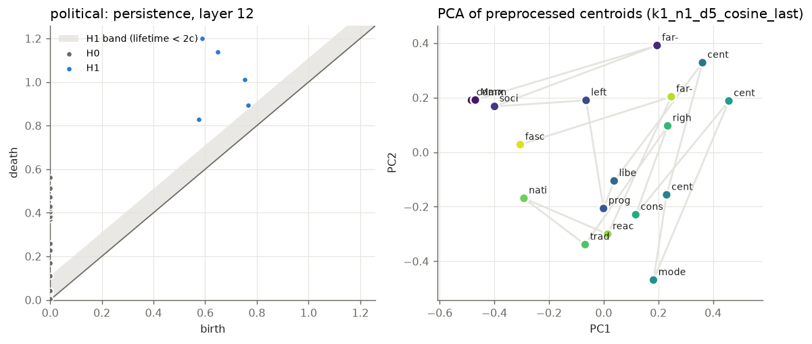
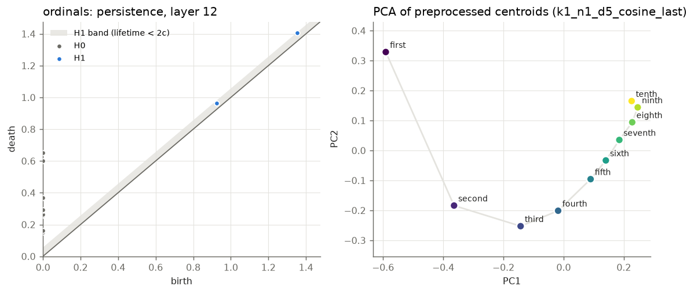
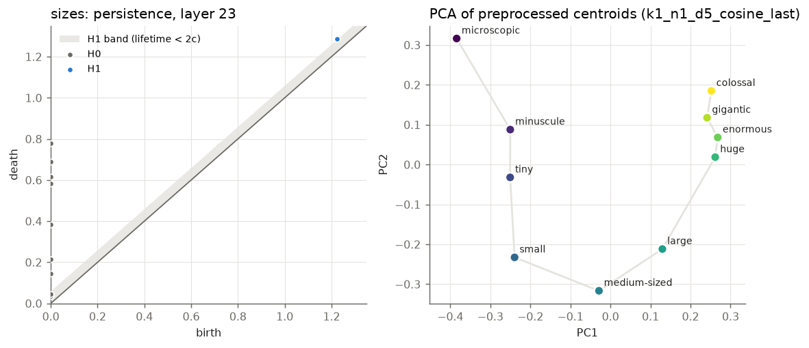
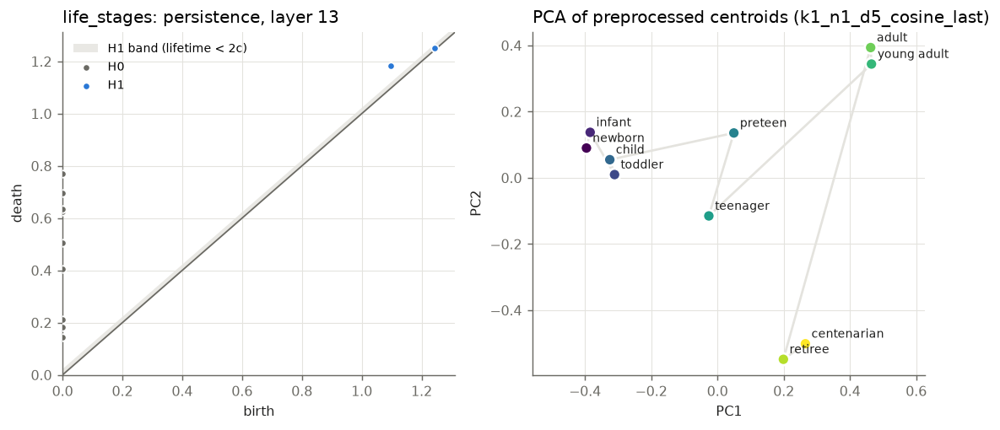
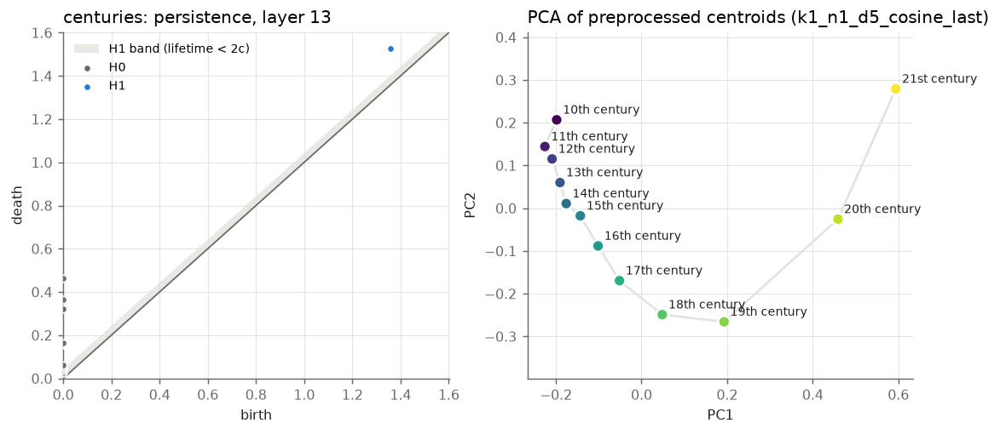
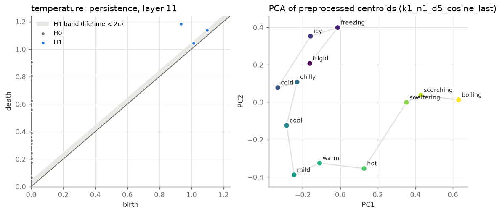
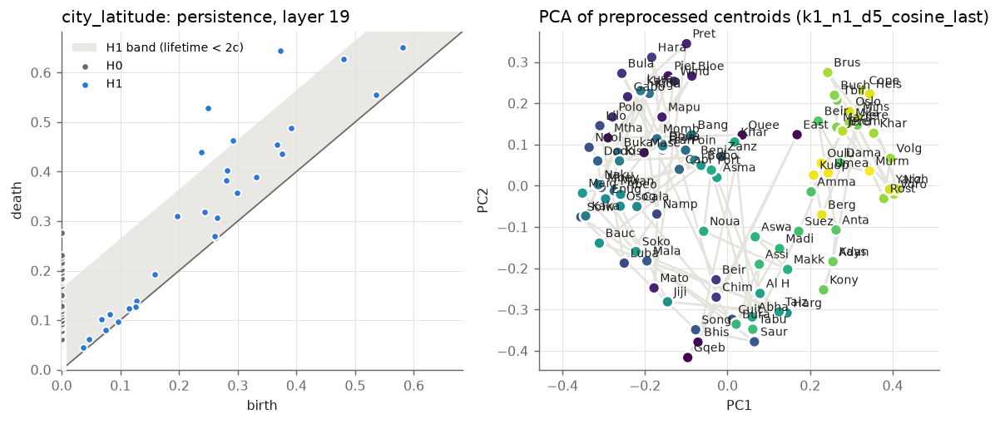
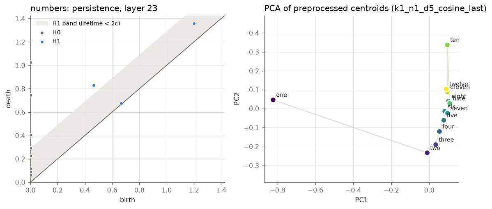
