# phase1_families / 160m_s0_step143000

Primary preprocessing {'k_remove': 1, 'd_proj': 5, 'metric': 'cosine', 'variant': 'last'}; template contexts unless stated. Topology score = order_score x 1[closure < 2] for circle families of 30 items or fewer; line_order_score x 1[closure >= 2] for line controls (an ordered arc that stays open); h1_ratio above 30 items (cities). shape_pass = significant H1 + exact cyclic order (p < 0.05) + closure < 2 for circles; linear order p < 0.05 + closure >= 2 for line controls. Robustness = share of the 36 preprocessing settings with shape_pass at the best layer (< 50% = fragile).

| family | topology | origin | items | best layer | score | closure | n_sig_h1 | gauss p | shape_pass layers | robustness | score @12-16 | pile items | pile best layer | pile score |
|---|---|---|---|---|---|---|---|---|---|---|---|---|---|---|
| days | circle | explicit | 7 | 7 | 1.00 | 1.51 | 1 | 0.27 | 0-9 | 33% (fragile) | nan | 7 | 0 | 1.00 |
| months | circle | explicit | 12 | 4 | 1.00 | 1.80 | 2 | 0.02 | 4-9 | 22% (fragile) | nan | 12 | 4 | 1.00 |
| clock_hours | circle | explicit | 12 | 9 | 0.00 | 3.08 | 1 | 0.31 | none | 0% (fragile) | nan | 12 | 5 | 0.00 |
| zodiac | circle | explicit | 12 | 4 | 0.62 | 0.40 | 5 | 0.80 | none | 0% (fragile) | nan | 12 | 8 | 0.32 |
| moon_phases | circle | explicit | 8 | 10 | 0.36 | 0.88 | 0 | 0.73 | none | 0% (fragile) | nan | - | - | - |
| compass | circle | explicit | 16 | 8 | 0.12 | 1.12 | 1 | 1.00 | none | 0% (fragile) | nan | 16 | 0 | 0.17 |
| hues | circle | implicit | 24 | 8 | 0.09 | 0.46 | 2 | 0.98 | none | 0% (fragile) | nan | 24 | 1 | 0.15 |
| cities_longitude | circle | implicit | 300 | 11 | 4.14 | 1.47 | 14 | 0.03 | 1, 3, 6, 8, 10-11 | 33% (fragile) | nan | 263 | 2 | 4.28 |
| krebs | circle | implicit_long | 9 | 1 | 0.65 | 0.27 | 4 | 0.36 | none | 0% (fragile) | nan | 8 | 3 | 0.46 |
| anacyclosis | circle | implicit_long | 6 | 3 | 0.25 | 1.08 | 1 | 0.46 | none | 0% (fragile) | nan | 5 | 9 | 0.52 |
| water_cycle | circle | explicit | 5 | 7 | 0.52 | 1.18 | 1 | 0.22 | none | 0% (fragile) | nan | 5 | 10 | 1.00 |
| emotions | circle | emergent | 28 | 4 | 0.61 | 0.71 | 5 | 0.21 | none | 0% (fragile) | nan | 27 | 11 | 0.52 |
| keys | torus | emergent | 24 | 11 | 0.23 | 0.64 | 2 | 0.26 | none | 0% (fragile) | nan | 15 | 6 | 0.16 |
| triads | torus | emergent | 24 | 5 | 0.21 | 0.81 | 3 | 0.82 | none | 0% (fragile) | nan | 9 | 9 | 0.24 |
| political | unknown | open | 18 | 0 | 0.29 | 0.92 | 4 | 0.93 | none | 0% (fragile) | nan | 18 | 8 | 0.28 |
| ordinals | interval | control | 10 | 5 | 0.77 | 3.89 | 0 | 0.84 | 0-11 | 100% | nan | 10 | 10 | 0.73 |
| sizes | interval | control | 10 | 11 | 0.67 | 2.26 | 1 | 0.48 | 5, 10-11 | 36% (fragile) | nan | 10 | 9 | 0.59 |
| life_stages | interval | control | 10 | 9 | 0.00 | 1.62 | 2 | 0.37 | none | 0% (fragile) | nan | 10 | 10 | 0.00 |
| centuries | interval | control | 12 | 6 | 0.99 | 17.25 | 0 | 1.00 | 0-11 | 100% | nan | 12 | 6 | 1.00 |
| temperature | interval | control | 12 | 8 | 0.07 | 2.18 | 3 | 0.16 | none | 0% (fragile) | nan | 11 | 8 | 0.11 |
| city_latitude | interval | control | 100 | 9 | 0.00 | 1.64 | 6 | 0.09 | none | 11% (fragile) | nan | 77 | 7 | 0.45 |
| numbers | interval | control | 12 | 11 | 0.87 | 2.57 | 1 | 0.32 | 0-11 | 100% | nan | 12 | 9 | 0.96 |

## Circles vs line controls (families of 30 items or fewer, template contexts)

| group | n | mean score at best layer | mean score at layers 12-16 |
|---|---|---|---|
| circle/torus | 13 | 0.44 | nan |
| line controls | 7 | 0.48 | nan |
| unknown (political) | 1 | 0.29 | nan |

Cities (h1_ratio): cities_longitude 4.14 (best) / nan (12-16)

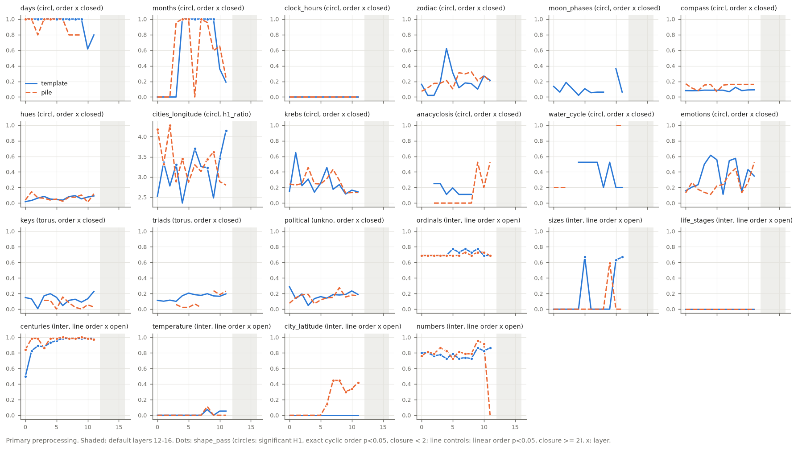

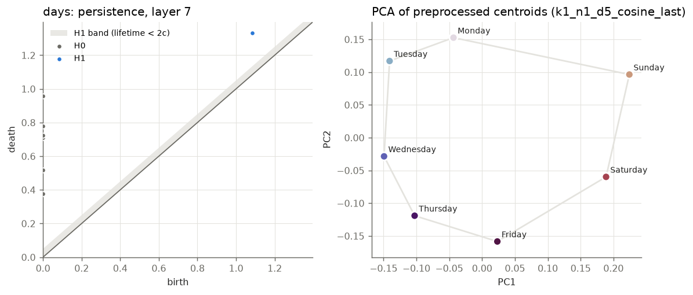
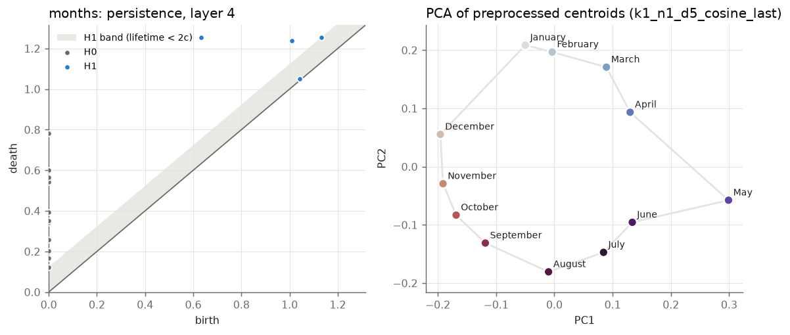
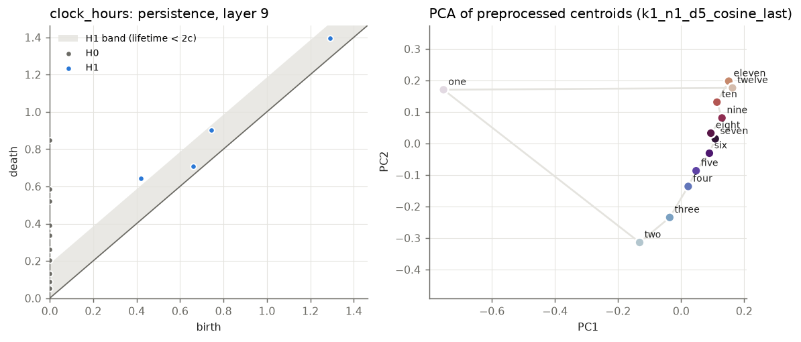
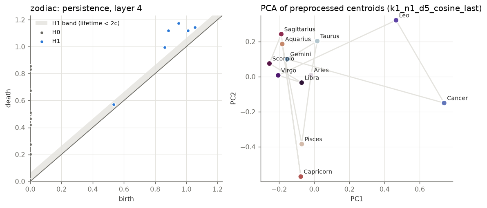
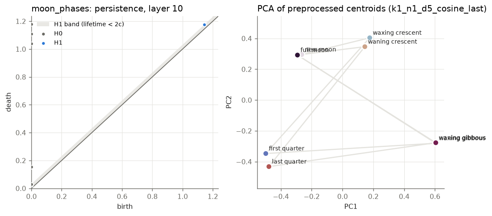
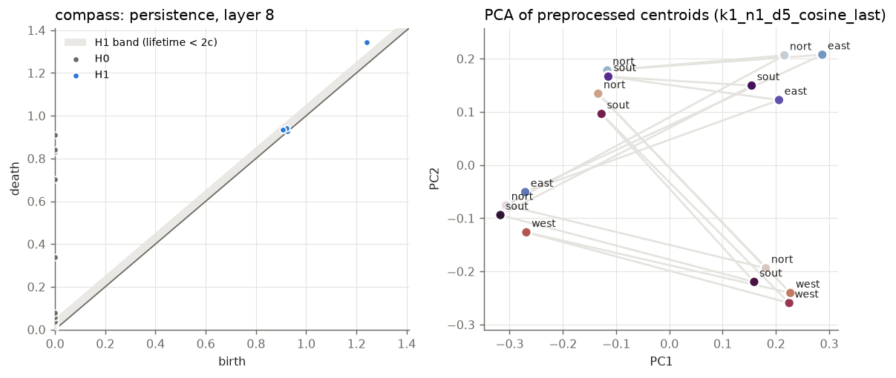
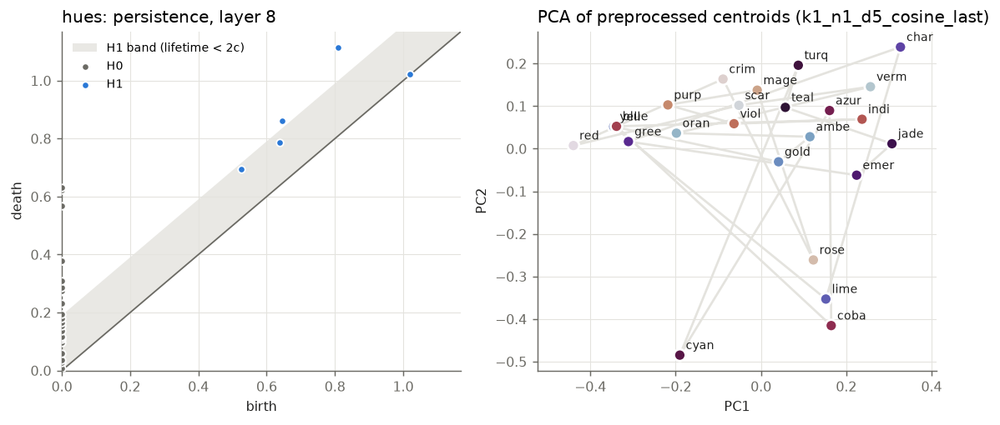
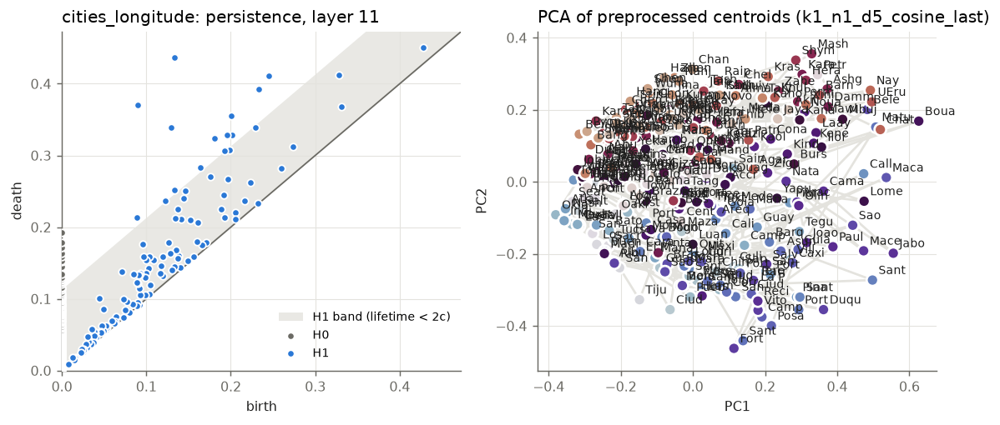
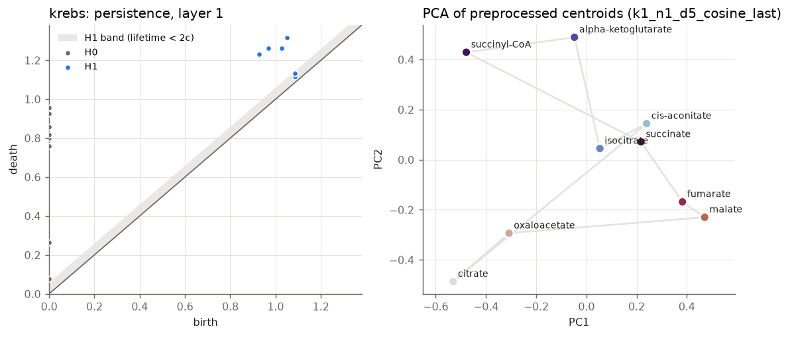
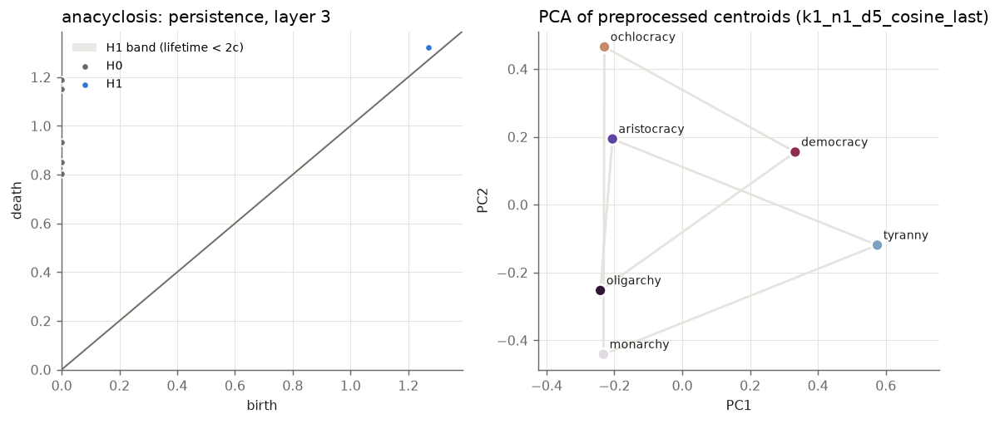
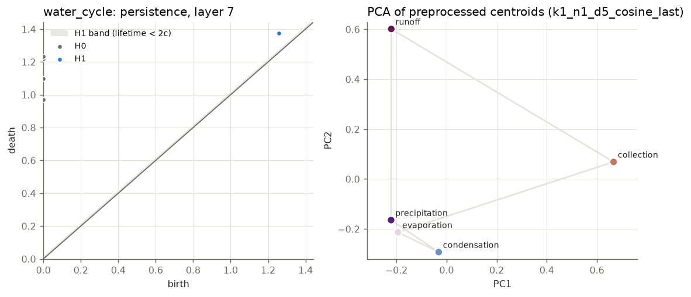
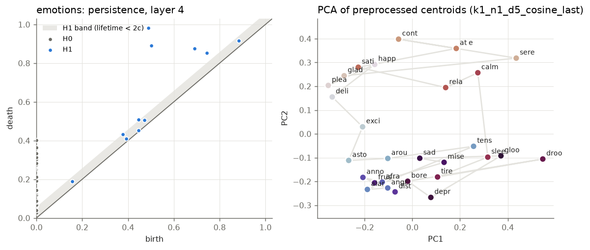
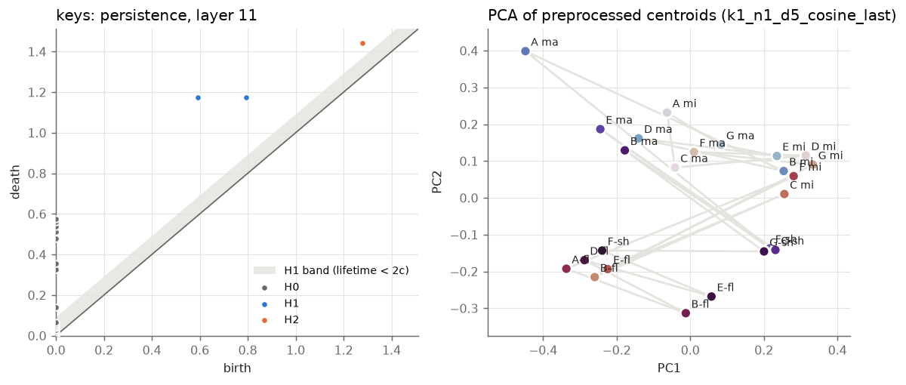
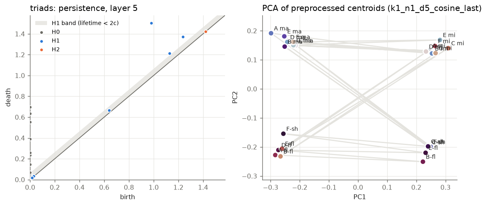
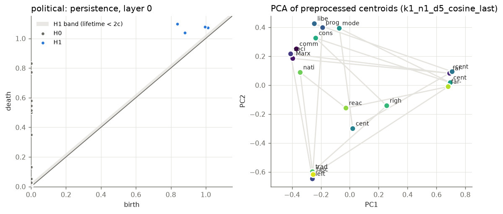
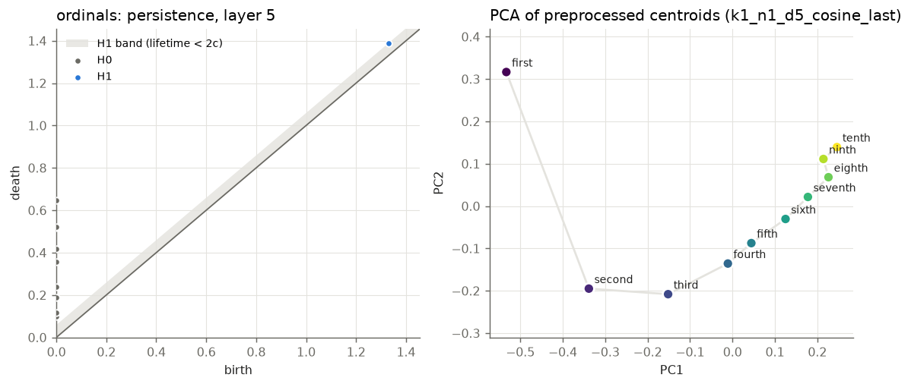
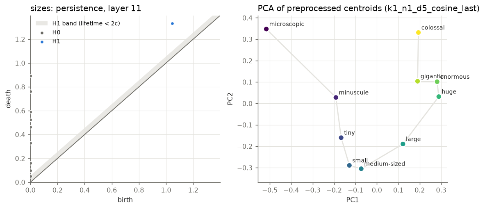
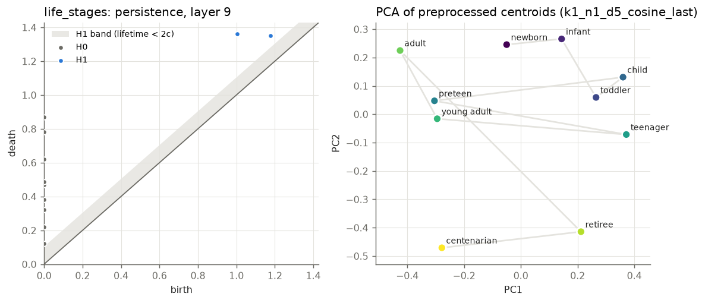
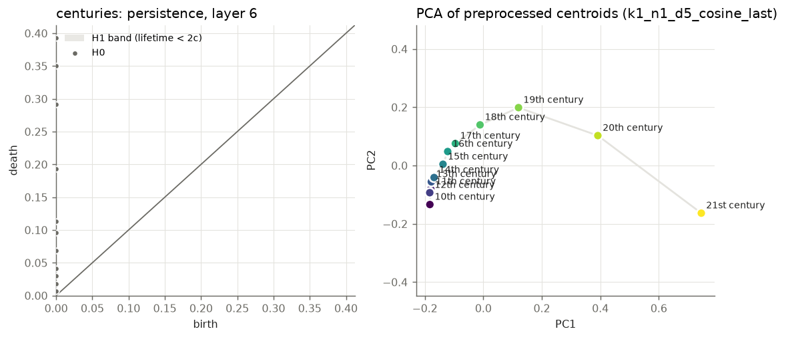
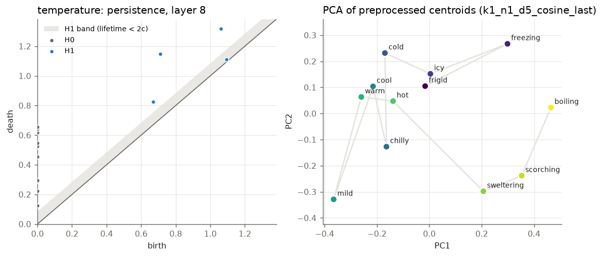
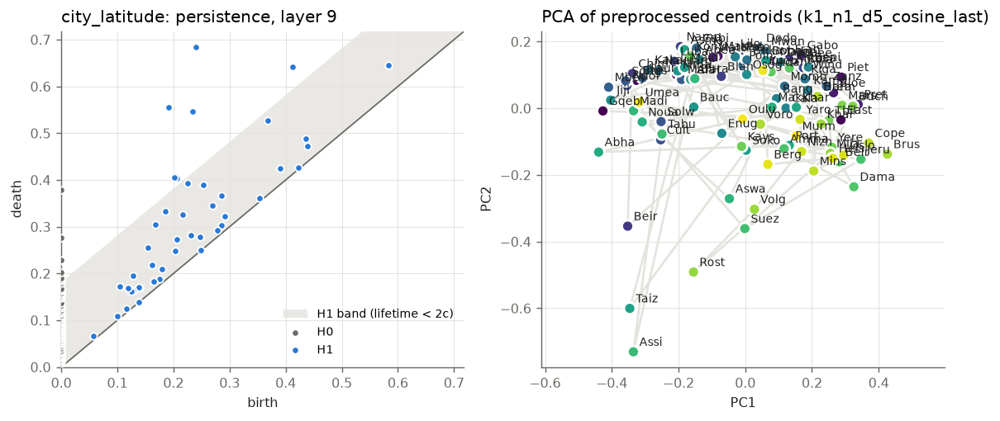
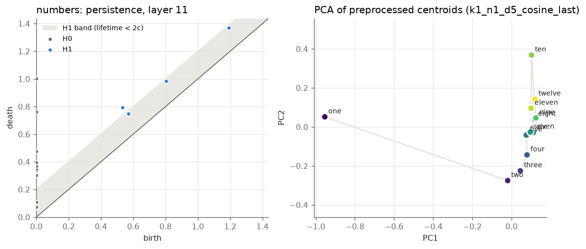
