# phase1_families / 1b_s0_step143000

Primary preprocessing {'k_remove': 1, 'd_proj': 5, 'metric': 'cosine', 'variant': 'last'}; template contexts unless stated. Topology score = order_score x 1[closure < 2] for circle families of 30 items or fewer; line_order_score x 1[closure >= 2] for line controls (an ordered arc that stays open); h1_ratio above 30 items (cities). shape_pass = significant H1 + exact cyclic order (p < 0.05) + closure < 2 for circles; linear order p < 0.05 + closure >= 2 for line controls. Robustness = share of the 36 preprocessing settings with shape_pass at the best layer (< 50% = fragile).

| family | topology | origin | items | best layer | score | closure | n_sig_h1 | gauss p | shape_pass layers | robustness | score @12-16 | pile items | pile best layer | pile score |
|---|---|---|---|---|---|---|---|---|---|---|---|---|---|---|
| days | circle | explicit | 7 | 3 | 1.00 | 1.40 | 1 | 0.20 | 0-8, 14 | 33% (fragile) | 0.85 | 7 | 3 | 1.00 |
| months | circle | explicit | 12 | 11 | 1.00 | 1.82 | 1 | 0.01 | 10-14 | 17% (fragile) | 0.99 | 12 | 12 | 1.00 |
| clock_hours | circle | explicit | 12 | 9 | 0.00 | 4.71 | 1 | 0.61 | none | 0% (fragile) | 0.00 | 12 | 15 | 0.00 |
| zodiac | circle | explicit | 12 | 1 | 0.47 | 0.05 | 5 | 0.70 | none | 0% (fragile) | 0.27 | 12 | 7 | 0.65 |
| moon_phases | circle | explicit | 8 | 7 | 0.21 | 0.97 | 2 | 0.80 | none | 0% (fragile) | 0.07 | - | - | - |
| compass | circle | explicit | 16 | 0 | 0.64 | 1.15 | 3 | 0.84 | none | 0% (fragile) | 0.17 | 16 | 1 | 0.63 |
| hues | circle | implicit | 24 | 15 | 0.22 | 0.50 | 2 | 0.69 | none | 0% (fragile) | 0.21 | 24 | 8 | 0.22 |
| cities_longitude | circle | implicit | 300 | 13 | 4.20 | 1.28 | 8 | 0.01 | 0, 10-15 | 47% (fragile) | 3.69 | 263 | 5 | 6.43 |
| krebs | circle | implicit_long | 9 | 6 | 0.58 | 1.57 | 1 | 0.58 | none | 0% (fragile) | 0.23 | 8 | 3 | 0.86 |
| anacyclosis | circle | implicit_long | 6 | 9 | 0.25 | 1.23 | 1 | 0.39 | none | 0% (fragile) | 0.16 | 5 | 4 | 0.20 |
| water_cycle | circle | explicit | 5 | 9 | 0.52 | 1.15 | 1 | 0.27 | none | 0% (fragile) | 0.20 | 5 | 13 | 1.00 |
| emotions | circle | emergent | 28 | 5 | 0.62 | 0.54 | 6 | 0.72 | none | 0% (fragile) | 0.51 | 27 | 7 | 0.65 |
| keys | torus | emergent | 24 | 11 | 0.16 | 0.91 | 4 | 0.74 | none | 0% (fragile) | 0.12 | 15 | 15 | 0.14 |
| triads | torus | emergent | 24 | 11 | 0.14 | 0.93 | 4 | 0.78 | none | 0% (fragile) | 0.11 | 9 | 13 | 0.32 |
| political | unknown | open | 18 | 8 | 0.39 | 0.62 | 4 | 0.35 | none | 0% (fragile) | 0.30 | 18 | 8 | 0.59 |
| ordinals | interval | control | 10 | 13 | 0.84 | 5.22 | 0 | 0.85 | 0-15 | 100% | 0.80 | 10 | 3 | 0.77 |
| sizes | interval | control | 10 | 13 | 0.71 | 3.23 | 1 | 0.59 | 5-15 | 72% | 0.70 | 10 | 13 | 0.67 |
| life_stages | interval | control | 10 | 10 | 0.65 | 2.39 | 3 | 0.85 | 7-11 | 47% (fragile) | 0.00 | 10 | 9 | 0.65 |
| centuries | interval | control | 12 | 14 | 0.90 | 14.29 | 0 | 0.88 | 0-15 | 100% | 0.90 | 12 | 15 | 0.94 |
| temperature | interval | control | 12 | 10 | 0.89 | 3.54 | 2 | 0.49 | 7-14 | 42% (fragile) | 0.40 | 11 | 9 | 0.81 |
| city_latitude | interval | control | 100 | 12 | 0.54 | 3.30 | 6 | 0.35 | 6-15 | 56% | 0.46 | 77 | 14 | 0.66 |
| numbers | interval | control | 12 | 15 | 0.90 | 2.99 | 0 | 0.55 | 0-15 | 100% | 0.86 | 12 | 14 | 0.87 |

## Circles vs line controls (families of 30 items or fewer, template contexts)

| group | n | mean score at best layer | mean score at layers 12-16 |
|---|---|---|---|
| circle/torus | 13 | 0.45 | 0.30 |
| line controls | 7 | 0.78 | 0.59 |
| unknown (political) | 1 | 0.39 | 0.30 |

Cities (h1_ratio): cities_longitude 4.20 (best) / 3.69 (12-16)

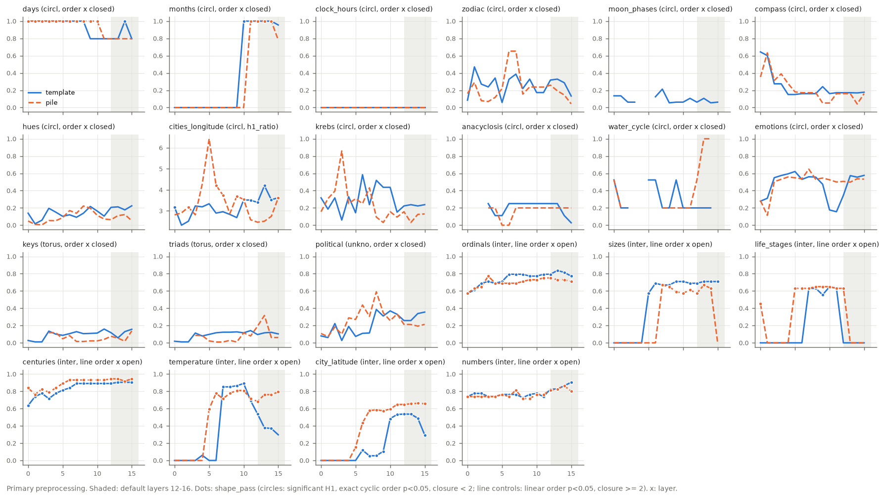

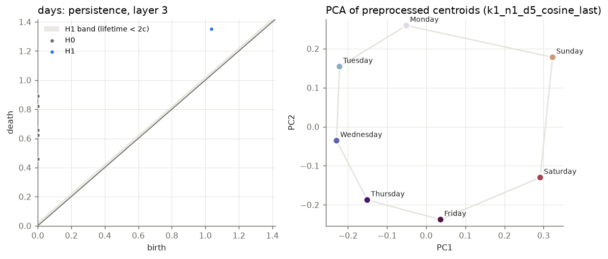
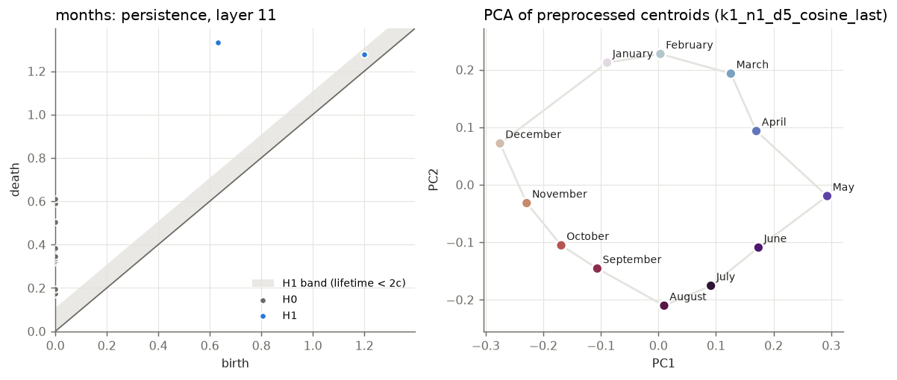
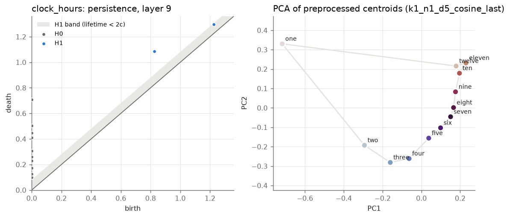
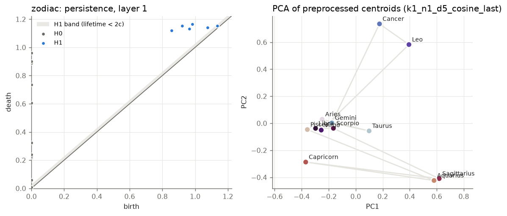
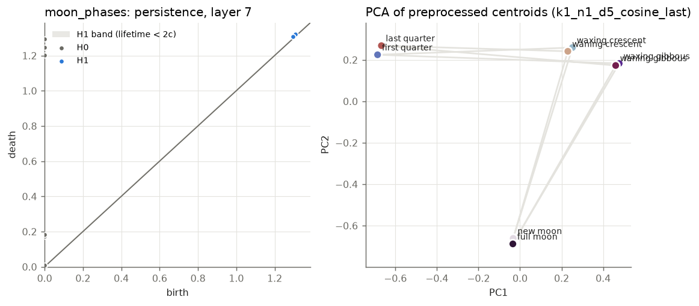
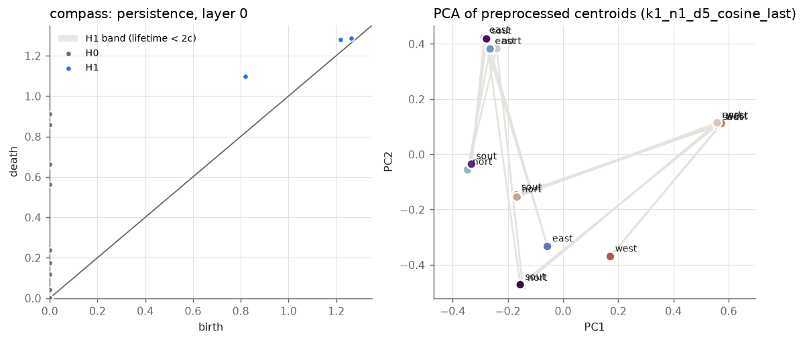
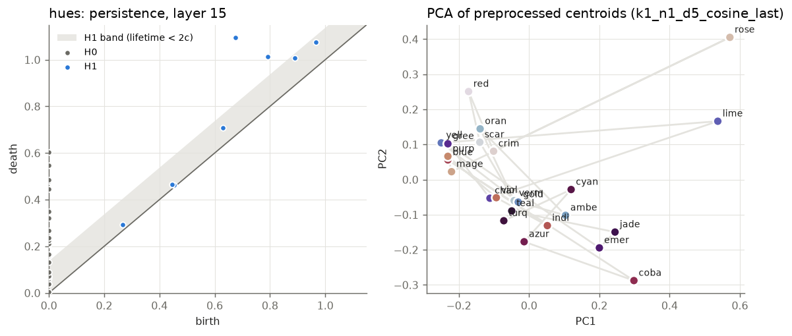
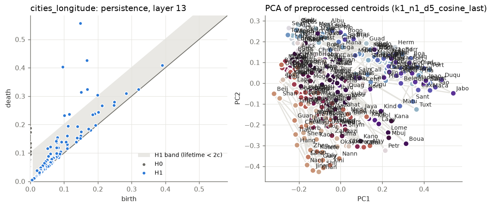
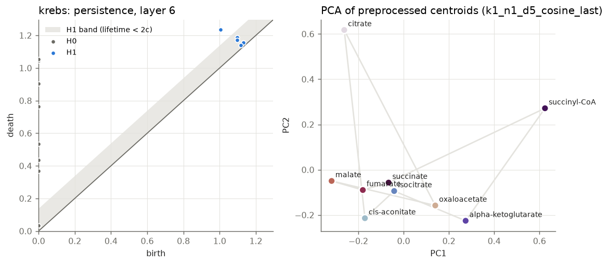
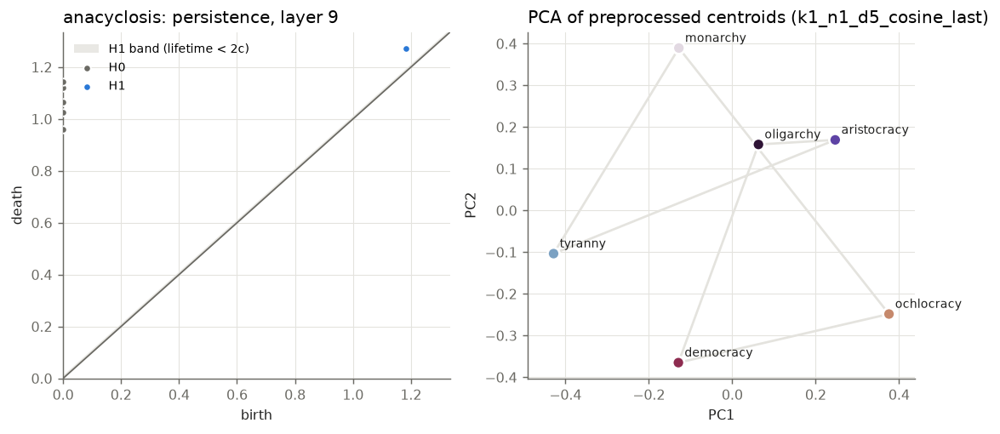
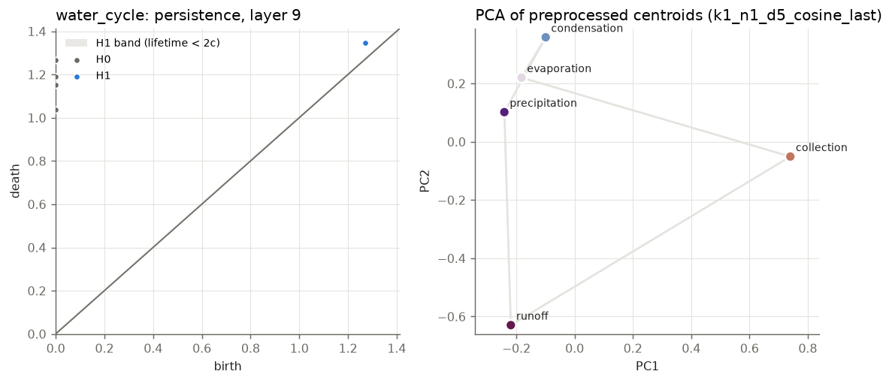
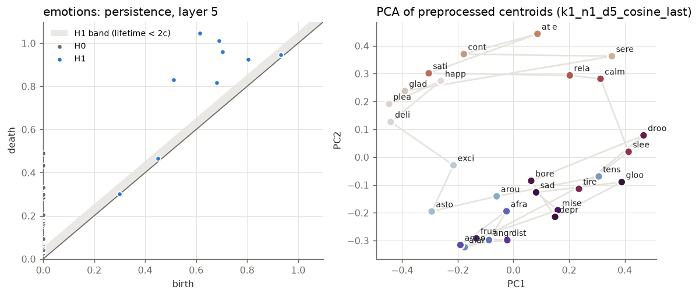
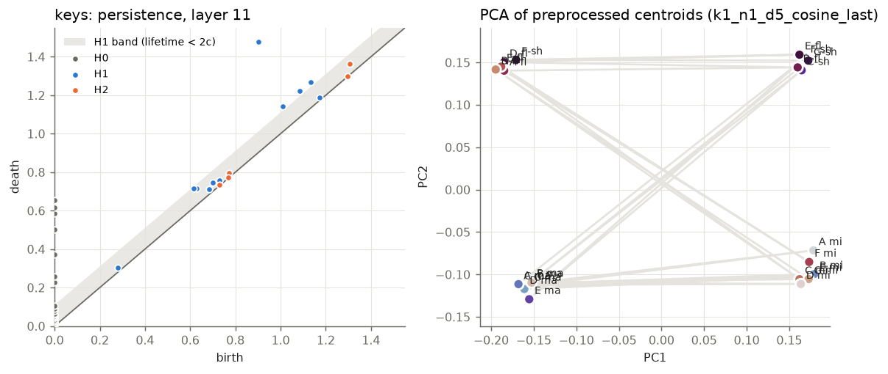
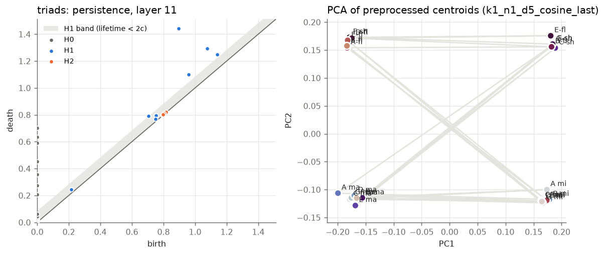
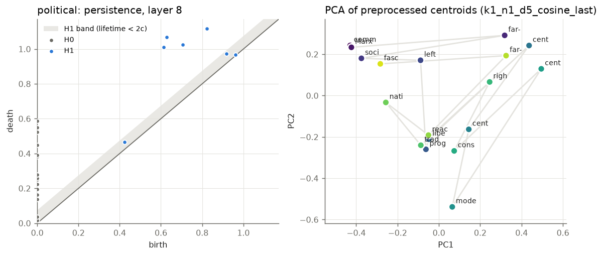
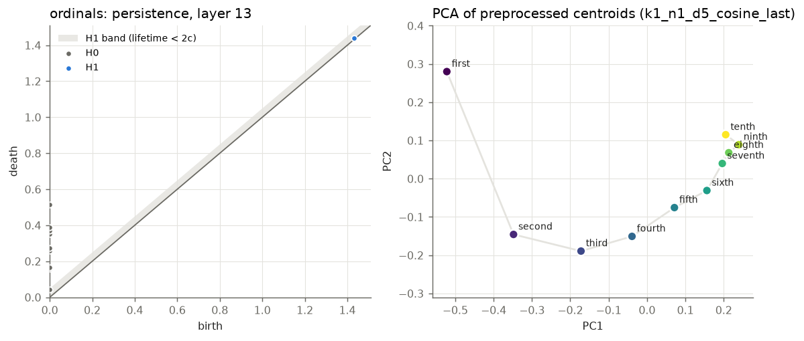
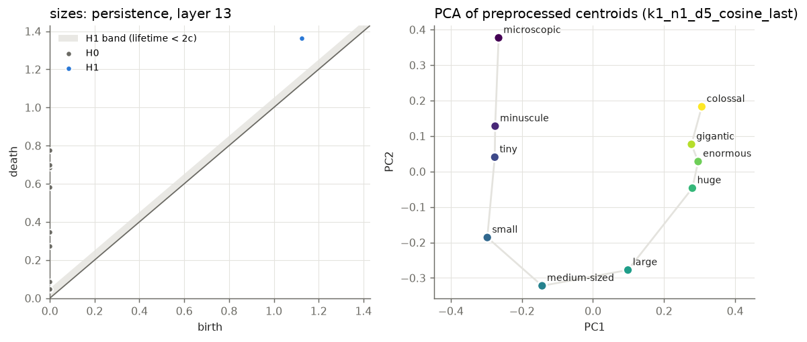
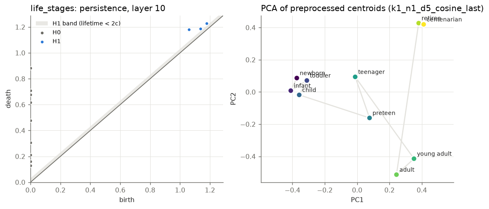
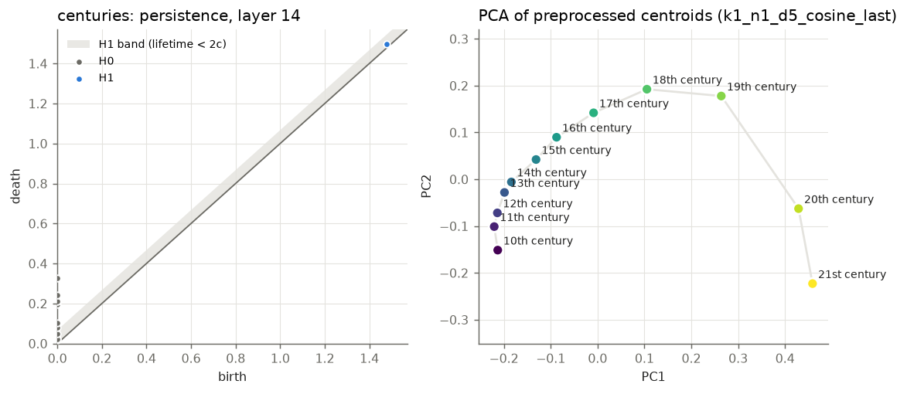
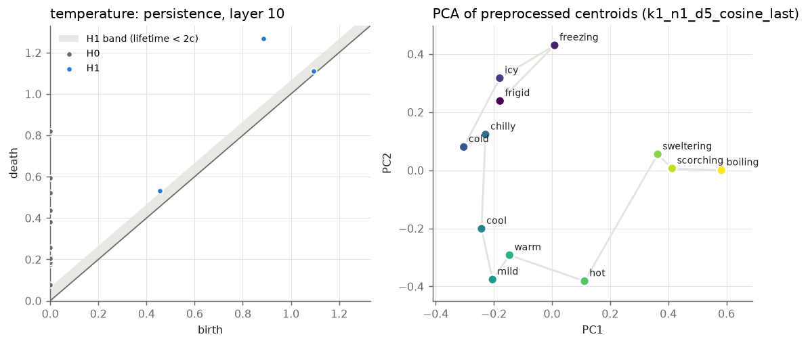
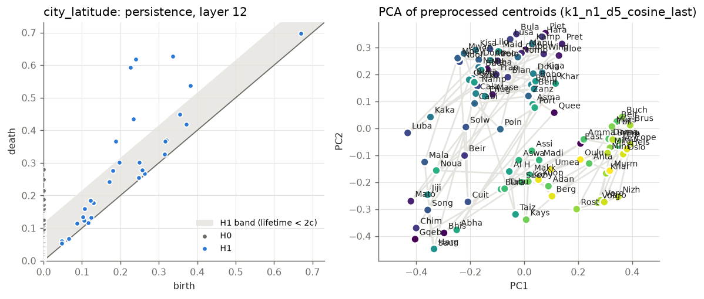
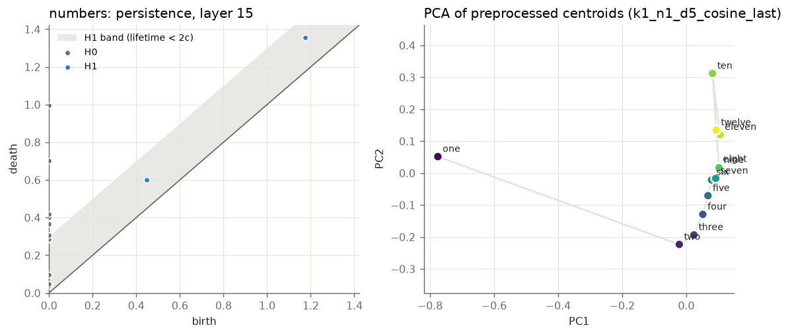
