# phase1_families / 410m_s0_step143000

Primary preprocessing {'k_remove': 1, 'd_proj': 5, 'metric': 'cosine', 'variant': 'last'}; template contexts unless stated. Topology score = order_score x 1[closure < 2] for circle families of 30 items or fewer; line_order_score x 1[closure >= 2] for line controls (an ordered arc that stays open); h1_ratio above 30 items (cities). shape_pass = significant H1 + exact cyclic order (p < 0.05) + closure < 2 for circles; linear order p < 0.05 + closure >= 2 for line controls. Robustness = share of the 36 preprocessing settings with shape_pass at the best layer (< 50% = fragile).

| family | topology | origin | items | best layer | score | closure | n_sig_h1 | gauss p | shape_pass layers | robustness | score @12-16 | pile items | pile best layer | pile score |
|---|---|---|---|---|---|---|---|---|---|---|---|---|---|---|
| days | circle | explicit | 7 | 6 | 1.00 | 1.36 | 1 | 0.10 | 0-20, 22 | 17% (fragile) | 1.00 | 7 | 18 | 1.00 |
| months | circle | explicit | 12 | 17 | 1.00 | 1.46 | 1 | 0.02 | 15-20, 22 | 17% (fragile) | 0.40 | 12 | 16 | 1.00 |
| clock_hours | circle | explicit | 12 | 15 | 0.00 | 3.22 | 1 | 0.35 | none | 0% (fragile) | 0.00 | 12 | 22 | 0.00 |
| zodiac | circle | explicit | 12 | 6 | 0.50 | 0.73 | 2 | 0.38 | none | 0% (fragile) | 0.35 | 12 | 23 | 0.53 |
| moon_phases | circle | explicit | 8 | 17 | 0.36 | 1.07 | 2 | 0.72 | none | 0% (fragile) | 0.14 | - | - | - |
| compass | circle | explicit | 16 | 0 | 0.31 | 1.18 | 3 | 0.81 | none | 0% (fragile) | 0.16 | 16 | 0 | 0.81 |
| hues | circle | implicit | 24 | 22 | 0.23 | 0.36 | 2 | 0.90 | none | 0% (fragile) | 0.11 | 24 | 22 | 0.18 |
| cities_longitude | circle | implicit | 300 | 22 | 5.65 | 0.67 | 6 | 0.01 | 1, 12-20, 22-23 | 61% | 4.47 | 263 | 9 | 4.02 |
| krebs | circle | implicit_long | 9 | 17 | 0.57 | 1.31 | 1 | 0.68 | none | 0% (fragile) | 0.21 | 8 | 5 | 0.56 |
| anacyclosis | circle | implicit_long | 6 | 5 | 0.25 | 1.16 | 2 | 0.41 | none | 0% (fragile) | 0.25 | 5 | 18 | 0.52 |
| water_cycle | circle | explicit | 5 | 14 | 0.52 | 1.22 | 1 | 0.18 | none | 0% (fragile) | 0.52 | 5 | 21 | 1.00 |
| emotions | circle | emergent | 28 | 13 | 0.69 | 0.47 | 6 | 0.72 | none | 0% (fragile) | 0.58 | 27 | 10 | 0.56 |
| keys | torus | emergent | 24 | 11 | 0.19 | 0.82 | 2 | 0.97 | none | 0% (fragile) | 0.14 | 15 | 23 | 0.13 |
| triads | torus | emergent | 24 | 11 | 0.20 | 0.76 | 3 | 0.95 | none | 0% (fragile) | 0.12 | 9 | 19 | 0.28 |
| political | unknown | open | 18 | 1 | 0.42 | 0.95 | 2 | 0.98 | none | 0% (fragile) | 0.26 | 18 | 14 | 0.43 |
| ordinals | interval | control | 10 | 10 | 0.77 | 4.26 | 2 | 0.47 | 0-23 | 100% | 0.76 | 10 | 18 | 0.77 |
| sizes | interval | control | 10 | 14 | 0.69 | 3.13 | 1 | 0.60 | 6-23 | 58% | 0.66 | 10 | 13 | 0.65 |
| life_stages | interval | control | 10 | 19 | 0.56 | 2.25 | 1 | 0.68 | 19-20 | 22% (fragile) | 0.00 | 10 | 16 | 0.63 |
| centuries | interval | control | 12 | 13 | 0.99 | 14.18 | 1 | 0.78 | 0-23 | 100% | 0.96 | 12 | 6 | 1.00 |
| temperature | interval | control | 12 | 14 | 0.28 | 3.09 | 2 | 0.57 | none | 14% (fragile) | 0.22 | 11 | 21 | 0.83 |
| city_latitude | interval | control | 100 | 21 | 0.42 | 2.07 | 8 | 0.24 | 7-23 | 36% (fragile) | 0.34 | 77 | 17 | 0.61 |
| numbers | interval | control | 12 | 21 | 0.96 | 3.66 | 0 | 0.79 | 0-23 | 100% | 0.78 | 12 | 22 | 0.96 |

## Circles vs line controls (families of 30 items or fewer, template contexts)

| group | n | mean score at best layer | mean score at layers 12-16 |
|---|---|---|---|
| circle/torus | 13 | 0.45 | 0.31 |
| line controls | 7 | 0.67 | 0.53 |
| unknown (political) | 1 | 0.42 | 0.26 |

Cities (h1_ratio): cities_longitude 5.65 (best) / 4.47 (12-16)

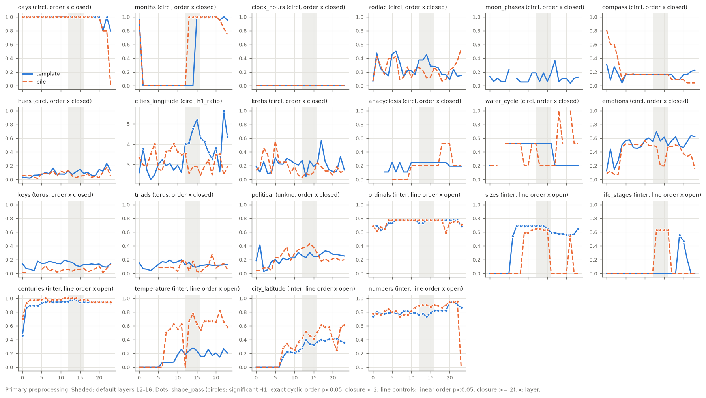

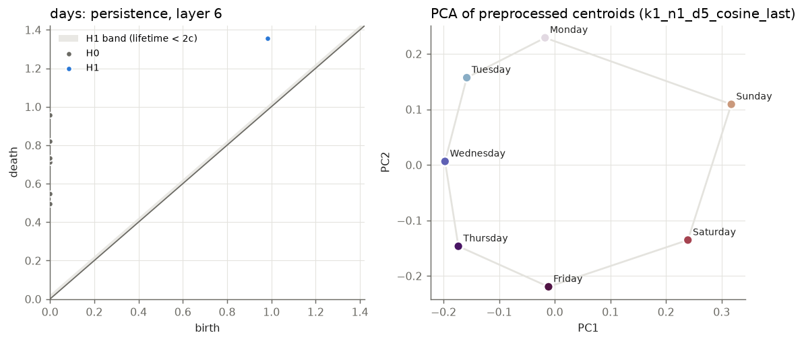
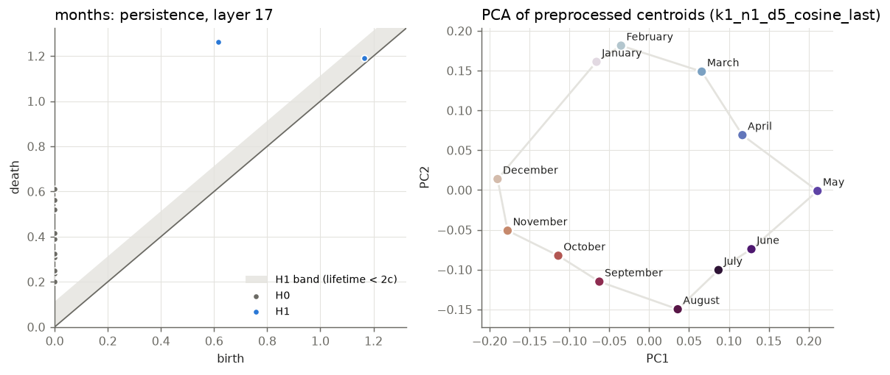
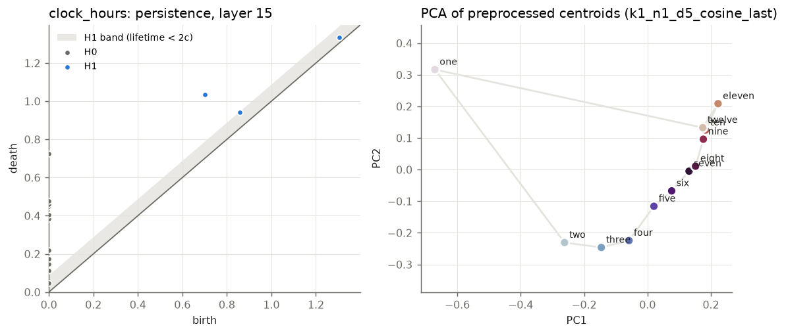
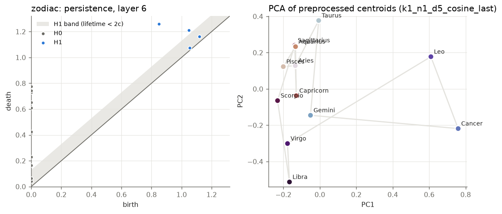
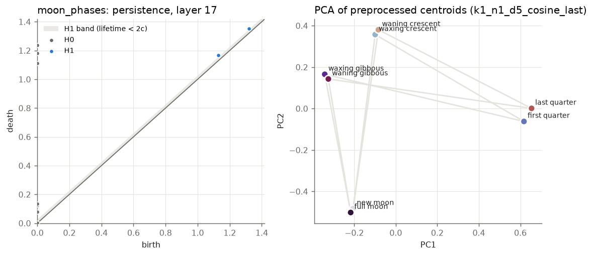
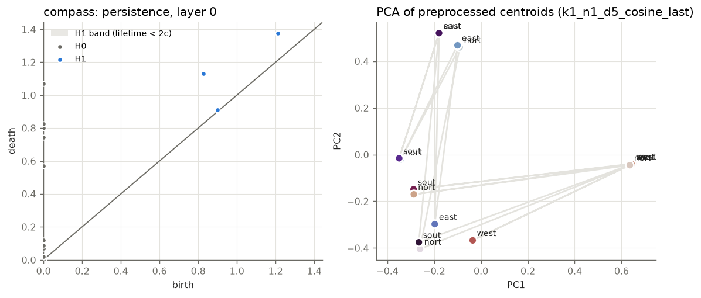
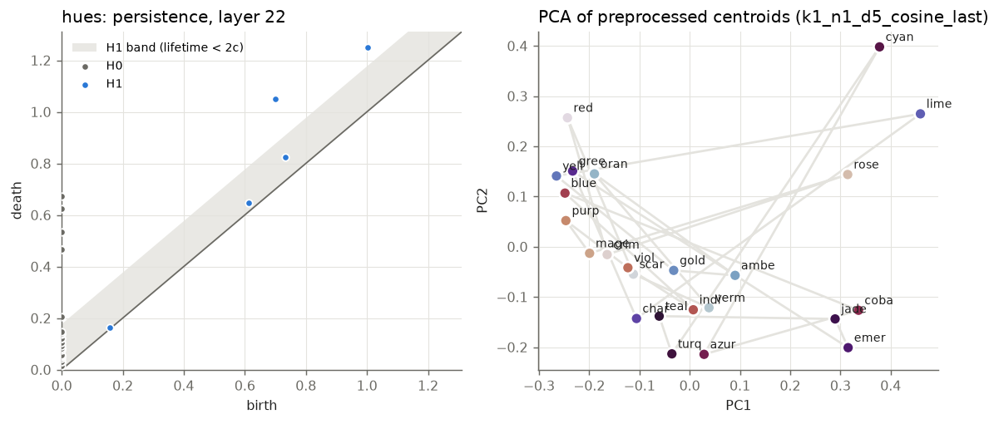
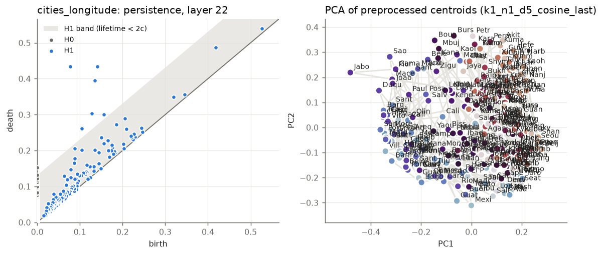
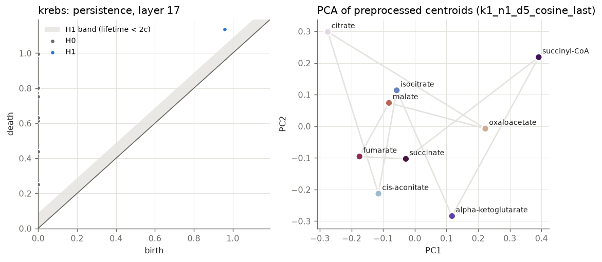
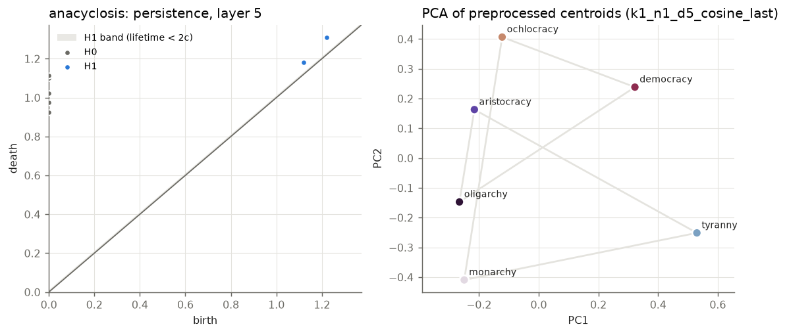
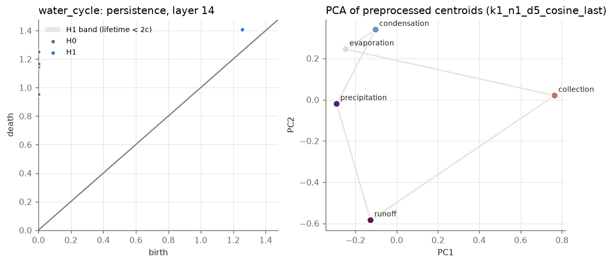
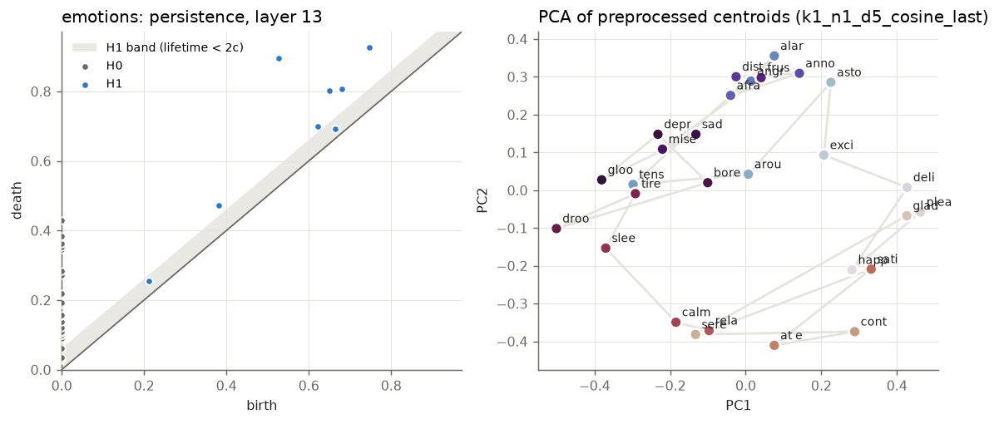
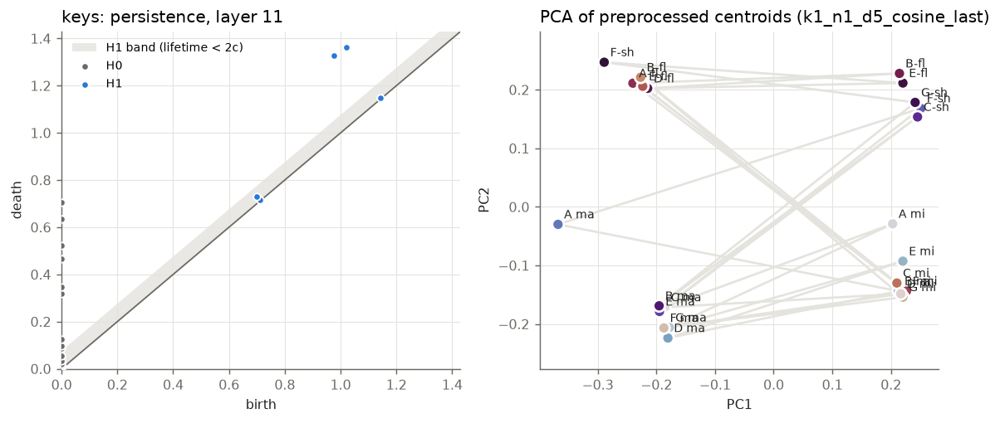
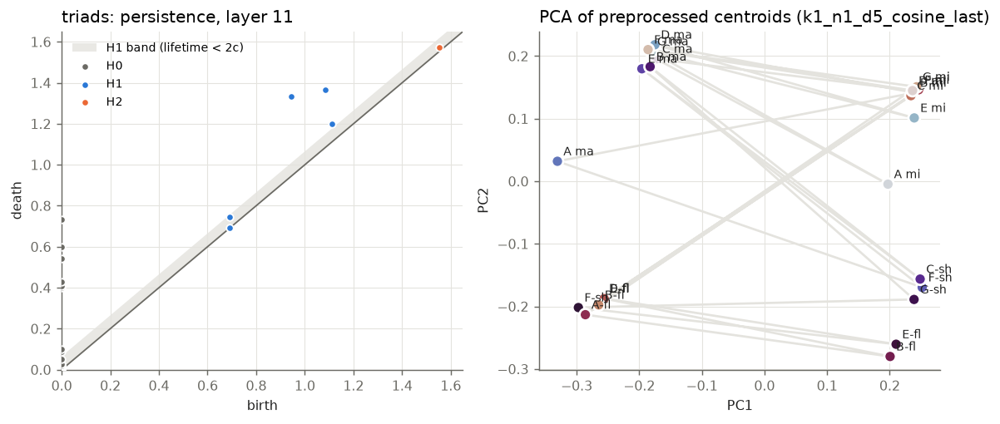
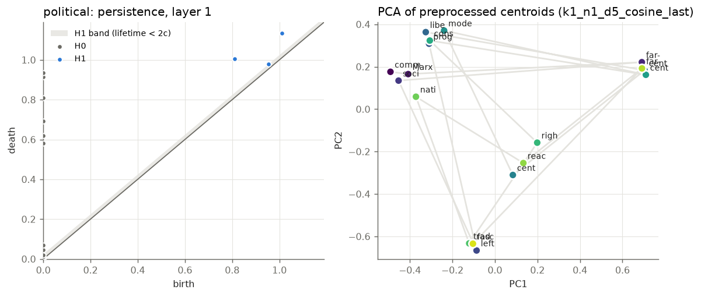
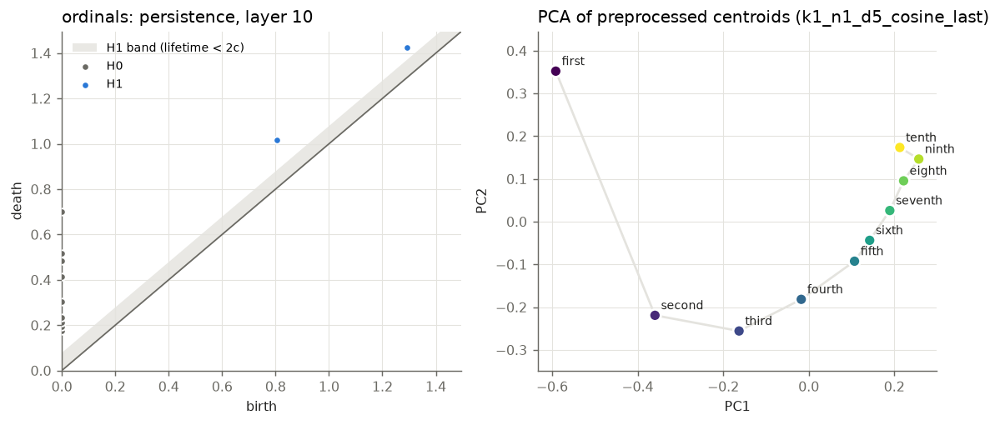
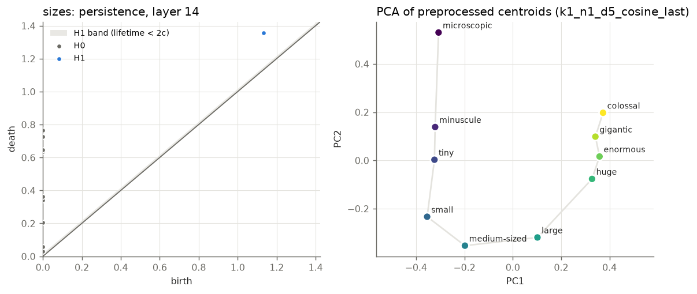
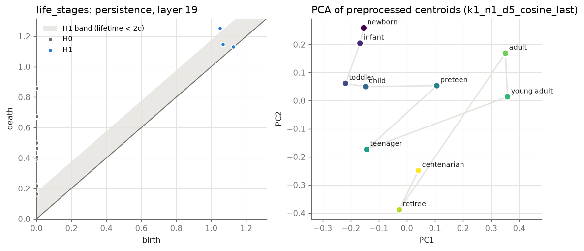
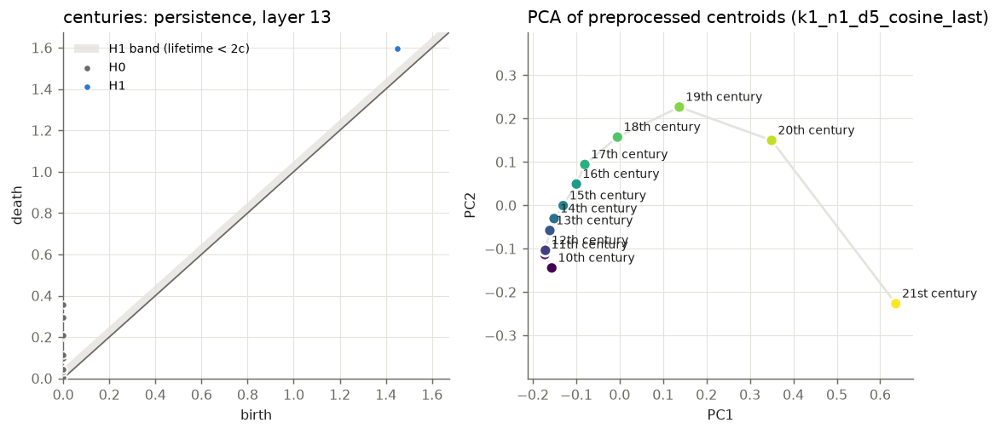
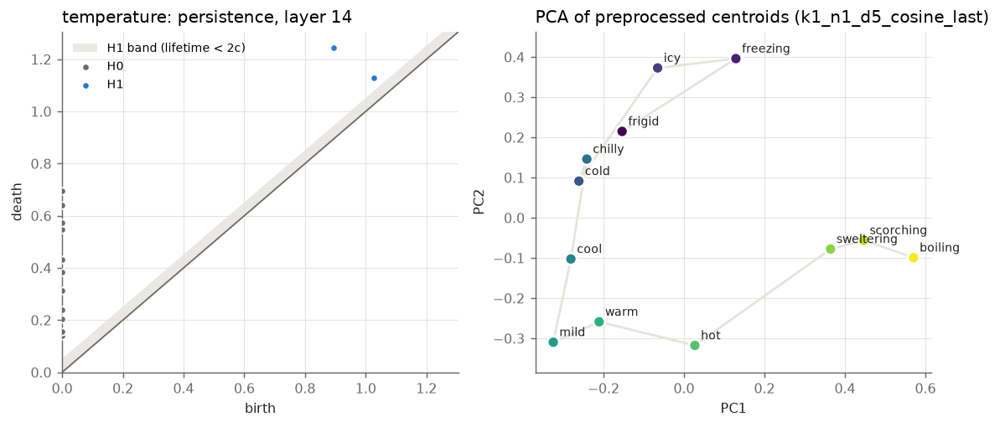
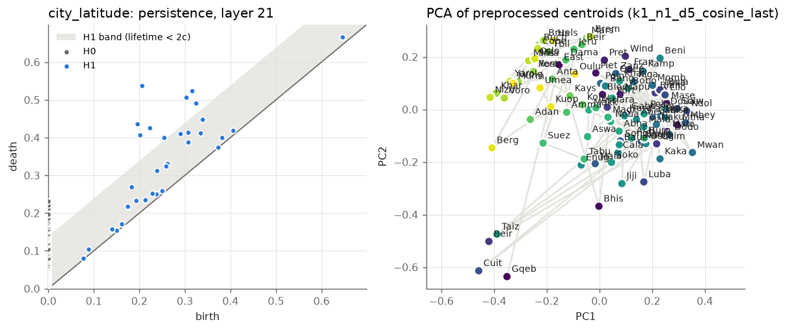
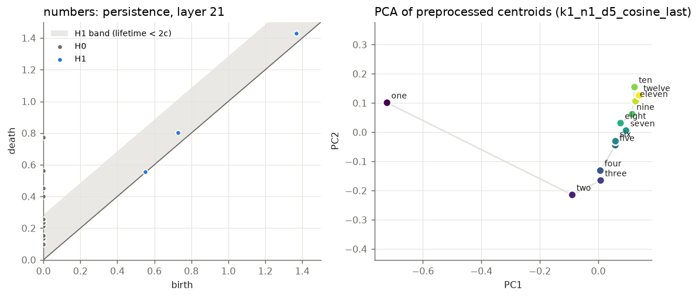
