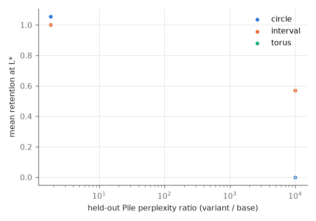

# Phase 3 durability (M4)

Preregistered analysis (PREREGISTRATION.md). L* per family: centuries 4, clock_hours 2, months 5, ordinals 4

## Primary metric: retention after 20M tokens of LoRA fine-tuning (mean of code, German Wikipedia)

Excluded (base score 0 at L*, retention undefined): none.

| family | topology | origin | base score | retention | ppl ratio |
|---|---|---|---|---|---|
| clock_hours | circle | explicit | 0.55 | 0.00 | 9979.799 |
| months | circle | explicit | 0.45 | 0.00 | 9979.799 |
| centuries | interval | control | 0.90 | 0.00 | 9979.799 |
| ordinals | interval | control | 0.82 | 1.14 | 9979.799 |

## Primary contrasts (bootstrap over families, 10,000 resamples)

| contrast | n | difference in mean retention [95% CI] |
|---|---|---|
| circles - line controls | 2 vs 2 | -0.569 [-1.139, +0.000] |
| implicit - explicit circles | 0 vs 2 | +nan [+nan, +nan] |

Mixed model failed: zero-size array to reduction operation maximum which has no identity

## Decision rules (PREREGISTRATION.md section 5)

- Circle minus line retention CI includes 0.

## Secondary: retention by variant (mean over families with a base loop)

| variant | circles | line controls | ppl ratio |
|---|---|---|---|
| lora-20M | 0.00 | 0.57 | 9979.799 |
| prune0.25 | 1.05 | 1.00 | 1.801 |

## Behavior (offset queries), base and variants

| unit | family | acc | acc wrap | acc no-wrap | margin wrap | margin no-wrap |
|---|---|---|---|---|---|---|
| 70m_s0_step143000 | centuries | 0.09 | nan | 0.09 | nan | -1.64 |
| 70m_s0_step143000+lora-20M | centuries | 0.09 | nan | 0.09 | nan | -3.17 |
| 70m_s0_step143000+prune0.25 | centuries | 0.03 | nan | 0.03 | nan | -1.82 |
| 70m_s0_step143000 | clock_hours | 0.08 | 0.00 | 0.12 | -2.10 | -0.82 |
| 70m_s0_step143000+lora-20M | clock_hours | 0.08 | 0.29 | 0.00 | -2.28 | -6.69 |
| 70m_s0_step143000+prune0.25 | clock_hours | 0.08 | 0.00 | 0.12 | -2.43 | -0.99 |
| 70m_s0_step143000 | months | 0.08 | 0.00 | 0.12 | -2.61 | -1.50 |
| 70m_s0_step143000+lora-20M | months | 0.06 | 0.14 | 0.03 | -2.63 | -2.15 |
| 70m_s0_step143000+prune0.25 | months | 0.08 | 0.07 | 0.09 | -2.48 | -2.14 |
| 70m_s0_step143000 | ordinals | 0.15 | nan | 0.15 | nan | -1.95 |
| 70m_s0_step143000+lora-20M | ordinals | 0.00 | nan | 0.00 | nan | -8.23 |
| 70m_s0_step143000+prune0.25 | ordinals | 0.00 | nan | 0.00 | nan | -1.95 |
