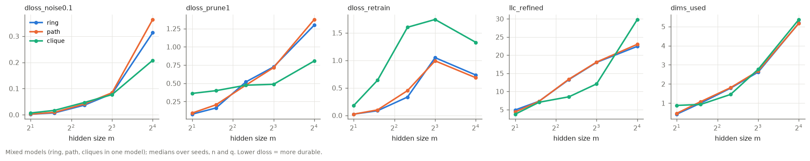

# phase4_toy

315 cells, 8100 rows (seed x substructure).

## Mixed models: ring vs path vs clique in the same model

Mean paired difference over (cell, seed) with 95% bootstrap CI. For durability metrics, negative ring - X means the ring is MORE durable.

| metric | ring | path | clique | ring - path | ring - clique |
|---|---|---|---|---|---|
| dloss_noise0.1 | 0.317 | 0.279 | 0.229 | +0.0374 [-0.0139, +0.0894] | +0.0881 [+0.0374, +0.139] |
| dloss_noise0.3 | 3.52 | 4.15 | 2.66 | -0.636 [-1.49, +0.0634] | +0.861 [+0.317, +1.45] |
| dloss_prune1 | 1.48 | 1.55 | 1.2 | -0.0729 [-0.255, +0.0839] | +0.275 [+0.134, +0.423] |
| dloss_retrain | 0.669 | 0.637 | 1.82 | +0.0321 [+0.00353, +0.0613] | -1.15 [-1.26, -1.05] |
| procrustes_retrain | 0.211 | 0.191 | 0.383 | +0.0195 [+0.00777, +0.0308] | -0.173 [-0.19, -0.156] |
| interference | 3.35 | 3.33 | 3.39 | +0.0205 [+0.00915, +0.0315] | -0.0424 [-0.0612, -0.0233] |
| dims_used | 2.21 | 2.27 | 2.24 | -0.0613 [-0.085, -0.0376] | -0.0303 [-0.0845, +0.0249] |
| dloss_per_dim | 2.57 | 1.04 | 0.0646 | +1.54 [-1.44, +5.89] | +2.51 [+0.0518, +6.65] |
| llc_refined | 17.4 | 17.6 | 10.6 | -0.194 [-0.358, -0.0314] | +6.88 [+5.27, +8.52] |

### By hidden size m (mixed models): ring - path and ring - clique, dloss_noise0.1 and llc_refined

| m | ring-path dloss_noise0.1 | ring-clique dloss_noise0.1 | ring-path llc_refined | ring-clique llc_refined |
|---|---|---|---|---|
| 2 | -0.000329 [-0.00211, +0.0015] | -0.00891 [-0.0119, -0.00607] | -0.215 [-0.645, +0.203] | +4.86 [+2.78, +7] |
| 3 | -0.0043 [-0.00971, +0.000921] | -0.009 [-0.0144, -0.00388] | -0.346 [-0.801, +0.113] | +9.86 [+6.37, +13.4] |
| 5 | -0.00616 [-0.0173, +0.00482] | +0.00743 [-0.00298, +0.0183] | -0.336 [-0.765, +0.0693] | +13.6 [+9.26, +18.2] |
| 8 | +0.0122 [-0.0185, +0.0454] | +0.0605 [+0.022, +0.101] | -0.157 [-0.426, +0.106] | +11.6 [+7.22, +16.5] |
| 16 | +0.186 [-0.0562, +0.445] | +0.39 [+0.151, +0.646] | +0.0833 [-0.0854, +0.248] | -5.47 [-6.91, -3.98] |

## Single-structure models

closed ring = order score >= 0.8 and closure < 2 for the structure's feature directions.

| structure | share closed ring | median order score | median closure | median emergence step | dloss_noise0.1 | dloss_prune1 | dloss_retrain | dims_used | llc_whole |
|---|---|---|---|---|---|---|---|---|---|
| clique | 0.00 | nan | nan | nan | 0.0494 | 0.63 | 1.12 | 4.98 | 24.6 |
| independent | 0.00 | nan | nan | nan | 0.0204 | 0.198 | -0.00013 | 5 | 31.6 |
| path | 0.00 | 0.08 | 3.02 | 4500 | 0.024 | 0.295 | 0.182 | 5 | 31.2 |
| periodic | 0.01 | 0.09 | 1.00 | 3500 | 11.3 | 81.2 | 127 | 4.99 | 30.3 |
| ring | 0.04 | 0.11 | 1.03 | 3000 | 0.0249 | 0.298 | 0.194 | 5 | 31.2 |
| ring_rare | 0.00 | 0.08 | 2.46 | 4500 | 0.0239 | 0.292 | 0.183 | 5 | 31.5 |

### Share of closed rings by m (single-structure models)

| structure | m=2 | m=3 | m=5 | m=8 | m=16 |
|---|---|---|---|---|---|
| clique | 0.00 | 0.00 | 0.00 | 0.00 | 0.00 |
| independent | 0.00 | 0.00 | 0.00 | 0.00 | 0.00 |
| path | 0.01 | 0.00 | 0.00 | 0.00 | 0.00 |
| periodic | 0.05 | 0.00 | 0.00 | 0.00 | 0.01 |
| ring | 0.02 | 0.00 | 0.00 | 0.06 | 0.12 |
| ring_rare | 0.01 | 0.00 | 0.00 | 0.00 | 0.00 |

### Rare closing edge (H-nov toy version)

| structure | median closure | share closure < 2 | median emergence step | median order score after retraining |
|---|---|---|---|---|
| path | 3.02 | 0.35 | 4500 | 0.08 |
| ring | 1.03 | 0.68 | 3000 | 0.09 |
| ring_rare | 2.46 | 0.43 | 4500 | 0.09 |

