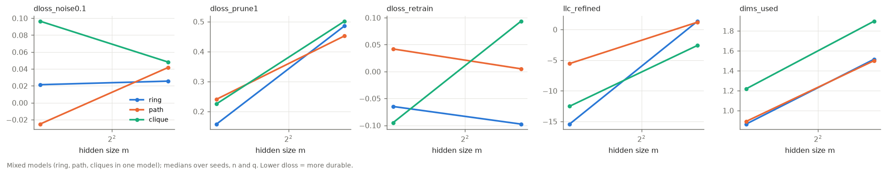

# phase4_toy_dryrun

5 cells, 36 rows (seed x substructure).

## Mixed models: ring vs path vs clique in the same model

Mean paired difference over (cell, seed) with 95% bootstrap CI. For durability metrics, negative ring - X means the ring is MORE durable.

| metric | ring | path | clique | ring - path | ring - clique |
|---|---|---|---|---|---|
| dloss_noise0.1 | 0.0542 | 0.0158 | 0.0702 | +0.0384 [-0.0258, +0.117] | -0.016 [-0.05, +0.0235] |
| dloss_noise0.3 | 0.239 | 0.279 | 0.381 | -0.0398 [-0.139, +0.0642] | -0.142 [-0.261, -0.0351] |
| dloss_prune1 | 0.337 | 0.401 | 0.39 | -0.0636 [-0.211, +0.134] | -0.0528 [-0.154, +0.0376] |
| dloss_retrain | -0.0888 | 0.0152 | 0.0216 | -0.104 [-0.174, -0.0394] | -0.11 [-0.399, +0.107] |
| procrustes_retrain | 0.0187 | 0.015 | 0.0277 | +0.00371 [-0.00137, +0.00905] | -0.00893 [-0.017, -0.000764] |
| interference | 2.95 | 3 | 3 | -0.0486 [-0.136, +0.0479] | -0.0437 [-0.15, +0.095] |
| dims_used | 1.12 | 1.21 | 1.58 | -0.0875 [-0.237, +0.0522] | -0.459 [-0.826, -0.212] |
| dloss_per_dim | 0.0527 | 0.00709 | 0.0538 | +0.0456 [-0.0141, +0.128] | -0.00116 [-0.0322, +0.0398] |
| llc_refined | -9.58 | -1.7 | -21.7 | -7.88 [-16.5, -0.601] | +12.1 [-3.81, +29.3] |

### By hidden size m (mixed models): ring - path and ring - clique, dloss_noise0.1 and llc_refined

| m | ring-path dloss_noise0.1 | ring-clique dloss_noise0.1 | ring-path llc_refined | ring-clique llc_refined |
|---|---|---|---|---|
| 3 | +0.0922 [+0.017, +0.215] | -0.0178 [-0.0751, +0.0528] | -12.9 [-26.1, +0.306] | +9.01 [-16.1, +37.1] |
| 5 | -0.0155 [-0.0889, +0.0596] | -0.0143 [-0.0359, +0.0205] | -2.85 [-7.19, +1.18] | +15.1 [-0.0777, +41.6] |

## Single-structure models

closed ring = order score >= 0.8 and closure < 2 for the structure's feature directions.

| structure | share closed ring | median order score | median closure | median emergence step | dloss_noise0.1 | dloss_prune1 | dloss_retrain | dims_used | llc_whole |
|---|---|---|---|---|---|---|---|---|---|
| path | 0.00 | 0.26 | 1.53 | nan | 0.0113 | -0.0181 | -0.196 | 1.98 | -138 |
| ring | 0.00 | 0.25 | 1.64 | nan | 0.012 | -0.0108 | -0.189 | 1.97 | -136 |
| ring_rare | 0.00 | 0.26 | 1.56 | nan | 0.0114 | -0.0197 | -0.197 | 1.97 | -143 |

### Share of closed rings by m (single-structure models)

| structure | m=2 |
|---|---|
| path | 0.00 |
| ring | 0.00 |
| ring_rare | 0.00 |

### Rare closing edge (H-nov toy version)

| structure | median closure | share closure < 2 | median emergence step | median order score after retraining |
|---|---|---|---|---|
| path | 1.53 | 0.75 | nan | 0.17 |
| ring | 1.64 | 0.75 | nan | 0.16 |
| ring_rare | 1.56 | 0.75 | nan | 0.17 |

