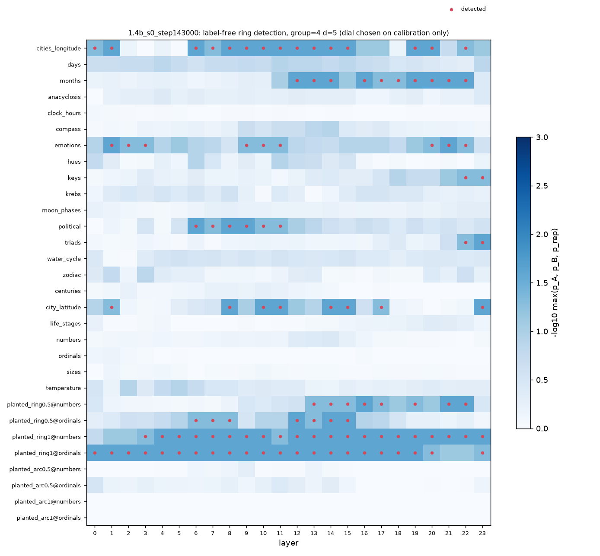

# Label-free ring detection: 1.4b_s0_step143000

Discover on half A of each item's contexts, confirm on half B; the true order is used only for the
`val_order` column (validation). See src/topodur/ring.py. Exploratory: not part of the frozen analysis.

## Calibration (dial = context group size x projection dim)

Detection rate over all layers. Objective = planted_ring - max(line, planted_arc).

| group | d_proj | line | planted_arc | planted_ring | reference | target | objective |
| --- | --- | --- | --- | --- | --- | --- | --- |
| 4 | 5 | 0.0476 | 0 | 0.604 | 0.347 | 0.066 | 0.557 |
| 16 | 8 | 0.0595 | 0 | 0.521 | 0.194 | 0.0938 | 0.461 |
| 0 | 3 | 0.0536 | 0 | 0.51 | 0.25 | 0.00347 | 0.457 |
| 16 | 3 | 0.0536 | 0 | 0.5 | 0.236 | 0 | 0.446 |
| 4 | 3 | 0.0595 | 0 | 0.5 | 0.222 | 0.0174 | 0.44 |
| 0 | 8 | 0.0595 | 0 | 0.49 | 0.208 | 0.066 | 0.43 |
| 4 | 8 | 0.0536 | 0 | 0.427 | 0.167 | 0.0556 | 0.374 |
| 16 | 5 | 0.0536 | 0 | 0.417 | 0.347 | 0.0278 | 0.363 |
| 0 | 5 | 0.0536 | 0 | 0.406 | 0.361 | 0.0417 | 0.353 |

Chosen dial: group=4, d=5.

## Families at the chosen dial

| role | family | layers_detected | n_layers | best_layer | min_p | median_coherence | val_order_at_detected | detected_at |
| --- | --- | --- | --- | --- | --- | --- | --- | --- |
| line | centuries | 0 | 24 | 10 | 0.39 | 0.997 | nan |  |
| line | city_latitude | 8 | 24 | 8 | 0.0244 | 0.999 | 0.333 | 1,8,10,11,14,15,17,23 |
| line | life_stages | 0 | 24 | 20 | 0.439 | 0.999 | nan |  |
| line | numbers | 0 | 24 | 14 | 0.122 | 0.995 | nan |  |
| line | ordinals | 0 | 24 | 1 | 0.659 | 0.999 | nan |  |
| line | sizes | 0 | 24 | 1 | 0.61 | 0.999 | nan |  |
| line | temperature | 0 | 24 | 2 | 0.0488 | 0.996 | nan |  |
| planted_arc | planted_arc0.5@numbers | 0 | 24 | 9 | 0.439 | 0.997 | nan |  |
| planted_arc | planted_arc0.5@ordinals | 0 | 24 | 0 | 0.0976 | 0.992 | nan |  |
| planted_arc | planted_arc1@numbers | 0 | 24 | 14 | 0.902 | 1 | nan |  |
| planted_arc | planted_arc1@ordinals | 0 | 24 | 4 | 0.927 | 0.997 | nan |  |
| planted_ring | planted_ring0.5@numbers | 8 | 24 | 16 | 0.0244 | 0.99 | 1 | 13,14,15,16,17,19,21,22 |
| planted_ring | planted_ring0.5@ordinals | 7 | 24 | 14 | 0.0244 | 0.988 | 0.925 | 6,7,8,12,13,14,15 |
| planted_ring | planted_ring1@numbers | 21 | 24 | 16 | 0.0244 | 0.998 | 1 | 3,4,5,6,7,8,9,10,11,12,13,14,15,16,17,18,19,20,21,22,23 |
| planted_ring | planted_ring1@ordinals | 22 | 24 | 8 | 0.0244 | 0.994 | 1 | 0,1,2,3,4,5,6,7,8,9,10,11,12,13,14,15,16,17,18,19,20,23 |
| reference | cities_longitude | 15 | 24 | 15 | 0.0244 | 1 | 0.135 | 0,1,6,7,8,9,10,11,12,13,14,15,19,20,22 |
| reference | days | 0 | 24 | 11 | 0.0488 | 0.995 | nan |  |
| reference | months | 10 | 24 | 16 | 0.0244 | 0.998 | 1 | 12,13,14,16,17,18,19,20,21,22 |
| target | anacyclosis | 0 | 24 | 23 | 0.39 | 0.998 | nan |  |
| target | clock_hours | 0 | 24 | 0 | 0.634 | 0.999 | nan |  |
| target | compass | 0 | 24 | 14 | 0.0244 | 0.998 | nan |  |
| target | emotions | 9 | 24 | 1 | 0.0244 | 0.998 | 0.645 | 1,2,3,9,10,11,20,21,22 |
| target | hues | 0 | 24 | 11 | 0.0488 | 0.997 | nan |  |
| target | keys | 2 | 24 | 22 | 0.0244 | 0.997 | 0.101 | 22,23 |
| target | krebs | 0 | 24 | 8 | 0.244 | 0.995 | nan |  |
| target | moon_phases | 0 | 24 | 23 | 0.488 | 0.994 | nan |  |
| target | political | 6 | 24 | 6 | 0.0244 | 0.997 | 0.296 | 6,7,8,9,10,11 |
| target | triads | 2 | 24 | 23 | 0.0244 | 0.995 | 0.0997 | 22,23 |
| target | water_cycle | 0 | 24 | 5 | 0.244 | 0.991 | nan |  |
| target | zodiac | 0 | 24 | 3 | 0.0732 | 0.996 | nan |  |

