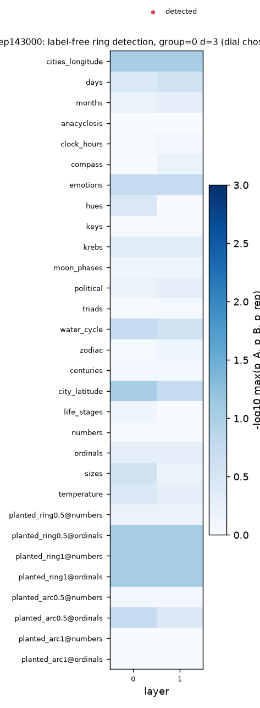

# Label-free ring detection: 1.4b_s0_step143000

Discover on half A of each item's contexts, confirm on half B; the true order is used only for the
`val_order` column (validation). See src/topodur/ring.py. Exploratory: not part of the frozen analysis.

## Calibration (dial = context group size x projection dim)

Detection rate over all layers. Objective = planted_ring - max(line, planted_arc).

| group | d_proj | line | planted_arc | planted_ring | reference | target | objective |
| --- | --- | --- | --- | --- | --- | --- | --- |
| 0 | 3 | 0 | 0 | 0 | 0 | 0 | 0 |
| 0 | 5 | 0 | 0 | 0 | 0 | 0 | 0 |
| 0 | 8 | 0 | 0 | 0 | 0 | 0 | 0 |
| 4 | 3 | 0 | 0 | 0 | 0 | 0 | 0 |
| 4 | 5 | 0 | 0 | 0 | 0 | 0 | 0 |
| 4 | 8 | 0 | 0 | 0 | 0 | 0 | 0 |
| 16 | 3 | 0 | 0 | 0 | 0 | 0 | 0 |
| 16 | 5 | 0 | 0 | 0 | 0 | 0 | 0 |
| 16 | 8 | 0 | 0 | 0 | 0 | 0 | 0 |

Chosen dial: group=0, d=3.

## Families at the chosen dial

| role | family | layers_detected | n_layers | best_layer | min_p | median_coherence | val_order_at_detected | detected_at |
| --- | --- | --- | --- | --- | --- | --- | --- | --- |
| line | centuries | 0 | 2 | 1 | 0.818 | 1 | nan |  |
| line | city_latitude | 0 | 2 | 0 | 0.0909 | 1 | nan |  |
| line | life_stages | 0 | 2 | 0 | 0.545 | 1 | nan |  |
| line | numbers | 0 | 2 | 1 | 0.909 | 1 | nan |  |
| line | ordinals | 0 | 2 | 0 | 0.545 | 1 | nan |  |
| line | sizes | 0 | 2 | 0 | 0.182 | 1 | nan |  |
| line | temperature | 0 | 2 | 0 | 0.273 | 1 | nan |  |
| planted_arc | planted_arc0.5@numbers | 0 | 2 | 1 | 0.727 | 1 | nan |  |
| planted_arc | planted_arc0.5@ordinals | 0 | 2 | 0 | 0.0909 | 1 | nan |  |
| planted_arc | planted_arc1@numbers | 0 | 2 | 0 | 1 | nan | nan |  |
| planted_arc | planted_arc1@ordinals | 0 | 2 | 0 | 1 | nan | nan |  |
| planted_ring | planted_ring0.5@numbers | 0 | 2 | 1 | 0.636 | 1 | nan |  |
| planted_ring | planted_ring0.5@ordinals | 0 | 2 | 0 | 0.0909 | 1 | nan |  |
| planted_ring | planted_ring1@numbers | 0 | 2 | 1 | 0.0909 | 1 | nan |  |
| planted_ring | planted_ring1@ordinals | 0 | 2 | 0 | 0.0909 | 1 | nan |  |
| reference | cities_longitude | 0 | 2 | 0 | 0.0909 | 1 | nan |  |
| reference | days | 0 | 2 | 1 | 0.182 | 1 | nan |  |
| reference | months | 0 | 2 | 1 | 0.545 | 1 | nan |  |
| target | anacyclosis | 0 | 2 | 0 | 1 | nan | nan |  |
| target | clock_hours | 0 | 2 | 1 | 0.818 | 1 | nan |  |
| target | compass | 0 | 2 | 1 | 0.636 | 1 | nan |  |
| target | emotions | 0 | 2 | 1 | 0.0909 | 1 | nan |  |
| target | hues | 0 | 2 | 0 | 0.364 | 1 | nan |  |
| target | keys | 0 | 2 | 1 | 0.909 | 1 | nan |  |
| target | krebs | 0 | 2 | 1 | 0.455 | 1 | nan |  |
| target | moon_phases | 0 | 2 | 0 | 0.636 | 1 | nan |  |
| target | political | 0 | 2 | 1 | 0.455 | 1 | nan |  |
| target | triads | 0 | 2 | 1 | 0.909 | 1 | nan |  |
| target | water_cycle | 0 | 2 | 0 | 0.182 | 1 | nan |  |
| target | zodiac | 0 | 2 | 1 | 0.727 | 1 | nan |  |

