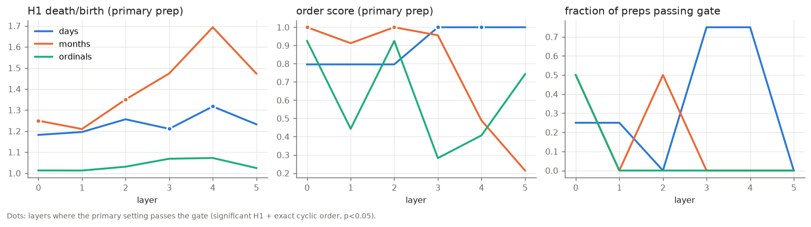
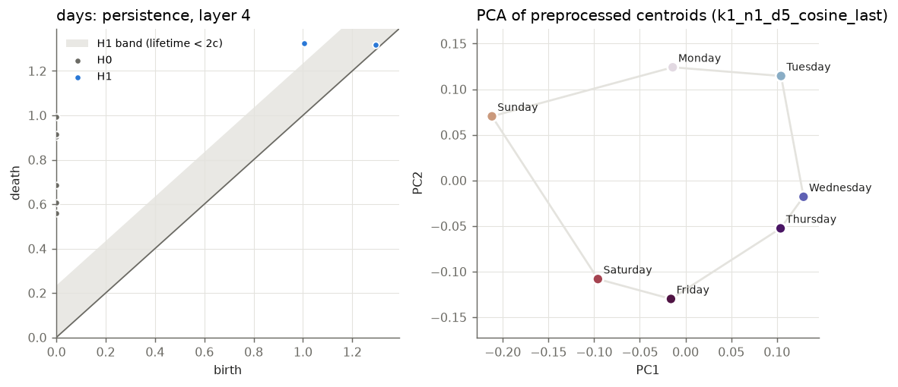
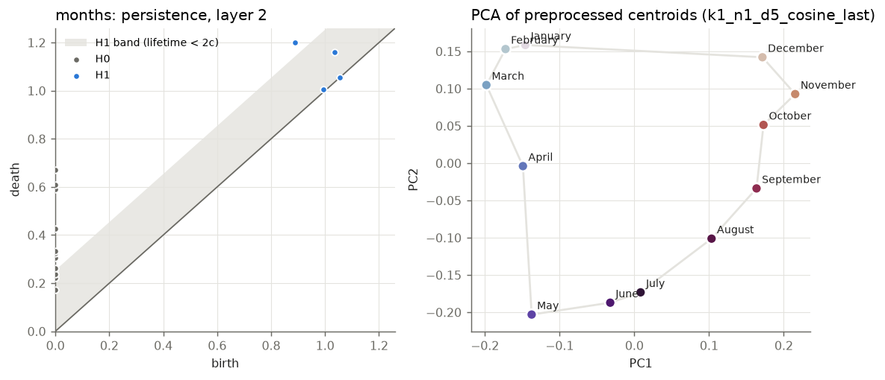
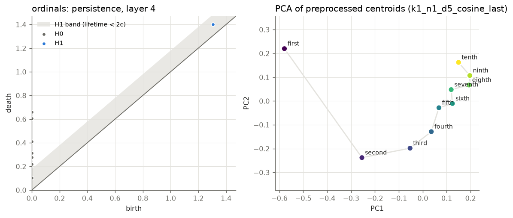

# test_cpu / 70m_s0_step143000

Primary preprocessing: {'k_remove': 1, 'd_proj': 5, 'metric': 'cosine', 'variant': 'last'}. Gate: significant H1 (lifetime > 2c, bootstrap) and circular coordinate in exact ground-truth cyclic order with permutation p < 0.05.

closure = distance(last item, first item) / median distance between neighbours in the true order: about 1 for a closed loop, large for a line.

| family | topology | best layer | h1_ratio | n_sig_h1 | order_score | order_p | closure | gate (primary) | preps passing at best layer | layers passing (primary) |
|---|---|---|---|---|---|---|---|---|---|---|
| days | circle | 4 | 1.32 | 1 | 1.00 | 0.00332 | 1.27 | PASS | 75% | 3, 4 |
| months | circle | 2 | 1.35 | 1 | 1.00 | 0.00332 | 2.74 | PASS | 50% | 0, 2 |
| ordinals | interval | 4 | 1.07 | 0 | 0.41 | 0.0698 | 4.70 | fail | 0% | none |

