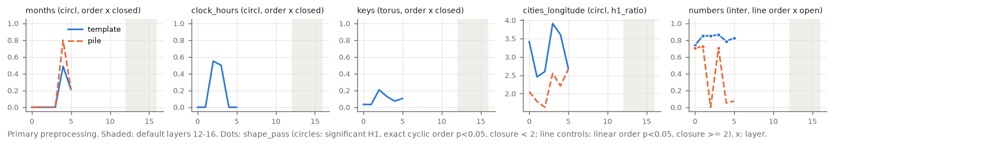
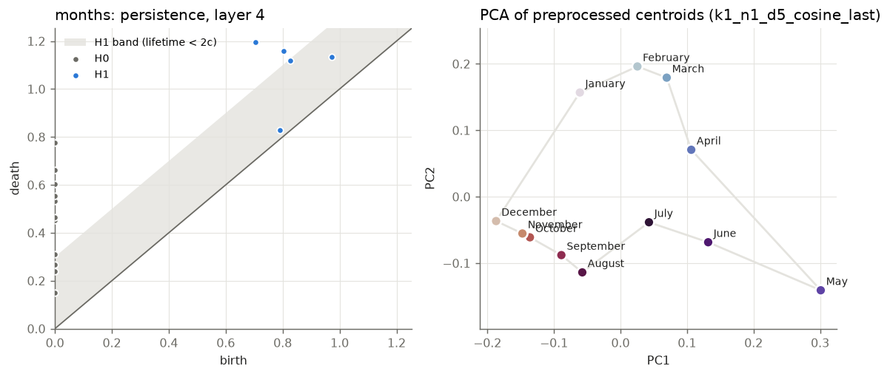
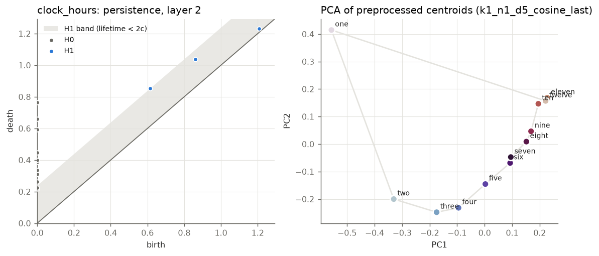
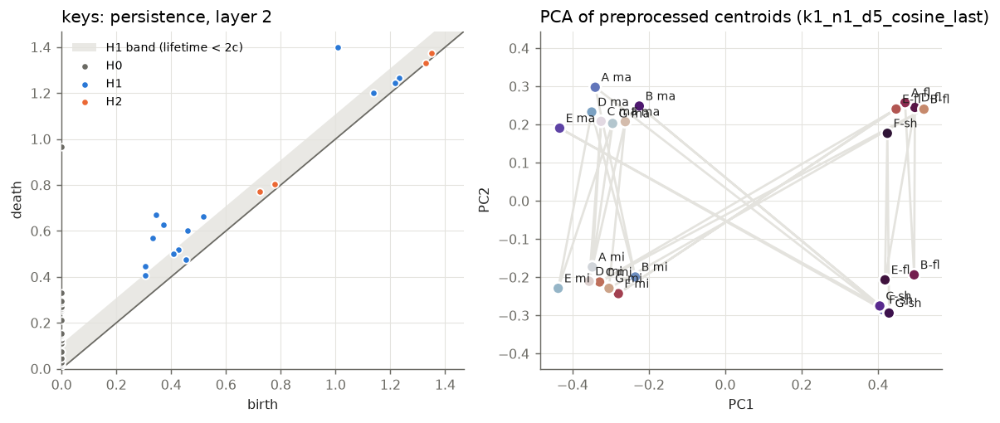
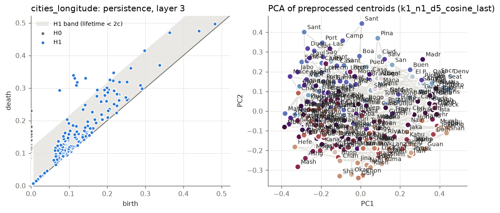
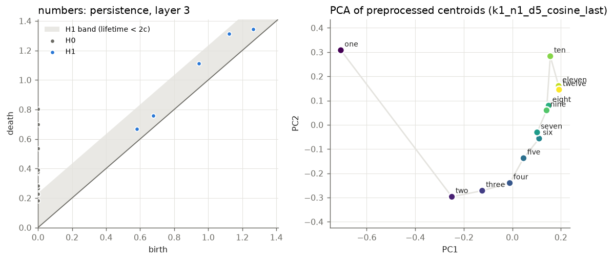

# test_cpu_phase1 / 70m_s0_step143000

Primary preprocessing {'k_remove': 1, 'd_proj': 5, 'metric': 'cosine', 'variant': 'last'}; template contexts unless stated. Topology score = order_score x 1[closure < 2] for circle families of 30 items or fewer; line_order_score x 1[closure >= 2] for line controls (an ordered arc that stays open); h1_ratio above 30 items (cities). shape_pass = significant H1 + exact cyclic order (p < 0.05) + closure < 2 for circles; linear order p < 0.05 + closure >= 2 for line controls. Robustness = share of the 36 preprocessing settings with shape_pass at the best layer (< 50% = fragile).

| family | topology | origin | items | best layer | score | closure | n_sig_h1 | gauss p | shape_pass layers | robustness | score @12-16 | pile items | pile best layer | pile score |
|---|---|---|---|---|---|---|---|---|---|---|---|---|---|---|
| months | circle | explicit | 12 | 4 | 0.49 | 1.10 | 2 | 0.19 | none | 0% (fragile) | nan | 12 | 4 | 0.80 |
| clock_hours | circle | explicit | 12 | 2 | 0.55 | 1.97 | 0 | 0.43 | none | 0% (fragile) | nan | - | - | - |
| keys | torus | emergent | 24 | 2 | 0.21 | 0.54 | 7 | 0.10 | none | 0% (fragile) | nan | - | - | - |
| cities_longitude | circle | implicit | 300 | 3 | 3.91 | 1.08 | 9 | 0.09 | none | 0% (fragile) | nan | 54 | 5 | 2.67 |
| numbers | interval | control | 12 | 3 | 0.87 | 2.13 | 0 | 0.81 | 0-5 | 100% | nan | 12 | 1 | 0.73 |

## Circles vs line controls (families of 30 items or fewer, template contexts)

| group | n | mean score at best layer | mean score at layers 12-16 |
|---|---|---|---|
| circle/torus | 3 | 0.42 | nan |
| line controls | 1 | 0.87 | nan |
| unknown (political) | 0 | nan | nan |

Cities (h1_ratio): cities_longitude 3.91 (best) / nan (12-16)

